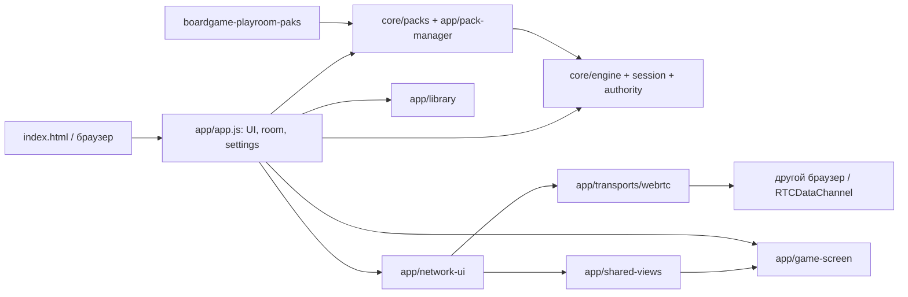
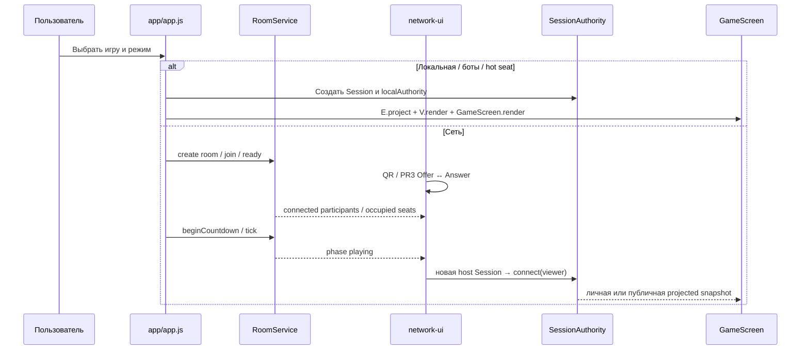

# Архитектура RC6: слои, загрузка, объекты, жизненный цикл

[← Оглавление](DEVELOPMENT.md) · [Интерфейс](DEV-UI.md) · [Сессии](DEV-GAMEPLAY.md) · [Сеть](DEV-NETWORK.md) · [Сборка](DEV-BUILD-QA.md)

Исходники: `dev` @ `afe8b9d`, функциональный состав `v0.15.0-rc.6`. Здесь описаны **точки владения состоянием**, а не абстрактный план развития.

## Граница зависимостей

- `core/engine.js`, `core/session.js`, `core/authority.js`, `core/protocol.js`: **авторитетное исполнение** правил, валидация ходов, неизменяемые снимки, проекции, журнал, receipts. Не должны зависеть от WebRTC или от вида меню.
- `core/packs.js`: локальная регистрация/активация точных версий. Запускает доверенный код пака и его представление через адаптеры; не является sandbox.
- `app/app.js`: UI-композиция для hub/локальной партии/лобби хоста, работа с местной сессией, `RoomService` и настройками. **Не** реализует правила UNO.
- `app/network-ui.js`: browser-only orchestration Offer/Answer, модальные диалоги подключения, каналы, возвращение клиента, показ сетевого GameScreen. Не является «сервером» в отдельном процессе.
- `app/shared-views.js`: личное или публичное **представление**, получает только проекции из `SessionClient`. Код правил на гостя не передаётся.
- `app/game-screen.js`: единая HTML-разметка для локальной партии и сети. Конкретную сцену создаёт зарегистрированный view игрового пака.
- `core/ui.js`, `core/input.js`, `core/motion.js`, `core/game-flow.js`, `core/audio.js`: общий рендеринг/ввод/движение/звук, не знают специфические названия игр.
- `app/library.js` и `app/pack-manager.js`: долговременные локальные партии (не сетевой host journal) и хранение версий паков.

## Порядок запуска

Основная точка входа — [`index.html`](../index.html). В RC6 нет frontend framework или bundler для выполнения в браузере: классические `<script src="...">` устанавливают API в `globalThis`, затем запускается `app/app.js`. Порядок важен:

1. Движок/модель: `core/engine.js → audio → session → protocol → authority → ui → player-target`.
2. Регистрация отображения/паков: `app/views.js → core/packs.js → installed-packs.js → app/pack-manager.js → app/library.js`.
3. Multiplayer/signaling: `app/multiplayer.js → app/pairing.js → app/pwa.js → app/vendor/qrcode.js → app/qr.js → app/vendor/jsqr.js → app/qr-scanner.js → app/vendor/ggwave.js → app/acoustic-pairing.js → app/transports/webrtc.js → app/transports/local.js → app/session-client.js`.
4. Presentation: `core/motion.js → core/game-flow.js → core/hand-overflow.js → app/game-screen.js → app/game-feedback.js → app/shared-views.js → app/network-ui.js → core/input.js → core/tooltips.js → app/app.js`.

Создание `PlayroomAppBridge` происходит ближе к концу `app/app.js`. `app/network-ui.js` определяет `bridge() => globalThis.PlayroomAppBridge` и обращается к нему при взаимодействиях, а не при первичной оценке модуля.

### Контракт глобальных имён

| Global | Откуда | Назначение |
| --- | --- | --- |
| `TabletopCore` (alias `PlayroomEngine`) | [`core/engine.js`](../core/engine.js) | правила, версия, создание/валидация/проекция состояния |
| `TabletopSession`, `SessionAuthority`, `PlayroomProtocol` | `core/session.js`, `core/authority.js`, `core/protocol.js` | история, доступ к ходам, конверт команд |
| `TabletopPacks`, `PlayroomPacks`, `PlayroomInstalledPacks` | `core/packs.js`, `app/pack-manager.js`, сборка | версия и загрузка содержимого пака |
| `PlayroomViews`, `TabletopUI` | `app/views.js`, `core/ui.js` | реестр видов и UI helpers |
| `PlayroomLibrary`, `PlayroomAppBridge` | `app/library.js`, `app/app.js` | локальные сохранения; фасад для сетевого UI |
| `PlayroomMultiplayer`, `PlayroomWebRTCTransport` | `app/multiplayer.js`, `app/transports/webrtc.js` | комнаты, участники, соединения |
| `PlayroomPairing`, `PlayroomAcousticPairing` | `app/pairing.js`, `app/acoustic-pairing.js` | PR2/PR3 и компактные ICE/DTLS данные |
| `PlayroomQR`, `PlayroomQRScanner`, `PlayroomPWA` | `app/qr.js`, `app/qr-scanner.js`, `app/pwa.js` | QR генерация, фото-декодер, URL/Share/PWA |
| `PlayroomSessionClient`, `PlayroomSharedViews`, `PlayroomGameScreen` | `app/session-client.js`, `app/shared-views.js`, `app/game-screen.js` | разрешённая проекция и единая игровая сцена |

Некоторые модули также экспортируются через `module.exports` для Node тестов. Скрипт может быть успешен синтаксически, но старт приложения сломается при изменении зависимости или порядка загрузки — проверять настоящий `index.html` и финальный автономный HTML.

## Кто владеет состоянием

**Локальная партия:** замкнутые переменные в `app/app.js` — `session`, `sessionId`, `viewer`, `gate`, `screen`, `settings`, `paused`, `replayIndex` и локальный `SessionAuthority`. `library` хранит сериализованную локальную `TabletopSession`.

**Комната хоста:** `roomService = new Multiplayer.RoomService()` создаётся в `app/app.js`, хранит `rooms`, event listeners, приватные `resumeTokens` и `connectionLeases`. `app/network-ui.js` хранит `hostPeer`, `hostRoomConnection`, `hostSwitch`, массив `connectedHostPeers`, во время партии — `hostAuthority`, `hostGameClient`, `hostMount`. RoomService отвечает за **лобби**, SessionAuthority — за **игровое состояние**. Это разные объекты.

**Браузер гостя:** `app/network-ui.js` хранит `clientPeer`, `clientTransport`, `clientRoom`, `clientParticipantId`, `clientGameClient`, `clientMount`. Нет авторитетного `TabletopSession`. Гость получает только projected `SessionClient.snapshot` с `viewer`, разрешёнными `actions` и `history`.

### Важный lifecycle

### Source of truth и безопасность

- Только хост обладает полной `Session.current`, `states` и списком секретов возврата. Подключённый клиент **не** выбирает сам `viewer`.
- `TabletopCore.project(state,viewer)` скрывает чужие руки и колоду; `SessionAuthority._snapshot` отдаёт явный whitelist полей, добавляет `actions` и разрешённую историю. Не передавать гостю `Session.export()` и `rng`.
- `ProfileStore` = публичный локальный идентификатор/имя, не авторизация комнаты.
- Действия игры отправляются через `PlayroomProtocol.command` в текущую authority; смена viewer через UI/CSS не даёт дополнительных прав.
- Получение QR и начальная WebRTC-сигнализация **не** возвращают приватное место автоматически — нужно подтверждение на хосте через зашифрованный RPC. См. [identity и reconnect](DEV-RECONNECT.md).

## Где искать новый функционал

- Новый пункт меню/настройка: `app/app.js` + CSS, при затрагивании сети — `app/network-ui.js`.
- Новое взаимодействие с рукой/полем: `core/input.js`, `core/ui.js`, вид пака и `app/shared-views.js`.
- Новые события/анимация/звук: `core/engine.js` и `core/game-flow.js`, `core/motion.js`, `app/game-feedback.js`.
- Новый канал сигнализации: только над `app/pairing.js`; игровой transport остаётся `app/transports/webrtc.js`.
- Новые права участника: `RoomService.connection`, `hostPeerServing` и `SessionAuthority.connect(viewer)`; проверять неразглашение рук.
- Изменения формата пака/сохранения: см. [паки и storage](DEV-STORAGE-PACKS.md), старые партии оставлять совместимыми.

## Исторические документы

`docs/ROADMAP.md`, `docs/UNIFIED-WEB-APP-PLAN.md` и ранний `docs/ARCHITECTURE.md` содержали проектные этапы до появления RC6. Их нельзя трактовать как более свежую реализацию, чем проверенный код. [Оглавление этого справочника](DEVELOPMENT.md) — актуальная точка входа.
