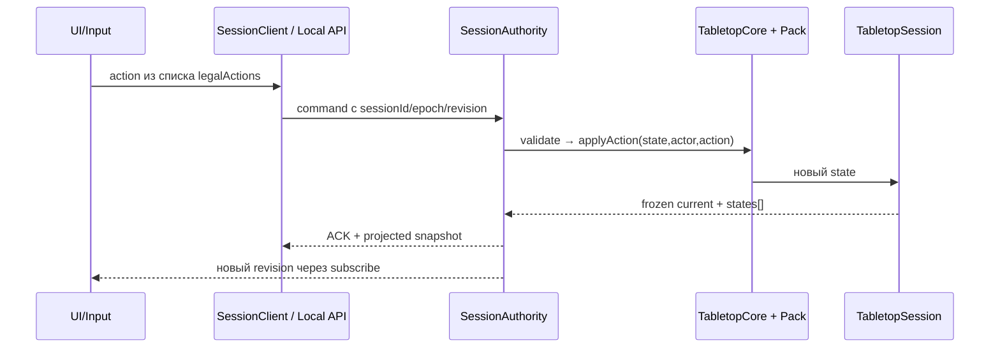

# Игровая модель RC6: состояния, сессии, боты и authority

[← Оглавление](DEVELOPMENT.md) · [UI](DEV-UI.md) · [Контракты JSON](DEV-PROTOCOLS.md) · [Паки и сохранения](DEV-STORAGE-PACKS.md) · [Сеть](DEV-NETWORK.md)

Исходники: [`core/engine.js`](../core/engine.js), [`core/session.js`](../core/session.js), [`core/authority.js`](../core/authority.js), [`core/protocol.js`](../core/protocol.js), [`app/session-client.js`](../app/session-client.js).

## Модель и ответственность

| Объект | Создаётся где | Что делает / не делает |
| --- | --- | --- |
| `TabletopCore` / `PlayroomEngine` | `core/engine.js` | Реестр версионированных правил, легальность, переходы, RNG, приватные проекции и sound cues. Не рисует DOM, не знает сеть. |
| `Pack rules.js` | В установленном/активированном паке | Реализует `create/legal/apply`, опционально `bot/reactions/botReaction/project/validateState`. Правила UNO и штрафы **не** живут в хабе. |
| `TabletopSession` | `app/app.js:startFromForm` или `app/network-ui.js:startHostGame` | Хранит `states` и полную историю; `act(actor,action)` добавляет замороженный новый снимок. |
| `SessionAuthority` | `app/app.js:localAuthority` либо сетевой хост `startHostGame` | Владелец исполнения ходов и прав клиента: `connect(viewer)`, RPC `dispatch`, `history`, дедупликация команд. |
| `SessionClient` | У удалённого участника (`app/session-client.js`) или локальной обёртки через transport | Хранит projected snapshot, формирует `PlayroomProtocol.command`, удерживает pending при сетевом сбое. **Не** имеет полной Session. |
| `GameScreen` + view пака | `app/game-screen.js` + `PlayroomViews` | Показывает уже готовую проекцию/разрешённые действия, не исполняет правила. |



## Состояние игры (`Core.createGame`)

Начальный `state` — JSON-объект со стабильными полями:

```json
{
  "version": 1,
  "game": "uno",
  "packVersion": "0.2.1",
  "packStateVersion": 1,
  "preset": "standard",
  "players": [
    {"name": "Игрок 1", "bot": false, "score": 0},
    {"name": "Бот", "bot": true, "score": 0}
  ],
  "turn": 0,
  "status": "playing",
  "winner": null,
  "move": 0,
  "rng": 12345,
  "openHands": false,
  "data": {},
  "events": []
}
```

*Пример схемы, не экспорт реальной UNO-партии; пакет может добавлять собственные поля в `data` и изменять набор пресетов.* Контракт проверяется в `validateState()`; числа, статус, версии, состав игроков, события и специфические ограничения пака проходят проверку при восстановлении.

- `state.players[]` содержит имя, `bot` и `score`; индекс в массиве — это игровой **viewer/actor**. Не путать с `RoomService.participantId` или `Seat.id`.
- `turn` — чей обычный ход; `move` — количество применённых действий. `status` — `playing`/`finished`. `winner` — индекс или `null`.
- `rng` — внутреннее детерминированное состояние генератора (`Core.random/shuffle/rollDie`), **не** посылается клиенту.
- `data` и детали `events` принадлежат правилам конкретной игры.
- `events[]` содержат `{id,text,player,kind,...}`; опционально `privateTo/publicText`, `sound:{id,target?}`, `notice:{title,detail?,tone?}`. `Core.event` увеличивает ID. `Core.finish` устанавливает `status/winner`, начисляет score и создаёт итоговое событие.

## Как применяется ход

1. UI получает разрешённый `actions[]`, а не формирует игровой смысл самостоятельно.
2. `SessionAuthority.connect(viewer)` связывает командный фасад с **фиксированным номером зрителя**. `Core.legalActions(state,actor)` комбинирует обычные действия текущего игрока и разрешённые reactions (в том числе вне очереди).
3. `Core.applyAction` сравнивает команду с вариантом из legal actions (поля `label/notify/confirmation/targetPrompt` — UI-метаданные, не часть сравнения), копирует state, увеличивает `move`, вызывает `pack.apply`.
4. `TabletopSession.act` замораживает новый state и добавляет его в `states`; прежние снимки содержат не более четырёх последних событий, **живое текущее состояние** — полный journal.
5. `SessionAuthority._publish` рассылает каждому `binding.viewer` его **собственную проекцию**, а не общий полный state.
6. `SessionClient.accept` проверяет `sessionId`, `authorityEpoch`, `revision`, `viewer`, `game`, `packVersion` и обновляет интерфейс только корректным snapshot.

Сетевой конверт команды и контракт идемпотентности — [Протоколы](DEV-PROTOCOLS.md). Важно: `SessionClient.retry()` повторяет ту же команду и `commandId` при потере ACK **на живой authority**; полная гарантия после restart хоста/новой эпохи ещё не реализована.

## Приватные проекции (`Core.project`)

Перед любым удалённым рендерингом хост вызывает `project(state,viewer)`:

- `viewer=-1` или недействительный viewer — **публичный стол**, чужие руки скрыты;
- `data.hands[i]` открывается только если `i === viewer` (в режиме `openHands` — обучающие публичные руки согласно реализации движка);
- `data.drawPile` / `stock` заменяются скрытыми маркерами без идентификаторов карт;
- приватные события (`privateTo`) для других зрителей получают обезличенный `publicText`; пакет может дополнительно фильтровать через `pack.project`;
- `SessionAuthority._snapshot` формирует whitelist полей `{version,game,packVersion,packStateVersion,preset,players,turn,status,winner,move,openHands,data,events}` и оборачивает его метаданными authority/допустимыми actions.

Не передавать гостю `Session.current`, `Session.export()`, секреты возврата, `state.rng` или весь паковый rules.js; не выбирать `viewer` из недоверенного запроса. Дополнительный UI-бейдж/скрытие через CSS — **не механизм приватности**.

## Как устроены боты

В режиме `solo` форма `setup` создаёт `players[0]={bot:false}` и `players[1..]={bot:true}`. Никакой отдельной LLM/AI-службы нет: выбор делает **код rules.js пака**.

- `Core.botAction(state,actor)` проверяет, что `actor===state.turn` и состояние `playing`; берёт `pack.legal(state,actor)` **без бесконечных реакций**, затем `pack.bot(state,actor,actions)` либо первый доступный ход.
- `Core.botReaction(state,actor)` берёт `pack.reactions(state,actor)` и необязательный `pack.botReaction(state,actor,actions)`; возвращаемая реакция дополнительно сверяется с допустимой.
- `SessionAuthority.scheduleBot({delay,run,onError})` отменяет предыдущий таймер, проверяет актуальную `revision`, выбирает приоритетный `botReaction` либо обычного бота на `state.turn`; при отсутствии действий ничего не исполняет.
- `app/app.js:scheduleBot()` вызывается из `renderTable`; не планирует бота при модалке, паузе, скрытом документе, history/replay, незавершённой анимации, `gate`/handoff или конце игры. Скорость задаёт `GameFlow.pace().botDelay`, см. [UI](DEV-UI.md).
- Действие бота проходит через `localAuthority().actBot` либо callback `act(actor,action)`; ход также создаёт состояние/историю/звук/анимацию, как ход человека.

**Важно:** перечисленное относится к локальному режиму и к API `SessionAuthority`. В RC6 сетевая партия формирует массив `players` из занятых людьми слотов; сетевых ботов в неё **автоматически не добавляют**. Если нужны сетевые боты, это отдельный UI/RoomService контракт и тесты.

## Local/hot seat vs сетевой жизненный цикл

**`solo`:** один живой Session в браузере, `viewer=0`; боты планируются локально. `TabletopInput` использует `localClient(viewer).dispatch` с `PlayroomProtocol.command`, чтобы не обходить проверку authority.

**`pass` (hot seat):** тот же Session, но `viewer` соответствует текущему человеку; `gate` накрывает стол перед передачей устройства, когда руки скрыты. Реакции вне очереди могут ожидать явного «Передать устройство», `awaitingPass`. Это всё ещё **один** браузер и одна локальная Session.

**`network-player` / `network-table`:** `RoomService` отвечает только за набор игроков/мест/готовность. После старта `app/network-ui:startHostGame` создаёт новую авторитетную `Session` с `mode:'solo'` и игроками из занятых слотов; гостевые `SessionClient` получают только действия/снимки для своего viewer. `RoomService` продолжает существовать у хоста для идентификации и reconnect, но не выполняет игровые ходы.

## История, сохранение и sound cues

- `Session.states[index]` — история, `Session.view(player,index)` — отфильтрованная историческая проекция.
- Для локальной игры `app/library.js` сохраняет каждую принятую команду: `session.serialize()`, активная запись `playroom.session.v1` и архив `playroom.paused.v1.*`.
- Сетевой `SessionAuthority.history(index)` отдаёт **только viewer-filtered snapshot**; UI загружает кадры по RPC, не всё сохранение.
- `GameFeedback` реагирует только на **новые** события `id` и `cues`. При загрузке, повторном ACK, показе истории и смене транспорта нельзя повторять эффект для старой ревизии.
- Host-authority сетевого матча в RC6 пока **не имеет durable SessionStore**. То, что локальная партия сохраняется, не означает сохранение сетевой партии после host restart. Это отдельная задача LAN-01.

### Типичные ошибки расширения

1. Добавили новое правило в `app/app.js` — перенести в паковый `rules.js`; UI должен узнавать только `legalActions` и metadata.
2. Сетевой клиент рендерит raw `Session` — заменить на `authority._snapshot(viewer)`.
3. Использовали публичный `Profile.id` как viewer — spectator/вкладка может получить чужую руку. Привязка должна идти через доверенный `RoomService` + `SessionAuthority.connect(viewer)`.
4. Реакция бота попала в обычный loop хода и зациклила объявление — развести `botAction` и `botReaction`.
5. Восстановили старую Session новым паком — закрепить конкретную `packVersion` и проверить timeline всех снимков.
6. Обновили состояние напрямую из обработчика DOM — применять только через `Session.act / Authority.dispatch`.

Тестовые ориентиры: [`tests/engine.test.cjs`](../tests/engine.test.cjs), [`tests/session.test.cjs`](../tests/session.test.cjs), [`tests/authority.test.cjs`](../tests/authority.test.cjs), [`tests/uno-reactions.test.cjs`](../tests/uno-reactions.test.cjs), [`tests/network-reconnect-browser.test.cjs`](../tests/network-reconnect-browser.test.cjs).
