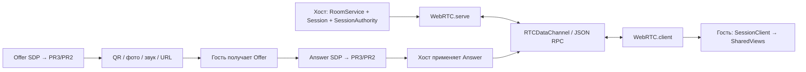
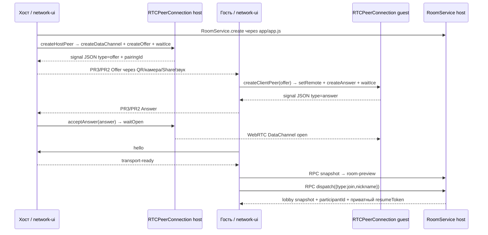

# Сеть RC6: WebRTC P2P, PR3/PR2, QR, звук и обмен RPC

[← Оглавление](DEVELOPMENT.md) · [Форматы пакетов и сообщений](DEV-PROTOCOLS.md) · [Identity/reconnect](DEV-RECONNECT.md) · [UI](DEV-UI.md)

Код: [`app/network-ui.js`](../app/network-ui.js), [`app/transports/webrtc.js`](../app/transports/webrtc.js), [`app/pairing.js`](../app/pairing.js), [`app/qr-scanner.js`](../app/qr-scanner.js), [`app/acoustic-pairing.js`](../app/acoustic-pairing.js), [`app/multiplayer.js`](../app/multiplayer.js), [`app/pwa.js`](../app/pwa.js).

## Архитектура P2P, без RoomHub

Два браузера соединяются напрямую через `RTCPeerConnection` и упорядоченный `RTCDataChannel` с label `playroom`. **В RC6 нет отдельного Node-host, WebSocket, сервера комнат, WebRTC TURN/relay или облачной authority**. Комната существует в памяти браузера хоста. Сигнализация — альтернативные носители одного Offer/Answer: QR-код, фотография/галерея, системное Share/URL, копирование или звуковой ggwave.

Важно отличать **сигнализацию** от последующего трафика: QR/звук передают ICE/DTLS-описание для создания соединения, но **не** игровые команды и не карты. После открытия DataChannel отправляются JSON/RPC и личные projected snapshots. QR не переносит секрет восстановления участника.

## Поток первоначального подключения

Реальные функции:
1. Хост `app/app.js:createNetworkRoom` создаёт `RoomService`; `network-ui.js:hostInvite` создаёт `hostRoomConnection = RoomService.connection(room.id)`, `hostSwitch = new SwitchableConnection(hostRoomConnection)` и `W.createHostPeer()`.
2. `hostPeerServing` ставит `W.serve(hostPeer.channel, ...facade)`. Пока партия не началась, фасад делегирует в `RoomService.connection`; при старте через `hostSwitch.set(hostAuthority.connect(viewer))` начинает принимать команды игры. Отдельно обрабатывает безопасный `resume`.
3. `Pairing.fromSignal('offer',hostPeer.offer)` создаёт PR3, когда доступна компактная кодировка, либо PR2. `soundSettings` и `updatePairingToken` перевыпускают QR/ссылку при изменении IP/UDP-порта.
4. Гость `showJoin` принимает Offer из фотографии (`readPairingQR`) или из текста/Share (`signalFromInput`); `createClientAnswer` вызывает `W.createClientPeer(signal)`, формирует Answer и показывает QR-ответ.
5. Хост `acceptAnswerSignal` проверяет корректный Answer через `peer.acceptAnswer`, ждёт открытия канала, помещает связку в `connectedHostPeers[]` и освобождает только **pending** host-приглашение. Уже подключённые игроки не закрываются при следующем приглашении.
6. Гость ждёт `clientPeer.waitOpen`, создаёт `W.client(channel)`, получает `room-preview` и показывает форму входа. `joinRoom` вызывает `dispatch({type:'join',nickname})`; только тогда выдаётся секрет возвращения. См. [reconnect](DEV-RECONNECT.md).
7. `RoomService.canStart` проверяет количество, ready и connected; `beginCountdown(seconds=3)` + `tick` переводит `room.phase` в `playing`. Сетевая игра стартует через `network-ui:startHostGame`, создавая `TabletopSession` + `SessionAuthority`. Каждому игроку назначается viewer из **упорядоченных занятых мест**, а не из запроса клиента.

## Транспорт: сообщения в RTCDataChannel

[`app/transports/webrtc.js`](../app/transports/webrtc.js) реализует JSON поверх одного канала:

- Сервер `serve(channel,connection)` принимает `hello` и отвечает `transport-ready`; получает `request` с `requestId`/`method`/`value`, вызывает `connection.snapshot/dispatch/history` и отправляет `response`. Публикует `{kind:'snapshot',snapshot}` при изменениях.
- Клиент `client(channel)` посылает hello до подтверждения, хранит `pending Map(requestId→Promise)`, устанавливает тайм-аут RPC и предоставляет `snapshot()`, `dispatch(command)`, `history(index)`, `subscribe(listener)` и `close()`. Использует `clone` при получении объектов.
- Таймаут ожидания ICE gathering по умолчанию 8 секунд (`waitIce`), открытия DataChannel 10 секунд (`waitOpen`); RPC клиент: 7 секунд, transport hello/ready: 5 секунд (конкретный UI может переопределить).
- Ошибка серверного dispatch пересылается как **общее сообщение** `'Запрос не выполнен.'`; конкретные причины доступны в коде/тестах. Отладочные счётчики находятся в `channel.__playroomDebug` / `__playroomClientDebug` и `PlayroomNetworkDebug()`.
- `app/transports/local.js` даёт такой же фасад без сети; `app/transports/message-port.js` содержит альтернативный MessagePort bridge, он **не является** текущим путём browser-to-browser P2P.

JSON-конверты, список `kind` и примеры — [DEV-PROTOCOLS.md](DEV-PROTOCOLS.md). Протокол игровых команд формирует `PlayroomProtocol.command`, а не браузерная форма.

## Три пути сигнализации и один PR3

### QR, фото и галерея (RC6)

- Генерация: `app/qr.js` → локальная `app/vendor/qrcode.js` (MIT) → SVG QR для `PWA.pairingUrl(token)`. В `file/content` ссылка обычно `web+playroom:pair/PR3.…`, в HTTPS — `https://…/?pair=PR3.…`.
- Получение: `scanControls('client'|'host')` предлагает системную камеру `<input type="file" accept="image/*" capture="environment">` и загрузку изображения из галереи.
- `app/qr-scanner.js:scan(file)` проверяет MIME/размер до **20 MiB**, получает ImageBitmap/Image, рисует масштабированные проходы на Canvas, пробует системный `BarcodeDetector({formats:['qr_code']})`; если не сработал — встроенный `jsQR(...,{inversionAttempts:'attemptBoth'})` (Apache-2.0), полностью офлайн.
- `parsePayload` использует **тот же `PlayroomPairing.extract/decode`**, что и текст. `network-ui.js:readPairingQR` различает направление: гость обязан получить Offer, хост — Answer; автоматически запускает `createClientAnswer` или `acceptAnswerSignal`.
- Если фото плохое, файл неподдерживаемый, токен не PlayRoom или неправильного типа — ошибка показывается, другая сторона и комнатная authority не изменяются. Изображение не уходит на сервер.

Подтверждённый пользователем на Android подход: системная камера возвращает JPEG в `content://`, JavaScript читает его пиксели. **Для камеры из file input не требуется `getUserMedia`**. Возможность live video и доступ к микрофону — отдельные разрешения, не смешивать их с QR.

### Share/URL/текст

`app/pwa.js`:
- `pairingUrl(token)`: на HTTPS/HTTP формирует URL с параметром `pair`; на локальном `file:/content:` — кастомную `web+playroom:pair/…`.
- `shareToken` использует `navigator.share`; `tokenFromUrl` извлекает приглашение из `pair/protocol/text/url`; `subscribePair` и `pairQueue` доставляют полученный токен в `network-ui.js`.
- Установка и service worker разрешаются модулем только для HTTPS/localhost (`secure`). `sw.js` кеширует PWA shell и может передавать токен в уже открытую страницу.
- На `content://` `navigator.clipboard.writeText` может отказать: `network-ui.copy` в таком случае выделяет поле для ручного копирования. QR-фото исключает эту необходимость в основном сценарии.

### Звуковая ggwave-сигнализация

`app/acoustic-pairing.js` + локальная JS/WASM `app/vendor/ggwave.js`:
- `Acoustic.pack` сжимает host UDP IPv4-кандидат, IP/порт, `pairingId`, ICE ufrag/pwd и DTLS fingerprint в один бинарный frame. Base64URL до **140 ASCII байт** отправляется через `Acoustic.play`; слушатель `Acoustic.listen` возвращает декодированный Offer/Answer.
- Tx-протоколы: `fastest` (по умолчанию), `fast`, `normal`, слышимый диапазон. Соединение после звука всё равно использует обычный WebRTC.
- На `content://` и без разрешения микрофона `getUserMedia` часто недоступен. `microphoneIssue/explainMicrophoneError` объясняют причину, слушающие кнопки отключены; режим **только передачи звука** не требует микрофона хоста, Answer можно получить по QR.
- Наличие звукового сигнала не меняет правила игры и не обходит VPN/изоляцию Wi-Fi.

## IP/ICE: все адреса не гарантируются

`Acoustic.allCandidates` читает ICE кандидатов текущего SDP, `probeAddresses` запускает дополнительный `RTCPeerConnection`, `statsAddresses` пробует `getStats`. `network-ui:soundCandidates` показывает обнаруженные адреса и вручную сохранённые варианты, предпочитая реальные LAN IP при автоселекции. Источники `session/probe/stats/saved` различаются в подписи.

Нельзя гарантировать все IP системы из обычного браузера: VPN, mDNS и IP privacy могут скрывать их. `0.0.0.0`, `::` и их полностью нулевая форма исключены из списка; `192.0.2.x` и другие TEST-NET отмечены как нерабочие. При вводе IPv4 вручную UDP-порт берётся из ICE-сеанса — подстановка **не гарантирует** реальной сетевой маршрутизации. IPv6/TCP/mDNS могут отображаться как диагностика, но compact PR3 кодирует один IPv4 UDP host. При отсутствии подходящего кандидата сохраняется полный `PR2` в QR/Share.

## Что нельзя менять без архитектурного решения

- Не переносить правила игры или секретные руки в QR, ggwave, URL/Share, `RoomService.preview`.
- Не добавлять отдельный Node LAN-сервер вместо текущего browser-host без решения по архитектуре.
- Не создавать `RoomService` на госте как источник истины: authoritative room + session живут у хоста.
- Не менять кодировку PR3 при добавлении identity: удостоверение участника передаётся **в RPC после соединения**.
- Не переиспользовать `hostRoomConnection` для уже соединённых пользователей при выпуске следующего Offer; сохранять `connectedHostPeers` и корректные `SwitchableConnection`.
- Нельзя выдавать «восстановление после restart хоста» за работающее. Текущий reconnect ручной, на живом хосте.

Тесты: [`tests/webrtc-browser.test.cjs`](../tests/webrtc-browser.test.cjs), [`tests/acoustic-webrtc-browser.test.cjs`](../tests/acoustic-webrtc-browser.test.cjs), [`tests/qr-pairing-browser.test.cjs`](../tests/qr-pairing-browser.test.cjs), [`tests/network-main-app.test.cjs`](../tests/network-main-app.test.cjs), [`tests/network-reconnect-browser.test.cjs`](../tests/network-reconnect-browser.test.cjs). См. [QA](DEV-BUILD-QA.md).
