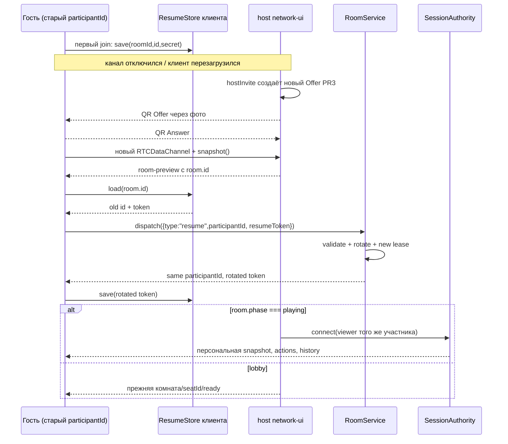

# Identity и reconnect RC6: Profile, Participant, Seat, Connection, Viewer

[← Оглавление](DEVELOPMENT.md) · [P2P/QR](DEV-NETWORK.md) · [JSON-контракты](DEV-PROTOCOLS.md) · [Игровая authority](DEV-GAMEPLAY.md)

Исходники: [`app/multiplayer.js`](../app/multiplayer.js), [`app/network-ui.js`](../app/network-ui.js), [`core/authority.js`](../core/authority.js), [`app/transports/webrtc.js`](../app/transports/webrtc.js).

**RC6 реализует частичный LAN-03:** возвращение на прежнее место через **новый QR/PR3 Offer↔Answer, пока хост не перезапущен**. Это не полноценная автоматическая реконнекция ICE или восстановление хостовой Session с диска.

## Семь разных сущностей

| Сущность | Создание/владелец | Идентификатор | Особенность |
| --- | --- | --- | --- |
| **Profile** | `ProfileStore`, localStorage конкретного браузера | `Profile.id` | Публичное имя/UUID игрока по умолчанию. Две вкладки одного origin могут иметь один профиль. **Не служит полномочием** в комнате. |
| **Room** | `RoomService.create` только на хосте | `room.id` + видимый 4-значный `room.code` | Настройки, ограничения игроков, набор правил, лобби/phase, события, список мест. `room.code` — декоративный короткий номер, не пароль. |
| **Participant** | `RoomService.join` на хосте | `participant.id` | Уникальный участник **данной** комнаты. Гость сначала spectator; host может быть player или table. |
| **Seat** | `RoomService.create` / `claimSeat` | `seat.id` (например, `seat-2`) и `seat.index` | Занятая позиция/цвет и связь с `participantId`. Место не равно viewer до начала игры. |
| **Connection** | Каждая `RoomService.connection(roomId)` + WebRTC peer | `connectionLeases[roomId:participantId]` | Конкретное действующее подключение; заменяется при reconnect, старый lease не может выполнять команды. |
| **Viewer** | Назначает `startHostGame` по занятым местам | целочисленный индекс игрока; `-1` для Стола | Полномочия `SessionAuthority.connect(viewer)`. Определяет чью руку видеть/чьи действия отправлять. Клиент не назначает себе viewer. |
| **Session / authority epoch** | `TabletopSession` / `SessionAuthority` хоста | `sessionId` + `authorityEpoch` | Полная партия и ревизии команд, отдельные от лобби. Не восстановятся после полного перезапуска хоста в RC6. |

**Публичные значения (`Profile.id`, nickname, IP, room code, `seat.id`, QR Offer/Answer) — не секреты аутентификации.** При входе `RoomService.connection.dispatch({type:'join',nickname})` создаёт новый participant ID независимо от `profileId` из запроса; тест `network-same-origin` проверяет, что общий профиль двух вкладок не превращается в полномочия хоста.

## Приватный resumeToken

На первом успешном `join` хост создаёт **32 криптографически случайных байта**, сериализованных как 64 строчные hex-цифры (`secureResumeToken` через `crypto.getRandomValues`). Функции:

- `RoomService.resumeTokens` — приватная хостовая карта `roomId:participantId → token`. Поле не входит в room object, `RoomService.snapshot/preview` и QR/PR3/Share.
- `RoomService.connection.dispatch('join')` возвращает токен **только внутри RPC ответа по DTLS-зашифрованному RTCDataChannel** рядом с `{ok:true,snapshot:{kind:'lobby',...},resumeToken}`.
- `ResumeStore` клиента сохраняет `{version:1,roomId,participantId,token}` под `localStorage['playroom.network-resume.v1.' + roomId]`. При отказе persistent storage есть только память текущей страницы и сообщение об ограничении.
- `RoomService.resume(roomId,{participantId,token})` проверяет формат, наличие участника, отсутствие прав host, совпадение секрета и возможность входа во время `phase='playing'`. Успех **ротирует токен** и помечает прежнего участника connected. Старый токен нельзя повторно предъявить.
- `connectionLeases` привязывает участника к активному объекту lease; прежний канал после замены не может выполнять RPC и его поздний `close()` не сбрасывает флаг connected нового участника.
- `kick` удаляет участника, его secret и lease. Браузерная очистка storage гостя удаляет право на автоматическое подтверждение места.

Токен — **bearer capability, а не пароль от аккаунта**. Другая вкладка того же origin или вредоносный локальный скрипт потенциально могут читать localStorage; в RC6 не заявлена защита от компрометации устройства/origin. Не включать токен в diagnostic/toast/log, не пересылать по QR/публичному REST/текстовому чату.

## Реконнект по новой QR-паре: точный порядок

### Как это реализовано по функциям

1. В `network-ui.js:createClientAnswer` после `waitOpen` и `clientTransport.snapshot()` гость получает `room-preview`, извлекает `preview.room.id` и вызывает `resumeStore.load(room.id)`.
2. Если ключ найден — `clientTransport.dispatch({type:'resume',participantId:saved.participantId,resumeToken:saved.token})`; хост выполняет проверку через `RoomService.connection`.
3. При успехе гость сохраняет **новый** секрет в `ResumeStore`; его `clientParticipantId` остаётся прежним. Если текущая проекция `snapshot` игровая, вызывает `startClientGame(snapshot)` без нового join/новой руки; иначе рисует прежний lobby.
4. Хост `hostPeerServing` при RPC `resume` находит предыдущий peer того же participantId и закрывает его. Если `room.phase='playing'`, ищет `viewer` по `room.seats.filter(seat.participantId).sort(seat.index)`, затем переключает новый `SwitchableConnection` на `hostAuthority.connect(viewer)`.
5. `SessionAuthority` выпускает **только** projected snapshot для этого viewer. Исходная полная `Session` остаётся у хоста; новая связь не создаёт вторую независимую игру.
6. `RoomService.connection.close` обновляет `connected=false` только если его lease ещё активен. Это защищает новый канал от позднего `close` старого RTC.

**Отказ:** неверный/устаревший токен не подтверждается; `createClientAnswer` сообщает об отказе. После начала партии гость **без приватного секрета** не может войти новым spectator/player и получить чужую руку. В лобби до старта обычный новый join ещё доступен как другой участник.

## UI reconnect и объекты

- У клиента `clientPeer.pc.connectionState` наблюдается через `connectionstatechange`; при `disconnected/failed/closed` текст помещается в `reconnectStatus`. `showDisconnectBanner()` вставляет `#network-reconnect-button` при наличии сетевой `.table-shell`.
- На хосте во время партии `ensureButtons()` добавляет `#network-pair-button` с текстом «Подключить / вернуть игрока». Это новый Offer/Answer; **не** попытка тихого reconnect.
- `connectedHostPeers[]` хранит все активные `{peer,switchable,serveClose,roomConnection}`. Новая `hostInvite` закрывает только pending PeerConnection, не уже обслуживаемые игры. При успешном resume старую соответствующую запись закрывают и удаляют.
- `clientGameClient = new SessionClient(clientTransport)` и `clientMount = Shared.mount(clientGameClient,definition,...)` создаются с новой авторизованной проекцией; прошлые `SessionClient` и подписки закрываются через `closeClient()`.
- `hostRoomUnsub` служит обнаружению `phase='playing'`, а `hostStarted` предотвращает повторный старт полной Session.

## Таблица угроз/инвариантов

| Попытка / состояние | Что обязано происходить |
| --- | --- |
| Другой клиент знает ник/UUID/IP/seat и тот же PR3 | Не может занять старую руку в начатой игре: нет секрета. |
| Две вкладки используют один `Profile.id` | Получают независимые `participant.id`, host-права не повышаются. |
| Старый RTC закрылся после принятия нового | Lease старого подключения не сбрасывает `connected` и не исполняет действия. |
| Произошёл повтор `resume` со старым токеном | Отказ (секрет уже ротирован). |
| Повторный `join` на том же connection | Отказ «Участник уже вошёл». |
| Новый viewer не соответствует занятым местам начатой игры | Подключение не должно получить чужую проекцию; обращаться только к авторитетному seat/participant mapping. |
| Гость потерял ACK игрового хода, потом создал новый RTC | `SessionClient.pending` не автоматически переносят между эпохами; exactly-once **через смену канала не гарантирован**. |

## Границы / что ещё разрабатывать

- `RoomService.rooms`, `resumeTokens`, `connectionLeases` и хостовая `TabletopSession` в RC6 **не имеют durable host persistence**. Перезапуск вкладки хоста теряет эти объекты. Отдельный [LAN-01](PlayRoom_Roadmap_and_Agent_Handoff_2026-10-08.md): SessionStore, journal, хранение authority epoch/receipts и восстановление host-state.
- Нет автоматической сигнализации для ICE restart: при недоступном DataChannel нужен новый Offer/Answer, обычно фото QR. Уход Android в фон/смена Wi-Fi может прервать канал.
- `ResumeStore` хранится по origin. Новый `file://`/`content://` URL, другой браузер, приватный режим или удаление site data могут лишить гостя старого ключа. Проверять доступность persistent storage и предупреждать.
- Замена канала и ротация токена **не являются транзакцией устойчивого хранения на двух устройствах**. Если клиент не получил/не сохранил новый ответ, старый ключ уже недействителен; это риск будущего recovery-потока.
- Нельзя выдавать способность вернуться на `seatId` за полноценное восстановление истории/партии при host reboot.

Тесты: [`tests/network-resume.test.cjs`](../tests/network-resume.test.cjs), [`tests/network-reconnect-browser.test.cjs`](../tests/network-reconnect-browser.test.cjs), [`tests/network-same-origin.test.cjs`](../tests/network-same-origin.test.cjs). Любое изменение протокола аутентификации требует их сохранения и новых отрицательных тестов.
