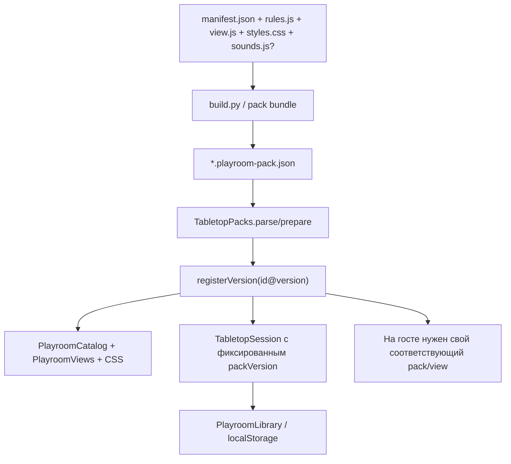

# Пакеты, версии, локальные сохранения и offline-ресурсы RC6

[← Оглавление](DEVELOPMENT.md) · [Игровая сессия](DEV-GAMEPLAY.md) · [Контракты JSON](DEV-PROTOCOLS.md) · [Сборка и QA](DEV-BUILD-QA.md)

Код: [`core/packs.js`](../core/packs.js), [`app/pack-manager.js`](../app/pack-manager.js), [`app/library.js`](../app/library.js), [`core/session.js`](../core/session.js), [`build.py`](../build.py), [`sw.js`](../sw.js).

## Где находятся игровые правила

**Исходники игровых паков живут в отдельном [`boardgame-playroom-paks`](https://github.com/GraphGiraffe/boardgame-playroom-paks).** В этом репозитории `core/` — SDK исполнения, `app/` — оболочка. Каталог `packs/`, если присутствует в dev-окружении, сгенерирован для тестов/разработки и не должен коммититься. `installed-packs.js` также генерируется.



## Паковый файл: формат `playroom-pack`

Внешний `*.playroom-pack.json` — JSON:

```json
{
  "format": "playroom-pack",
  "formatVersion": 1,
  "manifest": {
    "id": "example-game",
    "version": "1.2.3",
    "engineApi": 1,
    "stateVersion": 1,
    "name": "Название",
    "rules": "rules.js",
    "view": "view.js",
    "styles": "styles.css"
  },
  "files": {
    "rules.js": "/* JavaScript, регистрирует правила */",
    "view.js": "/* JavaScript, регистрирует представление */",
    "styles.css": "/* CSS пака */"
  }
}
```

Это **пример схемы**, не конкретный игровой пак. В действительной реализации `TabletopPacks.parse` проверяет `format/formatVersion`, `id`, semver, `engineApi===1`, положительный `stateVersion`, название, обязательные три файла и пути ресурсов. Не более **128 файлов**, один bundle не больше **4 MiB**, общая библиотека — до **20 MiB**. `manifest.sounds='sounds.js'` позволяет добавить четвёртый модуль и `PlayroomCatalog.sounds`. Спецификация дополнительных metadata и view — [`PACK-FORMAT.md`](PACK-FORMAT.md), [`PACKS.md`](PACKS.md).

**Правила:** `rules.js` вызывает `TabletopCore.register` с реализацией `{id,name,min,max,presets,create,legal,apply,…}`. Могут быть `validateState`, `bot`, `reactions`, `botReaction`, `project` и т. д.

**Представление:** `view.js` вызывает `PlayroomViews.register(gameId,render,cover,{surfaces:{table,player}})`. `combined` — стандартный render, `table`/`player` — дополнительные. UI helpers из `TabletopUI`: `hand`, `opponents`, `source`, `target`, `art`.

**Ключевой trust boundary:** `TabletopPacks.prepare` исполняет JavaScript пакета через `Function('globalThis','module','exports',...)` в staging scope, чтобы изолировать ошибки регистрации. **Это не security sandbox и не выполнение непроверенного JS без прав**. Устанавливать доверенные паки; не считать проверку manifest защитой от вредоносного кода.

## Жизненный цикл установки и версии

1. `app/pack-manager.js` создаёт `globalThis.PlayroomPacks = new TabletopPacks({engine,views,catalog,storage})` и сразу делает `bootstrap(PlayroomInstalledPacks||[])`.
2. `bootstrap` объединяет предустановленные бандлы из `installed-packs.js` и сохранённую библиотеку. Если **встроенный пакет той же версии отличается** от сохранённого, консервативно сохраняет старое содержимое, пока от него зависят партии (см. `PlayroomPackManager.reconcile` и `PlayroomLibrary.references`).
3. `PackManager.create` открывает модалку, читает JSON из `<input type="file">`, показывает manifest и предупреждение о коде; после подтверждения вызывает `manager.prepare(bundle)` и `manager.install(token,{activate:true})`.
4. `TabletopPacks.install` не позволяет заменить **тот же `id@version` другим содержимым**; при ошибке откатывает регистрационное и storage-состояние. Новая версия пакуется рядом со старой.
5. `activate(id,version)` регистрирует конкретные rules в `TabletopCore`, view в `PlayroomViews`, CSS через `style[data-playroom-pack]` и актуальный `PlayroomCatalog`; не подменять правила уже начатой игры.
6. При запуске/возобновлении партии `TabletopSession.packVersion` закрепляет точную версию; `PlayroomLibrary.restore` сначала активирует именно её. `PACK_VERSION_MISSING` или несовместимые данные не заменяют сохранение другой версией.
7. Удаление версии с активными зависимыми сохранениями блокируется менеджером; `removed[]` записывает удалённые встроенные бандлы, чтобы они не «воскресли» при bootstrap.

В **сетевой игре** гость по `room.game.id/version` сам активирует/экспортирует `view` из своих установленных паков (см. `network-ui.js:showPreview/startClientGame`). Код `rules.js` гостю не пересылается и не исполняется для определения ходов; правила остаются у хоста. **Нужная версия пака/его представление должна присутствовать на стороне гостя**, иначе отрисовка/вход не будут надёжны. Это требование нельзя заменить передачей только названия игры в QR.

## Все используемые хранилища

| Ключ/хранилище | Кто читает и пишет | Что реально сохраняется |
| --- | --- | --- |
| `localStorage['playroom.player-profile.v1']` | `Multiplayer.ProfileStore` | Публичные `{version:1,id,name,createdAt,updatedAt}` |
| `localStorage['playroom.settings.v1']` | `app/app.js` | `sound`, `volume`, `animationSpeed`, `quickPlay` |
| `localStorage['playroom.packs.v1']` | `TabletopPacks` / PackManager | Библиотека версий: `{format:'playroom-packs',formatVersion:1,packs:[],active:{},removed:[]}` |
| `localStorage['playroom.session.v1']` | `PlayroomLibrary` | Открытая **локальная** `TabletopSession.serialize()` + `libraryId` |
| `localStorage['playroom.paused.v1.' + id]` | `PlayroomLibrary` | Другие локальные партии с той же схемой |
| `localStorage['playroom.acoustic-known-addresses.v1']` | `app/network-ui.js` | До восьми явно введённых IPv4 строк; они **не** считаются подтверждёнными ICE адресами |
| `localStorage['playroom.network-resume.v1.' + roomId]` | `Multiplayer.ResumeStore` клиента | `{version:1,roomId,participantId,token}` — **приватный bearer secret** для возвращения на место |
| `RoomService.rooms / resumeTokens / connectionLeases` | только браузер хоста, **RAM** | Комнаты, live участники и секреты возврата; **не сохраняются на диск** |
| `TabletopSession` / `SessionAuthority` сетевого хоста | только браузер хоста, **RAM** | Полная сетевая партия и её история; **нет durable host persistence в RC6** |
| Cache API (`sw.js` `CACHE`) | HTTPS PWA service worker | Офлайн shell, скрипты, локальный QR/ggwave vendor, статические ресурсы. **Не** backup игровых партий |

**Особенность ключей:** локальные сохранения и ResumeStore привязаны к origin браузера. Для `content://`, нового URL того же HTML, другого приложения/браузера, приватного режима или очищенных site data нет гарантии, что прежние записи доступны. Никогда не писать приватные resume tokens в QR/`PlayroomLibrary`/экспорт сохранения/лог.

## `PlayroomLibrary`: как хранятся и загружаются партии

- `current()` получает активную `session` из `playroom.session.v1`.
- `records()` объединяет активную запись и `playroom.paused.v1.*`, определяет `id` через `libraryId` или legacy fallback. `list()` извлекает метаданные для UI, маркирует missingPack/invalid.
- `activate(session,id)` переносит прежнюю активную партию в `paused` и записывает новую; порядок операций предотвращает потерю старой записи при отказе первой записи. `write(session,id)` переписывает только существующий active/paused слот.
- `remove(id)` удаляет выбранную запись. В `app/app.js:deleteSession` после этого пересчитывается привязка версий паков и исчезает устаревшее предупреждение.
- `serialize()` по умолчанию использует `playroom-session v2 / interned-json-v1`, тогда как `serialize({compact:false})` — читаемая версия 1; `restore` валидирует всю цепочку и требуемый packVersion. Подробно: [форматы](DEV-PROTOCOLS.md).

**Не путать:** успешная **локальная** запись `Library.write` после каждого `app/app.js:act()` не означает, что ход WebRTC-партии записан durable. Сетевой матч живёт у `hostAuthority` внутри `app/network-ui.js`. Для надёжности host restart требуется отдельный `SessionStore`/атомарный event log (план LAN-01).

## Offline HTML и PWA: что попадает в файл

`build.py:bundle_html` инлайнит `<script src>` и CSS из `index.html`, вместо `installed-packs.js` подставляет генерированный каталог паков. `playroom.html` — приложение/движок без встроенных игр, `playroom-all-games.html` — сборка с указанными пятью исходными паками.

`build.py:pwa_runtime_items` собирает `index.html`, CSS/JS, `core`, `app/vendor` и тексты лицензий, manifest и service worker, а затем генерирует нужные иконки/installed packs. В RC6 **jsQR, qrcode-generator и ggwave включены локально**, QR-генерация и распознавание не требуют CDN во время игры.

`sw.js` precache основных файлов, fallback navigation на `index.html`, handoff ссылки `PR3/PR2` в открытый PWA-клиент и cache-first выдачу ресурсов. PWA устанавливается с HTTPS/localhost, а **системная камера через file input** может работать и из Android `content://`. Доступ микрофона — отдельное разрешение; `getUserMedia` через `content://` может возвращать `Permission denied`.

## Совместимость и инварианты

- Версия приложения (RC6), версия пака (`uno@0.2.1`), `engineApi`, `packStateVersion`, версия `playroom-session` и сигнальный `PR3` независимы. Не повышать их синхронно без изменения конкретного контракта.
- Старое сохранение **не** мигрирует автоматически на новые rules.js; набор `id@version` неизменяем.
- Удаление повреждённой записи допустимо только по явному действию пользователя, остальные сохранения должны остаться.
- Публичная pack-оболочка/полная Session могут содержать исполняемый код или секретные карты; не передавать целиком на клиента.
- Встроенный/offline QR-декодер — приложение работает без интернета **после загрузки файлов**, но связь WebRTC требует маршрутизируемую локальную сеть.

Тесты: [`tests/packs-reconcile.test.cjs`](../tests/packs-reconcile.test.cjs), [`tests/session.test.cjs`](../tests/session.test.cjs), [`tests/recovery-warning.test.cjs`](../tests/recovery-warning.test.cjs), [`tests/pwa.test.cjs`](../tests/pwa.test.cjs), [`tests/qr-pairing-browser.test.cjs`](../tests/qr-pairing-browser.test.cjs).
