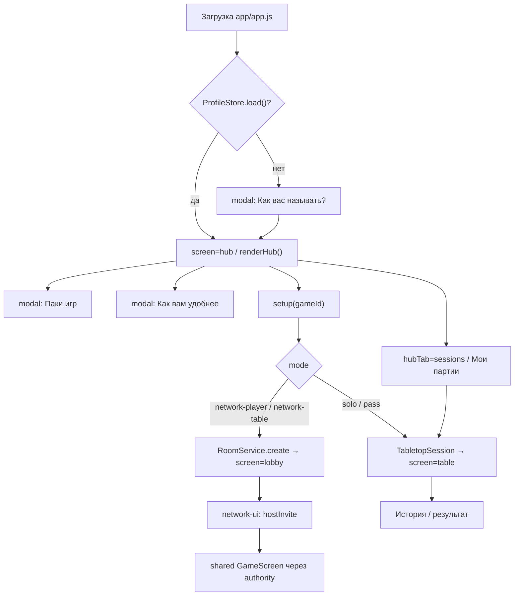

# Интерфейс RC6: меню, формы, лобби, GameScreen, события и ввод

[← Оглавление](DEVELOPMENT.md) · [Слои](DEV-ARCHITECTURE.md) · [Игровая модель](DEV-GAMEPLAY.md) · [WebRTC/QR](DEV-NETWORK.md)

**Код:** [`app/app.js`](../app/app.js), [`app/game-screen.js`](../app/game-screen.js), [`app/shared-views.js`](../app/shared-views.js), [`app/network-ui.js`](../app/network-ui.js), [`core/input.js`](../core/input.js), [`core/ui.js`](../core/ui.js).

## Общая схема экранов

В `app/app.js` основной роутинг — **локальная переменная `screen`**, а не HTML routes:

`render()` выбирает `renderHub()`, `renderLobby()` или `renderTable()`. `#app` — основная корневая область; `#modal-root` — независимый слой диалогов; `#toast` — кратковременные сообщения. HTML собирается строками и назначается через `innerHTML`; **рендер часто полностью заменяет DOM**. Не хранить ссылки на элементы между вызовами `render*()`: искать заново, использовать делегирование событий и отменять асинхронные операции при удалении модалки.

## Структура «Все игры» / «Мои партии»

`renderHub()` строит:

- `.app-shell` с боковым меню `.side-nav`: **Все игры** (`data-command="home"`), **Мои партии** (`sessions`), **Как играть** (`help`).
- Верхнюю панель `.topbar`: **Паки игр** (`packs`), имя `ProfileStore`, полный экран (`fullscreen`) и настройки (`settings`).
- `.intro`, `.collection-count`, `.game-grid` и карточки игр (`tile()`); фильтры `all/cards/board` берутся из `PlayroomCatalog[gameId].category`.
- При существующей локальной `session` — `.resume-banner`. Список `Мои партии` строится `savedGamesMarkup()`, а не отдельной страницей: `hubTab='sessions'`.
- Менеджер паков рендерится `app/pack-manager.js:create()` через общий `openModal()`: выбрать `*.playroom-pack.json` → `manager.parse`/`prepare` → предпросмотр → `install`, удалить версию (если нет сохранений).

Основной `commands` объект находится внизу `app/app.js`. Делегированный `document.addEventListener('click')` распознаёт `data-command`, `data-start`, `data-filter`, `data-resume-id`, `data-delete-id`, `data-lobby-seat`, `data-kick-participant`, `data-rules`; `submit/change/input/keydown` имеют свои обработчики. `app/network-ui.js` использует отдельные обработчики с `stopPropagation()`, чтобы сетевые клики не попали в локальный TabletopInput.

### Меню создания партии (`setup`)

`#setup-form` содержит четыре реально реализованных значения `mode`:

| Значение | Смысл | Кто исполняет правила |
| --- | --- | --- |
| `solo` | Человек (нулевой игрок) и боты (последующие `players[].bot=true`) | Локальная `SessionAuthority` |
| `pass` | Hot seat / передаём одно устройство | Та же локальная `SessionAuthority`, `gate` закрывает чужую руку |
| `network-player` | Хост тоже занимает игровое место | Полная `Session` / `SessionAuthority` браузера хоста |
| `network-table` | Хост отображает публичный стол, не занимает место игрока | Та же host authority, `viewer=-1` на общем столе |

Поля `players`/`name0..N` видны только в `solo/pass`; `roomName`/`networkNickname` — только в сети. Общие поля: `preset`, опции пака `option-<key>`, `openHands` при `capabilities.hands`. `updateNames()` хранит черновые имена при переключении режимов. `roomRulesFromForm()` создаёт единый набор `{preset,presetLabel,openHands,options,display}`; `display` — только человекочитаемые подписи, не вход движка.

Создание сети в `createNetworkRoom` **проверяет поддержку `player` и `table` surfaces в реестре представлений** (сообщение об ограниченном preview для неготовых паков). Количество реальных игроков определяется занятыми местами в лобби, не количеством из локальной формы.

## Лобби сети: кто рисует какие части

**Лобби хоста:** `app/app.js:renderLobby()` читает авторитетный `RoomService.snapshot()`; отображает правила, слоты, участников и зрителей, никнейм, статус готовности, изменения правил, кнопку запуска. Метки:

| Элемент | Обработчик | Изменение |
| --- | --- | --- |
| `data-lobby-seat` | `claimLobbySeat` | `RoomService.claimSeat` |
| `data-command="lobby-ready"` | `toggleLobbyReady` | `RoomService.setReady` |
| `data-command="room-rules"` | `showRoomRulesEditor` / `updateRoomRules` | `RoomService.updateRules` и снятие ready |
| `data-command="lobby-start"` | `startLobbyCountdown` | `beginCountdown(seconds=3)` → `tick` |
| `data-kick-participant` | `kickLobbyParticipant` | Удаление гостя, токена и связи |
| `data-command="lobby-leave"` | `leaveLobby` | Локальный возврат в хаб |

**Лобби гостя:** `app/network-ui.js:renderClientLobby()` строит похожую, но **не хостовую** сцену из `clientRoom`. Кнопки имеют `data-net-seat` и `data-net-action`; каждое изменение отправляется как `clientTransport.dispatch({type:'claim-seat'/'ready'/'spectator', ...})`. Гость не вызывает `RoomService` на своём телефоне.

После `beginCountdown → tick` хостовый `hostRoomUnsub` в `network-ui.js` видит `phase='playing'` и вызывает `startHostGame(state)`: создаёт полную `TabletopSession`, `SessionAuthority` и личные каналы. См. [сетевой поток](DEV-NETWORK.md).

## Экран партии: общая разметка

**[`app/game-screen.js`](../app/game-screen.js)** — один канонический рендерер `GameScreen.render({gameName,subtitle,state,viewer,actions,scene,turnText,turnExtra,replay,busy,historyHTML,footerAction,...})`.

- `state` — **уже разрешённая проекция** (для сети: `SessionClient.snapshot.state`; для локальной игры: `TabletopCore.project`).
- `scene` — HTML конкретного пака через `PlayroomViews.render(state,viewer,actions,{selected,surface,quickPlay})`. `GameScreen` не знает раскладку UNO или домино.
- `GameScreen.playersMarkup` строит плашки игроков/счёт/статус, `historyMarkup` — управление повторами, `resultMarkup` — итоговый диалог (победа/поражение/ничья, баллы).
- В локальном режиме `renderTable` находится в `app/app.js`. В сетевом — `PlayroomSharedViews.mount(client,definition,{surface})` в `app/shared-views.js`.
- Сетевой **игрок** использует `combined` view, идентичную сцене локальной игры, а публичный `Стол` — `table`. Удалённому телефону не передаются JS-правила пака: `shared-views.install()` исполняет только доверенный `view.js` и CSS. Следить за whitelist проекций.

### Ввод: элементы и события

`core/ui.js:TabletopUI` предоставляет `actionAttr`, `source`, `target`, `hand`, `opponents` и реестр `createRegistry()`. Пак генерирует элементы, а `core/input.js:TabletopInput.attach` подключает общую механику:

- `data-action` — JSON допустимого действия; `data-select` и `data-drop-select` — двухэтапный выбор; `data-drag-piece` / `data-drop-piece` — drag&drop; `data-swipe-action`, `data-swipe-select` — свайп; `data-hand-preview` — просмотр карты.
- Пак обязан передавать в UI **только действия, выданные authority/engine**. Скрытая карта другого игрока не превращается в доступную операцию из-за CSS.
- `PlayroomPlayerTarget` обрабатывает `data-accuse-player` (например, реакции с целью — обвинение в UNO), подсветку и подтверждение; это общий механизм, а не правила одной игры.
- `app/app.js` использует `input = TabletopInput.attach(...)`, а `app/shared-views.js` — аналогичный ввод с `usable()` для сети. `usable()` отключает действия при disconnected, pending RPC, animation transition, modal/history или публичном `viewer=-1`.

## Настройки, тайминги, звук, эффекты

`settings` в `app/app.js`: `{sound,volume,animationSpeed,quickPlay}`; сохраняется в `localStorage['playroom.settings.v1']`. Значения `animationSpeed` определены в `core/game-flow.js`: `instant`, `fast`, `normal`, `slow`; `GameFlow.pace()` возвращает `duration`/`settle`/`botDelay`. `prefers-reduced-motion` обнуляет длительность движения. `quickPlay` ускоряет однозначные действия, **не** обходит проверку легальности.

- `core/motion.js` собирает координаты по `data-motion-*` / `data-entity` и анимирует только визуальный переход, не меняя состояние игры.
- `core/audio.js:TabletopAudio` создаёт локальные Web Audio звуки; `registerPack` добавляет/переопределяет звуки пака, `unlock` требует пользовательское взаимодействие. Настройка `sound` изначально выключена.
- `app/game-feedback.js` выводит `notice` и воспроизводит `cues` только из **новых разрешённых событий**; история, реконнект с snapshot и повтор потерянного ACK не должны запускать звуки задним числом.
- `PlayroomAppBridge.gameOptions()` и событие `playroom:game-options` позволяют сетевому `SharedViews` узнать текущие настройки UI хоста, не получая полную Session.

## Модалки, фокус, состояние браузера

`openModal()` помещает `.modal-backdrop > .modal` в `#modal-root`, блокирует `#app.inert`, останавливает локального бота/повтор, сохраняет фокус. `closeModal()` очищает модалку, возвращает фокус и позволяет продолжить бота. `Escape` закрывает диалог/историю; `Tab` ограничивается активной модалкой. `historyOpen/replayIndex` находятся отдельно от фактического текущего хода. `visibilitychange` отменяет анимации/локальных ботов; наличие полной непрерывной сетевой сессии в фоне этим **не гарантируется**.

При смене HTML UI через `innerHTML` старые DOM-элементы исчезают; долгий QR/IP-поиск и сетевой handshake должны проверять актуальную роль/соединение перед записью результата. См. [UI-события сети](DEV-NETWORK.md).

## CSS-карта

- `app/styles.css` — оболочка/хаб/модалки/базовые компоненты;
- `app/lobby.css` — сетевое лобби;
- `app/shared-views.css` — сетевые панели и отдельные shared controls;
- `app/game-interactions.css`, `core/input.css` — жесты, hand/drag affordances;
- `core/ui.css`, `core/motion.css` — базовые компоненты и анимации;
- `app/saved-games.css` и `app/pack-manager.css` — соответствующие диалоги/списки.

**После правок UI:** проверить телефон `320/390px`, широкую/низкую горизонтальную сцену, zoom в QR и `focus/inert`, закрытие модалок, `pointer/touch/drag/swipe`, скрытые руки, историю и порядок событий. Наборы тестов: [проверки](DEV-BUILD-QA.md).
