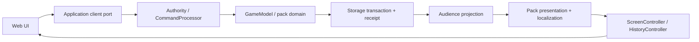

# Архитектура ХОД 0.18

Приложение и коллекция — два независимых репозитория. Пак владеет правилами игры, общая оболочка — вводом, сценой, историей, хранением и сетью. Доменные модули работают без браузера; Web — один из адаптеров.

| Слой / модули | Вход и результат | Граница ответственности |
|---|---|---|
| pack/domain | Position + actor + command → Transition | Чистые правила, RNG в состоянии, legal actions, результат |
| core/model-values, events, model-runtime | Проверенное определение → GameModel | JSON-инварианты, immutable переход, audience projection, timeline |
| core/model-registration, engine | Definition + presentation + locales + version → registry | Связь переносимой модели с Session; точная версия пака |
| core/session, history, session-codec | Команды → кадры/архив | История, метаданные игроков; часы через порт |
| core/command-processor, authority, journal | Запрос + права → durable commit → receipt | Очередь, дедупликация, revision, запись до ACK |
| pack/presentation + presentation/localization | Разрешённая проекция/событие → SceneModel/MessageRef | Смысловые показатели, подписи, публичные эффекты |
| application/game-screen-controller, history-controller | client.snapshot/history/send → состояние экрана | Отмена устаревших ответов, view state, навигация истории |
| application/rooms, host-session-service, client-connection-service | Порты room/client/authority | Жизненный цикл комнаты, подключение и права |
| application/history-sync-service, recovery-coordinator | Разрешённые кадры/курсоры | Backfill, восстановление, pending-команды |
| application/library, host-recovery, upgrade-service | Репозиторий/engine/Session | Библиотека, проверка архива, переход API |
| application/appearance, pwa-update-coordinator | Локальные preferences / состояния окон | Темы и безопасная активация обновления |
| platform/web | DOM, IndexedDB, Web Locks, pack-loader, identity-store | Реализация платформенных портов |
| app/game-screen, shared-views, game-feedback | SceneModel → Web UI | Единая геометрия, роли, эффекты и окна |
| core/ui, input, motion, audio | Разметка компонентов / события ввода | Выбор, drag/swipe/scroll, визуальный отклик |
| app/app, network-ui, multiplayer, transports/webrtc | UI и WebRTC | Сборка зависимостей и пользовательская навигация |
| shared/components и asset-packs коллекции | Semantic data + palette/skin → изображение | Канонические повторно используемые компоненты |

Локальная игра использует тот же игровой контракт; Hotseat меняет viewer через передачу устройства. Сетевая authority находится в браузере хоста. Комната переживает окончание матча; уход в меню паркует UI, явный выход закрывает участие. Просмотр истории отдельного клиента не останавливает всех остальных.

Состояние и действия всегда фильтруются **до** локализации, звука и анимации. Сеть не получает Session.export гостю. DOM, названия участников, тексты, часы и случайность окружения не входят в domain. Публичный actor Стола не меняет viewer=-1.

Канонические shared-компоненты/компилятор находятся в коллекции. Сборка приложения с явным --packs-dir синхронизирует закреплённые копии и digest; автономная сборка проверяет эти digest. Не редактировать generated-копии вручную. Пак не импортирует соседний репозиторий в поставляемом runtime.
