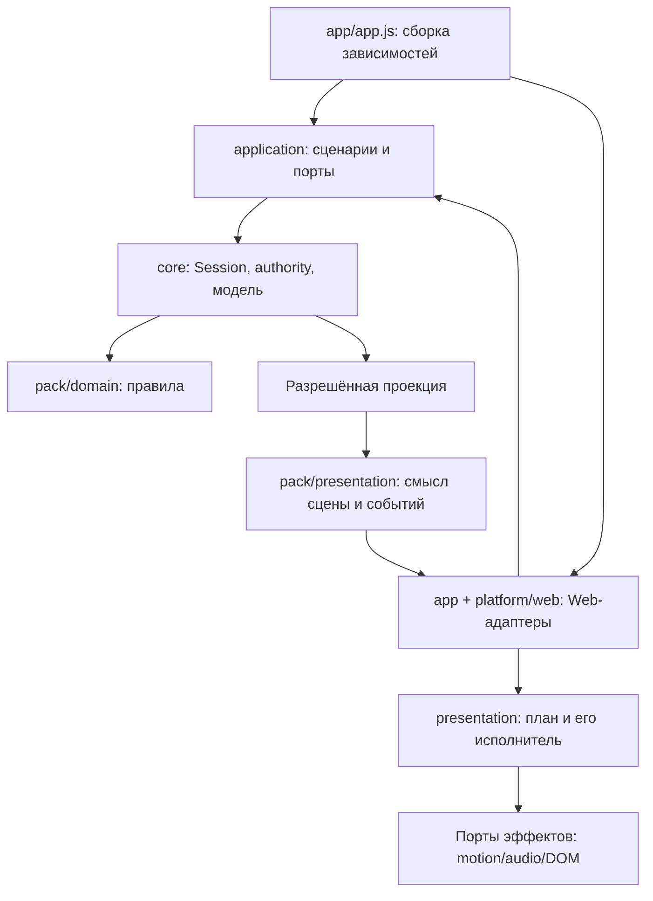
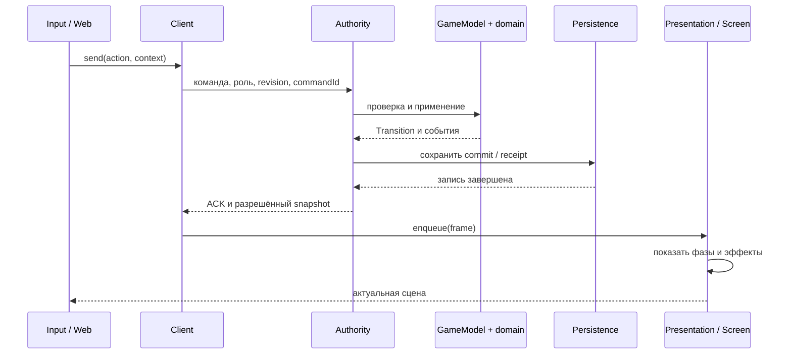

# Архитектура приложения ХОД

Область применения: приложение **0.21.0** и коллекция **0.8.9**, engineApi 4 / viewApi 3 / protocol 3. Исторические этапы ниже поясняют совместимость; текущая приёмка хранится в [utils](https://github.com/GraphGiraffe/boardgame-playroom-utils/blob/main/docs/project/app/reports/ACCEPTANCE-0.21.0.md).

Карта действующей реализации приложения 0.21.0 и коллекции 0.8.9. Аккаунты, облачные комнаты, общение и Web Push реализованы; статус конкретной публикации проверяется отдельно. Начальная точка — [индекс разработчика](DEVELOPER-INDEX.md), форматы — [SDK](SDK-0.18.md). Историческое имя файла SDK не меняет текущие контракты.

## Репозитории и направление зависимостей

| Репозиторий | Владеет | Не должен содержать |
|---|---|---|
| boardgame-playroom | Исполнение модели, Session, authority, хранение, сеть, общие UI и эффекты, пользовательские настройки | Правила конкретной игры, копии операционных утилит |
| boardgame-playroom-paks | Domain игр, presentation, сценарии обучения, переводы, renderer, canonical shared-компоненты и ассеты, compiler | Собственное пользовательское хранилище, сеть, второй проигрыватель эффектов |
| boardgame-playroom-utils | Процессы разработки, навыки, выбор проверок, публикация, roadmap | Runtime приложения или правила игры |

Паки поставляются автономными JSON-контейнерами. Они используют предоставленный SDK, а не импортируют соседний checkout. `build.py --packs-dir …` явно подготавливает companion и синхронизирует закреплённые shared-ресурсы. Список и digest — [core/shared-assets.json](../core/shared-assets.json); исходник общих компонентов находится в коллекции. Generated-копии не редактируют вручную.



Стрелка означает использование/передачу данных, а не импорт всей директории. Имена папок исторические: `core` содержит также Web-компоненты. Переносимость определяют зависимости конкретного файла. `app/app.js`, `app/network-ui.js` — существующие точки композиции и UI-адаптации; они ещё не разбиты на независимый объект для каждого окна. Остаточный долг описан в [аудите границ](https://github.com/GraphGiraffe/boardgame-playroom-utils/blob/main/docs/project/app/reports/ACCEPTANCE-0.21.0.md).

## Карта модулей

Пути в таблице относительны корню приложения. Таблица группирует файлы по ответственности; CSS, JSON-каталоги и тесты сопровождают соответствующую группу.

| Модуль / файлы | Вход → выход | Ответственность |
|---|---|---|
| `core/model-values.js`, `events.js`, `model-runtime.js` | Definition, Position, command → проверенный Transition/projection | Проверка контрактов, immutable snapshots, допустимые действия, видимость событий, timeline |
| `core/model-registration.js`, `engine.js` | Definition + presentation + locales + версия → зарегистрированная игра | Адаптация переносимой модели к Session, поиск точной версии |
| `core/random.js`, `bot-difficulty.js` | RNG/параметры сложности → воспроизводимый выбор | Общие примитивы; стратегия конкретной игры остаётся в паке |
| `core/session.js`, `history.js`, `session-codec.js` | Команды/кадры → история и архив | Жизнь партии, метаданные участников, восстановление сохранения |
| `core/authority.js`, `command-processor.js`, `journal.js`, `protocol.js` | Запрос с ролью/revision/commandId → commit/receipt/snapshot | Права, сериализация команд, дедупликация, durable commit до ACK; расписание ботов |
| `application/rooms.js`, `session-access.js` | Участники, места, правила → состояние комнаты и viewer/actor | Лобби, готовность, роли, локальные места, настройки ботов |
| `application/account-service.js` | Auth-порт → статус аккаунта/гостя без токенов | Вход, регистрация, восстановление и явная облачная гостевая идентичность; не игровые роли |
| `platform/web/supabase-auth.js`, `app/account-ui.js` | Конфигурация + формы → Auth REST/PKCE и модальное окно | HTTP, scoped session store, refresh, UI; [настройка и ограничения](NETWORK-SERVICE.md) |
| `application/social-service.js` | Аккаунт + RPC-порт → друзья и допуск в cloud room | Социальные сценарии; не игровые роли и не транспорт |
| `platform/web/supabase-social.js`, `app/social-ui.js`, `app/lobby-network.js`, `server/social.sql` | Явные формы → RPC → проверенные проекции | HTTP/UI, уникальное имя аккаунта, отдельные друзья и приглашения из лобби, серверные права; [этап 2 и миграция](NETWORK-SERVICE.md#этап-2-друзья-и-доступ-в-приватные-комнаты) |
| `application/community-service.js`, `app/community-ui.js`, `server/online.sql` | Auth ID + RPC → разрешённое общение/присутствие/обнаружение | Общее окно, пароль/видимость Онлайн и Web heartbeat; не чат-сервер, не игровая authority |
| `application/cloud-signaling.js`, `app/cloud-network.js`, `server/signaling.sql` | Cloud membership + RTC-порты → новое соединение | Обнаружение, короткоживущий SDP, аренда хоста; игровые проекции и resume остаются существующей authority |
| `application/host-session-service.js`, `host-recovery.js` | Комната/архив + порты → authority | Запуск и восстановление сессии хоста |
| `application/client-connection-service.js`, `history-sync-service.js` | Transport + snapshots/history → состояние клиента | Отправка/получение, согласование истории, pending-запросы |
| `application/recovery-coordinator.js` | Состояние канала + snapshot/reconcile + clock → состояние восстановления | Проверка связи, синхронизация, задержка уведомления, очистка таймеров |
| `application/game-screen-controller.js`, `history-controller.js` | Client snapshot/history/send → отображаемый кадр и очередь | Разделение live и history, последовательный показ ревизий, отмена устаревшей работы |
| `application/library.js`, `upgrade-service.js` | Архив/версия + storage/engine → библиотека и план обновления | Сохранения и явный переход несовместимых данных |
| `application/pack-update-cleanup.js` | Установленные версии + ссылки сохранений → удалённые старые версии | Только безопасная уборка после установки; не удаляет партии |
| `application/appearance.js`, `player-settings.js` | Предпочтения → нормализованные настройки | Схемы, значения по умолчанию, правила нормализации |
| `application/tutorial-controller.js` | Контекст + описание целей + progress-store → текущий этап/прогресс | Семантическое обучение без прямого DOM/storage/transport |
| `application/pwa-update-coordinator.js` | Состояние UI/обновления → решение об активации | Не прерывать чувствительную операцию обновлением оболочки |
| `platform/web/session-store.js`, `identity-store.js`, `player-settings-store.js`, `guide-preferences.js` | Платформенное хранение → соответствующие порты | Данные сессии, идентичность, пользовательские настройки и обучение |
| `platform/web/pack-loader.js`, `core/packs.js`, `app/remote-catalog.js` | Контейнер/каталог → доступная точная версия | Загрузка, проверка, регистрация и установка паков |
| `platform/web/dom.js`, `element-sizes.js`, `interface-scale.js`, `action-reveal.js`, `layout-guides.js` | DOM/viewport → измерения и Web-поведение | Платформенная геометрия и адаптация |
| `presentation/scene-contract.js`, `localization.js`, `messages-runtime.js` | SceneModel/MessageRef → проверенные и переведённые данные | Граница presentation; не вычисляет игровые правила |
| `presentation/event-plan.js`, `plan-player.js`, `scheduler.js`, `public-sequence.js` | Авторизованные события/кадры → очереди эффектов | Компиляция, группы одновременных cue, пауза, скорость, отмена |
| `app/game-screen.js`, `shared-views.js`, `views.js`, `game-feedback.js` | SceneModel + renderer → сцена/эффекты | Web-представление, стандартные панели, связка с проигрывателем |
| `core/ui.js`, `input.js`, `motion.js`, `audio.js` | Компоненты/жесты/cue → ввод и визуально-звуковой эффект | Выбор, drag/drop, перелёт, проигрывание звука; не принятие хода |
| `core/game-components.js`, `component-assets.js`, `token-layout.js`, `hand-overflow.js`, `player-target.js`, `size-tokens.*` | Публичные объекты + skin/размеры → компоненты | Общие элементы, геометрия руки/жетонов/целей и размеры |
| `app/first-turn-guide.js`, `first-turn-guide.css`, `tutorial-settings.js` | Этап обучения → курсор, диалоги, список | Рисование, idle-задержка, реальные UI-события; не правила прогресса |
| `app/hub-presenter.js`, `pack-manager.js`, `lobby-view.js` | Сервисы и состояния → каталог/паки/лобби | Навигация и UI-операции; мигание доступных обновлений |
| `app/session-client.js`, `multiplayer.js`, `network-ui.js`, `network-client-history.js` | Application-порты → Web-клиент/сетевые экраны | Композиция сетевых сервисов и представление состояния |
| `app/transports/{local,message-port,webrtc}.js`, `qr.js`, `acoustic-pairing.js` | Сообщения/приглашения → канал | Доставка и pairing; транспорт не исполняет правила |
| `index.html`, `app/app.js`, `app/pwa.js`, `sw.js` | Подключённые зависимости → запуск приложения | Порядок загрузки, композиция, PWA lifecycle/cache |

## Путь одного действия

Три разных понятия: **Position** — авторитетное состояние правил; **projection** — разрешённая конкретному viewer часть; **SceneModel** — семантика отображения. DOM не является ни одним из этих состояний. Поля `state`, `frame.state` в Web-коде могут обозначать уже подготовленный снимок, поэтому перед передачей данных проверяйте контракт, а не имя переменной.



Это путь через authority; синхронный локальный переход также поддержан `GameScreenController.transition`. Не нужно добавлять сетевой round-trip локальному renderer ради одинаковой картинки. Общими остаются контракты модели, projection и presentation.

Действие бота проходит ту же модель. `botReactionDelay` описывает задержку реакции, таймер принадлежит authority. Анимация не служит подтверждением хода и не блокирует приём сетевых snapshots. Общий экран может показывать предыдущую ревизию, пока новая уже сохранена; доступность ввода определяет controller. Независимые очереди работают асинхронно в браузере — это не обещание отдельных потоков/Web Workers.

## Показ: порядок, параллельность, звук

`event-plan.js` преобразует события в план; `GameFeedback` связывает его с эффектами Web. `public-sequence.js` обслуживает публичные последовательности кадров, включая Стихии. Не создавайте третий цикл таймеров в renderer.

```text
план
  группа 1: prepare scene → [перелёт + звук] → ждать оба
  группа 2: prepare scene → [раскрытие + звук] → ждать оба
  группа 3: delay
  группа 4: итоговая сцена
```

`PlanPlayer` сначала ждёт async-порт `group`, затем запускает cue группы одновременно. Следующая группа начинается после её минимальной `duration` **и** завершения всех Promise эффектов: время группы — максимум этих длительностей. `delay` — явный cue, не скрытый `setTimeout` после команды. Эффект должен вернуть Promise своей реальной длительности; иначе player не сможет его дождаться.

Сцены до/после передачи задают момент изменения руки, количества карт, сета и метрик. Финальный результат domain нельзя сразу подставлять во все промежуточные панели. Скрытое лицо не передаётся даже невидимому DOM-элементу. `EntityRef` идентифицирует разрешённый экземпляр; закрытая передача использует зоны/число карт.

Порты эффектов регистрируют animation/cleanup через context, учитывают `signal` и `current()`. При выходе из истории, смене партии или dispose отменяются очередь и эффекты; устаревший Promise не перерисовывает новый экран. Готовые планы освобождают сцены/callbacks. Проверочные копии неизменяемого состояния в модели допустимы; глубокое копирование всей партии на каждом кадре анимации — нет. См. [исполнитель](PRESENTATION-PLAYER.md) и [аудит производительности](https://github.com/GraphGiraffe/boardgame-playroom-utils/blob/main/docs/project/app/reports/ACCEPTANCE-0.21.0.md).

## Компоновка и ввод

Renderer пака возвращает описание view API 3 с `elements`, `playerContent` и layout-метаданными. Host монтирует стандартные зоны. `ui.selected` и `ui.viewState` принадлежат экрану, не Position: выбор карточки ещё не означает сыгранную карту.

Геометрия поля фиксирована по умолчанию. Резервируйте места до перелёта; новый объект не должен переставлять существующие элементы. Разрешение динамического изменения — явное `allowLayoutChange: true` для необходимого сценария либо изменение viewport/масштаба. Общие размеры карты/кубика/жетона берутся из size tokens; skin задаёт защищённые области перекрытия. Контуры соответствуют форме объекта. См. [UI API](GAME-ELEMENTS-API.md), [размеры](SIZE-SYSTEM.md), [инварианты](DEVELOPMENT-REGRESSIONS.md).

Tap, drag и клавиатурный ввод должны приводить к одной допустимой команде. Renderer использует переданные actions/Source/Target, а не повторно вычисляет legal moves. Предварительный выбор/примерка не должен запускать эффект принятого действия.

## Обучение и настройки

Полное руководство: [обучение и пользовательский прогресс](TUTORIALS.md).

Пак описывает каталог целей и доступные сейчас шаги. `TutorialController` сопоставляет семантическое событие и цель; `GuidePreferences` хранит освоенное по user + pack + goal revision; `first-turn-guide` двигает курсор и наблюдает реальный ввод; `tutorial-settings` показывает диалоги. Автоматическая смена поля или автоматический добор не считаются нажатием человека.

`PlayerSettings` нормализует основные настройки, `PlayerSettingsStore` реализует сохранение. Правила партии находятся отдельно в manifest/Position; botSettings — у участника; локальная выбранная карта — у screen controller. Нельзя записывать громкость или освоенные цели внутрь состояния правил. Для хотсита соблюдайте отдельную настройку игрока и срок жизни его идентичности.

## Сеть и сохранения

WebRTC передаёт сообщения; authority хоста принимает решения; recovery сверяет snapshot с хостом; screen controller показывает их. Краткий восстанавливаемый сбой не обязан создавать баннер. Длительный сбой или ошибка согласования показывается состоянием recovery; после закрытия канала может понадобиться новое приглашение. Секрет возобновления не попадает в публичный snapshot, QR или журнал эффектов.

Архив authority и публичная история клиента — разные данные. `Session.export` нельзя отправлять гостю. ACK следует после durable commit; повтор commandId не создаёт повторный ход. Чтение истории одного клиента не ставит всех игроков на паузу. См. [сетевой контракт](DEVELOPER-MULTIPLAYER.md), [данные](DEVELOPER-DATA.md).

Установленная версия пака закрепляется в сохранении. Обновление не переписывает старый архив. `PackUpdateCleanup` вызывается после успешной установки: сохраняет активную/более новую версию, версии со ссылками локальных и сетевых архивов; при активной сетевой комнате не удаляет версии, ошибка чтения архива также не разрешает удаление. Это отдельный механизм от `UpgradeService` и обновления PWA.

## Как расширять и проверять

| Требуется | Начать здесь | Проверить |
|---|---|---|
| Новое правило/команда | pack/domain, затем presentation/locales | Детерминизм, legal actions, privacy, replay |
| Новый общий тип эффекта | event-plan / plan-player + Web effect port | Порядок, длительность звука, отмена, history |
| Новый элемент поля | shared/components коллекции + host helpers | Fixed layout, размеры, skin, input, приватность |
| Новое обучение | pack tutorial + каталог перевода | Реальный ввод и command commit, редкий этап, выключение/reset |
| Новая настройка игрока | player-settings + Web store + UI | Defaults, нормализация, user/hotseat scope |
| Новый способ подключения | transport + client/host ports | Authority права, dedup, reconnect, teardown |
| Новое хранение | Platform adapter существующего порта | Атомарность, восстановление, ошибка записи до ACK |
| Изменение публикации | utils | Точные SHA, immutable assets, rollback; не новый runtime |

Новый модуль получает явные зависимости в constructor/factory, владельца состояния и lifecycle. Сервис с состоянием удобно выражать классом; чистые правила и преобразования — функциями. Не наследуйте игровой renderer от сетевого клиента и не создавайте универсальный объект, который одновременно хранит прогресс, вычисляет ход и проигрывает звук.

Для знакомства прочитайте `packs/gofish/{domain/game,presentation/scene,presentation/tutorial}.js`, затем те же части UNO (реакции) и Mage Brawl (одновременные планы). Реальные проверки приложения: `tests/model-contract.test.cjs`, `game-flow.test.cjs`, `game-feedback.test.cjs`, `domain-foundation.test.cjs`, `rc2-presentation-browser.test.cjs`, `network-reconnect-browser.test.cjs`. Выбирайте затронутые сценарии по [политике проверок](https://github.com/GraphGiraffe/boardgame-playroom-utils/blob/main/docs/VALIDATION-POLICY.md); изменение документации не требует запуска всего продукта или нового релиза.

### Static deployment port

`RemoteCatalog` accepts `basePath` (default `/api/packs/`), or the deployment-injected `PlayroomDeployment.catalogBasePath`. Only a local absolute directory path is accepted. The catalog schema and SHA/manifest checks remain identical across CF and GitHub Pages. Hosting tools, encryption and login templates belong to utils, not game/runtime modules.

## Локальное хранилище

Паки и локальные партии используют асинхронный durable port IndexedDB, настройки — localStorage. Запуск UI ждёт `PlayroomPacksReady`; успешная запись означает `transaction.oncomplete`. Новые локальные истории — журнал команд v3; прежние снимки v1/v2 совместимы. Схема, миграция и границы ответственности: [LOCAL-STORAGE.md](LOCAL-STORAGE.md).

## Предложение обновлений

`app/update-dialog.js` рисует единое стандартное окно, а `app/app.js` открывает его в безопасном главном меню после обнаружения обновления. Верхние баннеры больше не используются. Закрытие откладывает предложение; кнопка обновлений в меню позволяет вернуться к списку. Партия, комната, другой диалог и запись сохранений не прерываются.

`app/pwa.js` запрашивает `playroom-update-info` непосредственно у ожидающего Service Worker: сведения относятся к устанавливаемой оболочке, а не к старому кешу. `updates.json` содержит `releases: [{version, changes: [строка, ...]}]`; при сборке сведения и версия встраиваются в `sw.js`, в том числе для зашифрованного GitHub Pages. Перед выпуском добавляйте пользовательские изменения в этот файл и CHANGELOG. Окно показывает все записи после установленной версии до доступной включительно, от ранней к поздней. Текст экранируется; HTML не поддерживается.

Для паков аналогичный необязательный массив `manifest.releases` передаётся издателями CF и GitHub Pages в запись каталога. Сохраняйте записи прошлых выпусков, чтобы пользователь, пропустивший несколько версий, видел все изменения. Старые каталоги без описаний совместимы: UI честно сообщает об отсутствии списка, а не выдумывает его. Списки также доступны у обновлений в менеджере паков. Активация оболочки по-прежнему использует многооконную проверку `PwaUpdateCoordinator`; окно обновления само по себе не блокирует её.

Навигация Service Worker отдаёт установленную оболочку из текущего кеша сразу, без ожидания сети. Проверка обновлений выполняется независимо. Для GitHub Pages после первого входа издатель добавляет сохранение расшифрованного HTML с проверкой SHA-256 и заменой единственной записи оболочки; сервер продолжает отдавать только шифротекст. Канонический контракт — utils `docs/GITHUB-PAGES.md`.

`app/hub-action.js` владеет общей кнопкой установки/обновления в заголовке главного меню: обновление приоритетнее установки, оформление и анимация общие, reduced motion соблюдается. Сетевой UI больше не управляет установкой приложения.


### Общение и делегированные приглашения (локальная реализация 0.20)

- `app/friend-card.js`: единая карточка для друзей и приглашений. `app/community-ui.js`: общий список и присутствие. `app/chat-ui.js`: отдельный диалог, черновик, страницы сообщений, таймер только открытого диалога. Ни один из них не управляет игровым authority.
- `application/community-service.js`: граница аккаунта/поколения запросов; `platform/web/supabase-social.js`: авторизованный HTTP; `server/online.sql`: права, хранение сообщений, deduplication и лимиты.
- `application/rooms.js`: разрешение приглашения. `app/network-invitations.js`: одно ожидающее ручное приглашение на участника, срок 120 секунд, очистка при отзыве/закрытии. `app/network-ui.js`: проверка связанного с каналом участника и создание прямого RTC-канала хост ↔ новичок.
- `app/lobby-network.js`: Онлайн-настройки/номер комнаты/пароль/deeplink; существующий `app/cloud-network.js` сохраняет роль хоста. Короткий номер не заменяет внутренний UUID и resume-секрет.

Web Push остаётся отдельным этапом; текущая переписка не обещает доставки уведомления закрытому приложению. Проверки и обновление миграции описаны в [NETWORK-SERVICE](NETWORK-SERVICE.md).


Карточки продолжения и архива используют единый `GameScreen.sessionCard`: бейдж и название игры, название комнаты, участники, отдельная строка раунда/хода/действий; верхние действия справа. Архив добавляет версию/дату и отдельное удаление справа снизу. `resumeCard` и HubPresenter только подготавливают данные и команды. Общая геометрия и компактный бейдж (иконки 14 px) находятся в `app/saved-games.css`; дублирующая геометрия resume удалена из общих стилей. Локальная сводка сохраняет `roomName` из lobbyConfig; старые сводки без этого поля отображаются без выдуманного имени.

Имя последней собственной комнаты хранится в пользовательской настройке `lastRoomName`: создание и успешное переименование сохраняют нормализованное имя, новая комната любой игры использует его. Подключение к чужой комнате и восстановление сохранённой партии не меняют это предпочтение.

Окна общения используют общую карточку `PlayroomFriendCard`: аватар, имя, статус и действия внутри одной рамки. `modalHead` принимает необязательные `actions` для быстрых кнопок заголовка. В чате обновление расположено в заголовке, отправка — внутри `data-inline-actions` формы; textarea растёт от 1 строки до ограничения высоты и уменьшается после отправки. Скроллируемые области окон сохраняют симметричные отступы без резервной полосы справа; прокрутка колёсиком, касанием и клавиатурой остаётся доступной.

`friend-profile-ui.js` отвечает за подробности друга, приглашение и подтверждаемое удаление через существующие сервисы. Список друзей не содержит удаления подтверждённых друзей; отмена/принятие запросов остаются в списке. Кнопка с аватаром и никнеймом в чате открывает профиль, где видно имя аккаунта. При возврате чат восстанавливает загруженные сообщения, прокрутку и черновик; смена аккаунта закрывает связанный профиль. Заголовок окна «Друзья» содержит быстрые действия добавления и обновления.

Уведомления переписки отделены от рендерера чата: `chat-notifications.js` читает адресный RPC `inbox` через CommunityService, группирует баннеры и учитывает открытого собеседника; курсор аккаунта хранит `platform/web/chat-notification-store.js`. Браузерное хранение не содержит текста переписки. `PlayroomAppBridge.captureModalReturn` сохраняет действительные узлы исходного окна и его цепочку возврата, а `PlayroomChatUI.captureReturn` сохраняет состояние отдельной переписки. SQL-триггер записывает направленные приглашения как типизированные сообщения, сервер вычисляет их актуальное состояние при чтении. Клиент показывает игру, комнату, вход/отказ в одной карточке и группирует сообщения по локальным календарным дням.

### Эфемерные реакции игроков

`application/quick-reactions.js` — общий словарь и host-owned gate, без DOM и правил игр. `app/quick-reactions.js` — общий popup 3×3, фокус, отслеживание аватара и время жизни 2 секунды. ChatUI сохраняет эмодзи через обычный `send-message`; игровая сеть передаёт `quick-reaction` отдельно от snapshot и журнала. NetworkUI связывает отправителя с аутентифицированным участником комнаты и текущим session ID; транспорт не назначает actor и не хранит реакции. История и зритель не получают право отправки. Устроенный локально replay не воспроизводит игровые реакции.

### История комнаты и командный канал

`application/room-chat.js` — запись, дедупликация, лимит и фильтрация по актуальному членству/сохранённому списку адресатов. Порты: транзакционное хранилище, часы и разрешение личности. `app/network-ui.js` связывает RTC-участника с комнатой/командой, публикует только допустимые записи и ведёт историю игровых реакций отдельно от game journal. `app/room-chat-ui.js` — пагинация, черновики каналов, переключатель и отметки видимых сообщений. `app/chat-components.js` разделяет шапку, composer и отметки с личным чатом. `app/quick-reactions.js` показывает ограниченные по размеру пузырьки, не назначает права доступа. Серверные отметки личного чата принадлежат `server/online.sql`; локальные отметки комнаты принадлежат RoomChat.


### Группы и общий рендерер переписки

Групповое приглашение в игру хранит отдельный адресный доступ для каждого участника и остаётся пригодным для повторного входа до закрытия комнаты. Его нельзя отклонить; недоступность хоста временно меняет состояние на `offline`. Новые участники получают доступ к ещё открытым приглашениям из разрешённой им истории. Опция `show_history` включена по умолчанию; при выключении на момент вступления фиксируется `history_after`. Фильтр действует на чтение, известные ID, inbox, unread и seen. Переключение опции меняет правила будущих вступлений, сохраняя границы существующих участников.

`PlayroomChatComponents.navigation` управляет максимум одним индикатором активного игрового приглашения у каждого края списка и переходом к ближайшему приглашению в выбранном направлении. Круглая кнопка вниз появляется при прокрутке вниз вне конца истории. `PlayroomChatState` хранит ID и смещение первого видимого сообщения: при повторном открытии позиция восстанавливается без прыжка к новым сообщениям; в открытом чате конец отслеживается только если он уже виден. Для навигации дополнительные запросы в облако не нужны; первая страница включает также старые активные приглашения.

- `app/group-ui.js`: навигация группы, информация/участники, приглашение в группу и выход. Не управляет правилами игр или SQL.
- `app/room-chat-ui.js`: общий рендерер беседы для RTC-комнаты/команды и облачной группы. Источник передаётся как `source()` с `{roomId, connected, call}`; групповой адаптер переводит команды чтения/отправки/прочтения в `group-*` RPC. Внешний `identity` задаёт кликабельную шапку. Смена аккаунта очищает черновики/повторы.
- `app/chat-components.js`: общие шапка, ввод, время/отметки и карточка приглашения; одинаковая геометрия действий используется в личных и групповых чатах.
- `app/lobby-network.js`: отправка приглашения в текущую комнату, закрытие облачной комнаты, сценарий «Сыграть» с адресатом. `app/app.js` владеет созданием/сменой локального лобби и выбором пака; сетевой код не копирует каталог или верстку выбора.
- `app/community-order-ui.js`: порядок DOM-карточек и жесты; `platform/web/community-order-store.js`: ограниченный список идентификаторов в localStorage отдельно по аккаунту. Переписка, пароли и профили туда не попадают.
- `server/online.sql`: приватные таблицы групп, членства, приглашений и сообщений; `playroom_groups_rpc` доступен только из внешнего `playroom_online`. Общая SQL-проекция `playroom_invitation_state` вычисляет состояние комнатного приглашения. Групповое сообщение ссылается на адресные права входа через `playroom_room_invites.group_message_id`; триггер исключает их дублирование в личных чатах. `server/social.sql` проверяет членство группы при входе по такому приглашению.
- `app/chat-notifications.js`: раздельные курсоры личной и групповой переписки, общая очередь баннеров, подавление уведомлений активной беседы и обработанных приглашений. Web Push остаётся отдельным этапом.

### Принятые реакции и ввод сообщений (0.20.0-preview.1)

- `application/quick-reactions.js` владеет фиксированными ID, короткими обозначениями и проверкой сетевых реакций. Модель не зависит от DOM или графики. Поле `emoji` сохранено в протоколе для совместимости; новые значения — `:id:`. Старые Unicode-реакции принимаются при чтении истории и от старого клиента.
- `app/reaction-view.js` экранирует текст и заменяет только известные обозначения. Один рендерер используется в сообщениях, уведомлениях, выборе реакций и баблах.
- `app/assets/reactions/` содержит только 9 принятых ассетов: 7 SVG и 2 прозрачных PNG из утверждённого листа v14. CSS ссылается на них один раз; HTML и PWA встраивают ресурсы при сборке. Черновики и альтернативы остаются в workspace `tmp_files/reactions-draft`, вне исходного архива приложения и runtime.
- `app/chat-composer.js` владеет редактированием, выделением, вставкой, IME и преобразованием коротких обозначений. DOM картинок никогда не отправляется: form.elements.message содержит только текст. `chat-components.js` задаёт общий каркас; личный и комнатный/групповой контроллеры отправляют данные через свои существующие порты.
- Если пользователь вводит сообщение или есть черновик, выбор реакции вставляется в него. Пустое поле без фокуса позволяет отправить отдельную реакцию. Удержание показывает обозначение без отправки. Escape снимает фокус с поля, следующий Escape закрывает окно штатно.

Границы хранения прежние: `application/room-chat.js` проверяет полномочия и сохраняет сообщения через порт; `platform/web/*` реализует транспорт/хранилища; `app/chat-state.js` управляет кешем отображаемых бесед, прокруткой и бейджами. Реакции не меняют игровые правила или приватные проекции.

`app/reaction-raster.js` отвечает только за вывод двух растровых реакций. Полноразмерные принятые PNG не пережимаются и не меняются: canvas уменьшает их ступенями с качественным сглаживанием до размера элемента с учётом DPR. Кеш ограничен 32 размерами, отслеживание удалённых элементов освобождается. Семантика/короткие обозначения остаются в `reaction-view.js`; при недоступном canvas остаётся CSS-картинка. SVG-реакции сохраняют нативный векторный вывод.

Web Push: `app/push-ui.js` управляет явным включением и навигацией, `platform/web/push-device.js` — браузерной подпиской, `platform/web/push-worker.js` — фоновым приёмом, изоляцией аккаунта и целями перехода. Очередь/RPC/триггеры принадлежат `server/push.sql`, доставщик — `supabase/functions/playroom-push`; ключи сервера не входят в клиентскую сборку. Общий/командный чат получает разрешённую аудиторию у текущего хоста; Push не становится источником игровой authority или хранилищем истории комнаты.

Плановая передача хоста: `application/host-transfer.js` задаёт порядок consent/prepare/fence/commit/activate и преобразует private bundle без игровых правил; `platform/web/host-transfer-wire.js` передаёт ограниченные адресные части по существующему RTC. `app/host-transfer-ui.js` связывает согласие, хранилище и подготовку новых соединений. `app/network-ui.js` предоставляет порты текущей authority, drain и переподключение. `platform/web/session-store.js` хранит prepared/active/outgoing состояния, журнал и fence. Облачное подтверждение принадлежит `server/host-transfer.sql`; никакой полный Session в SQL не попадает. [Контракт и отказоустойчивость](HOST-TRANSFER.md).

## Временное управление местом

Сетевое отсутствие и подмена ботом не меняют domain players[].bot. Host-owned playerControls с отдельной ревизией и квитанциями атомарно сохраняются в IndexedDB. Привязанная личность проверяется PlayerControlService; Authority сериализует переход с принятыми ходами. См. [контракт этапа](TEMPORARY-BOT.md).


## Стандарт ответственности сетевого подключения

Локальная сеть и онлайн используют общий жизненный цикл попытки:
`application/connection-attempt.js`. Сервис принимает часы, генератор ID,
получение ICE-конфигурации, определение маршрута, диагностику и подписчика
состояния как порты. Он не читает DOM, аккаунт или браузерные глобальные сервисы.

- `app/connection-progress.js` связывает эти порты и отображает состояние.
- `platform/web/ice-config.js` получает временные credentials и отправляет
  ограниченную диагностику; локальное подключение не требует этого сервиса.
- `application/cloud-signaling.js` отвечает за онлайн rendezvous, а
  `app/transports/webrtc.js` — за RTC и доставку.
- Управление комнатой и авторитет партии остаются отдельными от подключения.

Новые варианты подключения используют этот контракт, а не копируют таймеры,
переходы состояния и завершение диагностики в экран. Терминальное состояние
фиксируется один раз; поздние обновления его не заменяют. Внешний UI-контракт
`PlayroomConnectionProgress.create` сохранён.


### Группировка сети и онлайн

| Модуль | Единственная область ответственности |
| --- | --- |
| application/online-connection.js | Вход, повторный вход, дедупликация попыток, дедлайн и защита от поздних ответов после смены аккаунта/попытки |
| app/cloud-network.js | Браузерные зависимости, окна, статус и pagehide |
| app/network-social.js | Комнатный чат, видимость сообщений, реакции и их доставка |
| app/network-presence.js | Проекция участников, метаданные, присутствие и индикатор потери связи |
| application/transfer-peer.js | Подготовка RTC-канала добровольной передачи и диагностика |
| application/host-transfer.js | Протокол добровольной передачи и переходы Sender |
| app/host-transfer-ui.js | Согласие пользователя, связывание протокола с хранением и комнатой |
| app/network-ui.js | Фасад совместимости и владелец живых host/client-соединений, монтирования партии и их освобождения |

Общие правила: application получает внешние эффекты через порты; Web-адаптер
владеет DOM. Выделенный адаптер читает актуальное состояние через getter-порты,
не хранит его вторую копию. Новый владелец соединения не создаётся ради разделения
файла. История уже делегирована HistorySyncService/HostSessionService, pairing —
PairingPresenter, восстановление — RecoveryCoordinator. Эти механизмы расширяются,
а не копируются. Размер файла сам по себе не основание для второго владельца.

Любой новый runtime-модуль добавляется в index, исходный SW-кэш и явные bootstrap
списки тестов. Generated assets и компилятор остаются сборочными копиями точного
companion, не ручными дублями. Изменения дизайна выполняются отдельно в 0.21.

## Подготовка аккаунта и обратная связь

`platform/web/account-profile-store.js` хранит только публичные username/nickname текущего аккаунта, раздельно по user ID. `application/social-service.js` принимает этот storage-порт, восстанавливает метаданные синхронно и отклоняет чужие результаты синхронизации. Полученные данные обновляют карточку профиля без открытия аккаунта. Проверка сохранённой сессии начинается при запуске, а безопасный переход в «Онлайн аккаунт» остаётся доступен во время проверки; операции изменения данных проверяются отдельно.

«Никнейм и аватар» не дублируется в редакторе имени аккаунта. Вход/регистрация имеют две вкладки, восстановление — отдельный пункт входа. Вложенные панели возвращаются на один уровень и очищают приватные поля при закрытии или смене владельца.

Обратная связь — явная отправка сообщения, до трёх сжатых изображений, диагностического лога по выбору и проверяемых технических сведений. Черновик и вложения живут в памяти панели. Серверный приём, лимиты и срок хранения описаны в `server/bug-reports.sql`; запись не публикуется через обычный SELECT/Realtime. Экран диагностики использует пассивное измерение лога, не порождающее новые sample-события.
