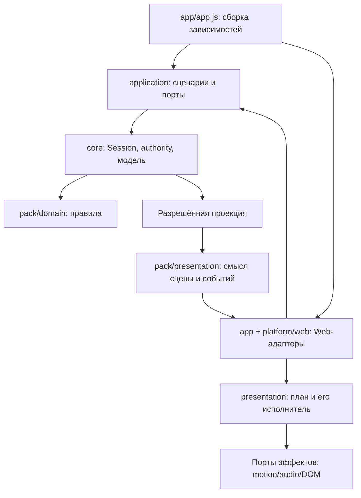
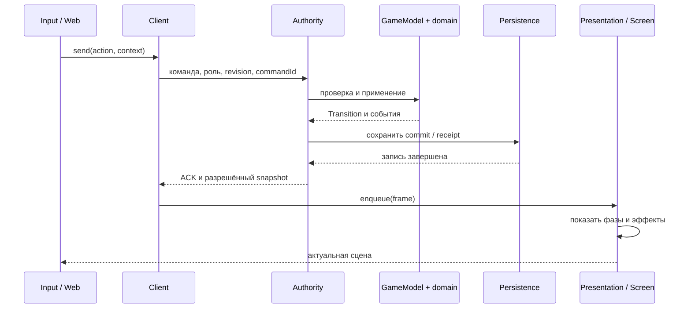

# Архитектура приложения ХОД

Карта реализации для приложения **0.19.7-preview.3**, коллекции **0.8.6**: engineApi 4, viewApi 3, protocol 3. Это описание существующего кода, а не план следующего рефакторинга. Начальная точка — [индекс разработчика](DEVELOPER-INDEX.md); точные форматы и проверки — [SDK](SDK-0.18.md). Историческое имя файла SDK не означает API 0.18.

## Репозитории и направление зависимостей

| Репозиторий | Владеет | Не должен содержать |
|---|---|---|
| boardgame-playroom | Исполнение модели, Session, authority, хранение, сеть, общие UI и эффекты, пользовательские настройки | Правила конкретной игры, копии операционных утилит |
| boardgame-playroom-paks | Domain игр, presentation, сценарии обучения, переводы, renderer, canonical shared-компоненты и ассеты, compiler | Собственное пользовательское хранилище, сеть, второй проигрыватель эффектов |
| boardgame-playroom-utils | Процессы разработки, навыки, выбор проверок, публикация, roadmap | Runtime приложения или правила игры |

Паки поставляются автономными JSON-контейнерами. Они используют предоставленный SDK, а не импортируют соседний checkout. `build.py --packs-dir …` явно подготавливает companion и синхронизирует закреплённые shared-ресурсы. Список и digest — [core/shared-assets.json](../core/shared-assets.json); исходник общих компонентов находится в коллекции. Generated-копии не редактируют вручную.



Стрелка означает использование/передачу данных, а не импорт всей директории. Имена папок исторические: `core` содержит также Web-компоненты. Переносимость определяют зависимости конкретного файла. `app/app.js`, `app/network-ui.js` — существующие точки композиции и UI-адаптации; они ещё не разбиты на независимый объект для каждого окна. Остаточный долг описан в [аудите границ](MODULE-BOUNDARY-AUDIT-0.19.5.md).

## Карта модулей

Пути в таблице относительны корню приложения. Таблица группирует файлы по ответственности; CSS, JSON-каталоги и тесты сопровождают соответствующую группу.

| Модуль / файлы | Вход → выход | Ответственность |
|---|---|---|
| `core/model-values.js`, `events.js`, `model-runtime.js` | Definition, Position, command → проверенный Transition/projection | Проверка контрактов, immutable snapshots, допустимые действия, видимость событий, timeline |
| `core/model-registration.js`, `engine.js` | Definition + presentation + locales + версия → зарегистрированная игра | Адаптация переносимой модели к Session, поиск точной версии |
| `core/random.js`, `bot-difficulty.js` | RNG/параметры сложности → воспроизводимый выбор | Общие примитивы; стратегия конкретной игры остаётся в паке |
| `core/session.js`, `history.js`, `session-codec.js` | Команды/кадры → история и архив | Жизнь партии, метаданные участников, восстановление сохранения |
| `core/authority.js`, `command-processor.js`, `journal.js`, `protocol.js` | Запрос с ролью/revision/commandId → commit/receipt/snapshot | Права, сериализация команд, дедупликация, durable commit до ACK; расписание ботов |
| `application/rooms.js`, `session-access.js` | Участники, места, правила → состояние комнаты и viewer/actor | Лобби, готовность, роли, локальные места, настройки ботов |
| `application/host-session-service.js`, `host-recovery.js` | Комната/архив + порты → authority | Запуск и восстановление сессии хоста |
| `application/client-connection-service.js`, `history-sync-service.js` | Transport + snapshots/history → состояние клиента | Отправка/получение, согласование истории, pending-запросы |
| `application/recovery-coordinator.js` | Состояние канала + snapshot/reconcile + clock → состояние восстановления | Проверка связи, синхронизация, задержка уведомления, очистка таймеров |
| `application/game-screen-controller.js`, `history-controller.js` | Client snapshot/history/send → отображаемый кадр и очередь | Разделение live и history, последовательный показ ревизий, отмена устаревшей работы |
| `application/library.js`, `upgrade-service.js` | Архив/версия + storage/engine → библиотека и план обновления | Сохранения и явный переход несовместимых данных |
| `application/pack-update-cleanup.js` | Установленные версии + ссылки сохранений → удалённые старые версии | Только безопасная уборка после установки; не удаляет партии |
| `application/appearance.js`, `player-settings.js` | Предпочтения → нормализованные настройки | Схемы, значения по умолчанию, правила нормализации |
| `application/tutorial-controller.js` | Контекст + описание целей + progress-store → текущий этап/прогресс | Семантическое обучение без прямого DOM/storage/transport |
| `application/pwa-update-coordinator.js` | Состояние UI/обновления → решение об активации | Не прерывать чувствительную операцию обновлением оболочки |
| `platform/web/session-store.js`, `identity-store.js`, `player-settings-store.js`, `guide-preferences.js` | Платформенное хранение → соответствующие порты | Данные сессии, идентичность, пользовательские настройки и обучение |
| `platform/web/pack-loader.js`, `core/packs.js`, `app/remote-catalog.js` | Контейнер/каталог → доступная точная версия | Загрузка, проверка, регистрация и установка паков |
| `platform/web/dom.js`, `element-sizes.js`, `interface-scale.js`, `action-reveal.js`, `layout-guides.js` | DOM/viewport → измерения и Web-поведение | Платформенная геометрия и адаптация |
| `presentation/scene-contract.js`, `localization.js`, `messages-runtime.js` | SceneModel/MessageRef → проверенные и переведённые данные | Граница presentation; не вычисляет игровые правила |
| `presentation/event-plan.js`, `plan-player.js`, `scheduler.js`, `public-sequence.js` | Авторизованные события/кадры → очереди эффектов | Компиляция, группы одновременных cue, пауза, скорость, отмена |
| `app/game-screen.js`, `shared-views.js`, `views.js`, `game-feedback.js` | SceneModel + renderer → сцена/эффекты | Web-представление, стандартные панели, связка с проигрывателем |
| `core/ui.js`, `input.js`, `motion.js`, `audio.js` | Компоненты/жесты/cue → ввод и визуально-звуковой эффект | Выбор, drag/drop, перелёт, проигрывание звука; не принятие хода |
| `core/game-components.js`, `component-assets.js`, `token-layout.js`, `hand-overflow.js`, `player-target.js`, `size-tokens.*` | Публичные объекты + skin/размеры → компоненты | Общие элементы, геометрия руки/жетонов/целей и размеры |
| `app/first-turn-guide.js`, `first-turn-guide.css`, `tutorial-settings.js` | Этап обучения → курсор, диалоги, список | Рисование, idle-задержка, реальные UI-события; не правила прогресса |
| `app/hub-presenter.js`, `pack-manager.js`, `lobby-view.js` | Сервисы и состояния → каталог/паки/лобби | Навигация и UI-операции; мигание доступных обновлений |
| `app/session-client.js`, `multiplayer.js`, `network-ui.js`, `network-client-history.js` | Application-порты → Web-клиент/сетевые экраны | Композиция сетевых сервисов и представление состояния |
| `app/transports/{local,message-port,webrtc}.js`, `qr.js`, `acoustic-pairing.js` | Сообщения/приглашения → канал | Доставка и pairing; транспорт не исполняет правила |
| `index.html`, `app/app.js`, `app/pwa.js`, `sw.js` | Подключённые зависимости → запуск приложения | Порядок загрузки, композиция, PWA lifecycle/cache |

## Путь одного действия

Три разных понятия: **Position** — авторитетное состояние правил; **projection** — разрешённая конкретному viewer часть; **SceneModel** — семантика отображения. DOM не является ни одним из этих состояний. Поля `state`, `frame.state` в Web-коде могут обозначать уже подготовленный снимок, поэтому перед передачей данных проверяйте контракт, а не имя переменной.



Это путь через authority; синхронный локальный переход также поддержан `GameScreenController.transition`. Не нужно добавлять сетевой round-trip локальному renderer ради одинаковой картинки. Общими остаются контракты модели, projection и presentation.

Действие бота проходит ту же модель. `botReactionDelay` описывает задержку реакции, таймер принадлежит authority. Анимация не служит подтверждением хода и не блокирует приём сетевых snapshots. Общий экран может показывать предыдущую ревизию, пока новая уже сохранена; доступность ввода определяет controller. Независимые очереди работают асинхронно в браузере — это не обещание отдельных потоков/Web Workers.

## Показ: порядок, параллельность, звук

`event-plan.js` преобразует события в план; `GameFeedback` связывает его с эффектами Web. `public-sequence.js` обслуживает публичные последовательности кадров, включая Стихии. Не создавайте третий цикл таймеров в renderer.

```text
план
  группа 1: prepare scene → [перелёт + звук] → ждать оба
  группа 2: prepare scene → [раскрытие + звук] → ждать оба
  группа 3: delay
  группа 4: итоговая сцена
```

`PlanPlayer` сначала ждёт async-порт `group`, затем запускает cue группы одновременно. Следующая группа начинается после её минимальной `duration` **и** завершения всех Promise эффектов: время группы — максимум этих длительностей. `delay` — явный cue, не скрытый `setTimeout` после команды. Эффект должен вернуть Promise своей реальной длительности; иначе player не сможет его дождаться.

Сцены до/после передачи задают момент изменения руки, количества карт, сета и метрик. Финальный результат domain нельзя сразу подставлять во все промежуточные панели. Скрытое лицо не передаётся даже невидимому DOM-элементу. `EntityRef` идентифицирует разрешённый экземпляр; закрытая передача использует зоны/число карт.

Порты эффектов регистрируют animation/cleanup через context, учитывают `signal` и `current()`. При выходе из истории, смене партии или dispose отменяются очередь и эффекты; устаревший Promise не перерисовывает новый экран. Готовые планы освобождают сцены/callbacks. Проверочные копии неизменяемого состояния в модели допустимы; глубокое копирование всей партии на каждом кадре анимации — нет. См. [исполнитель](PRESENTATION-PLAYER.md) и [аудит производительности](PERFORMANCE-AUDIT-0.19.5.md).

## Компоновка и ввод

Renderer пака возвращает описание view API 3 с `elements`, `playerContent` и layout-метаданными. Host монтирует стандартные зоны. `ui.selected` и `ui.viewState` принадлежат экрану, не Position: выбор карточки ещё не означает сыгранную карту.

Геометрия поля фиксирована по умолчанию. Резервируйте места до перелёта; новый объект не должен переставлять существующие элементы. Разрешение динамического изменения — явное `allowLayoutChange: true` для необходимого сценария либо изменение viewport/масштаба. Общие размеры карты/кубика/жетона берутся из size tokens; skin задаёт защищённые области перекрытия. Контуры соответствуют форме объекта. См. [UI API](GAME-ELEMENTS-API.md), [размеры](SIZE-SYSTEM.md), [инварианты](DEVELOPMENT-REGRESSIONS.md).

Tap, drag и клавиатурный ввод должны приводить к одной допустимой команде. Renderer использует переданные actions/Source/Target, а не повторно вычисляет legal moves. Предварительный выбор/примерка не должен запускать эффект принятого действия.

## Обучение и настройки

Полное руководство: [обучение и пользовательский прогресс](TUTORIALS.md).

Пак описывает каталог целей и доступные сейчас шаги. `TutorialController` сопоставляет семантическое событие и цель; `GuidePreferences` хранит освоенное по user + pack + goal revision; `first-turn-guide` двигает курсор и наблюдает реальный ввод; `tutorial-settings` показывает диалоги. Автоматическая смена поля или автоматический добор не считаются нажатием человека.

`PlayerSettings` нормализует основные настройки, `PlayerSettingsStore` реализует сохранение. Правила партии находятся отдельно в manifest/Position; botSettings — у участника; локальная выбранная карта — у screen controller. Нельзя записывать громкость или освоенные цели внутрь состояния правил. Для хотсита соблюдайте отдельную настройку игрока и срок жизни его идентичности.

## Сеть и сохранения

WebRTC передаёт сообщения; authority хоста принимает решения; recovery сверяет snapshot с хостом; screen controller показывает их. Краткий восстанавливаемый сбой не обязан создавать баннер. Длительный сбой или ошибка согласования показывается состоянием recovery; после закрытия канала может понадобиться новое приглашение. Секрет возобновления не попадает в публичный snapshot, QR или журнал эффектов.

Архив authority и публичная история клиента — разные данные. `Session.export` нельзя отправлять гостю. ACK следует после durable commit; повтор commandId не создаёт повторный ход. Чтение истории одного клиента не ставит всех игроков на паузу. См. [сетевой контракт](DEVELOPER-MULTIPLAYER.md), [данные](DEVELOPER-DATA.md).

Установленная версия пака закрепляется в сохранении. Обновление не переписывает старый архив. `PackUpdateCleanup` вызывается после успешной установки: сохраняет активную/более новую версию, версии со ссылками локальных и сетевых архивов; при активной сетевой комнате не удаляет версии, ошибка чтения архива также не разрешает удаление. Это отдельный механизм от `UpgradeService` и обновления PWA.

## Как расширять и проверять

| Требуется | Начать здесь | Проверить |
|---|---|---|
| Новое правило/команда | pack/domain, затем presentation/locales | Детерминизм, legal actions, privacy, replay |
| Новый общий тип эффекта | event-plan / plan-player + Web effect port | Порядок, длительность звука, отмена, history |
| Новый элемент поля | shared/components коллекции + host helpers | Fixed layout, размеры, skin, input, приватность |
| Новое обучение | pack tutorial + каталог перевода | Реальный ввод и command commit, редкий этап, выключение/reset |
| Новая настройка игрока | player-settings + Web store + UI | Defaults, нормализация, user/hotseat scope |
| Новый способ подключения | transport + client/host ports | Authority права, dedup, reconnect, teardown |
| Новое хранение | Platform adapter существующего порта | Атомарность, восстановление, ошибка записи до ACK |
| Изменение публикации | utils | Точные SHA, immutable assets, rollback; не новый runtime |

Новый модуль получает явные зависимости в constructor/factory, владельца состояния и lifecycle. Сервис с состоянием удобно выражать классом; чистые правила и преобразования — функциями. Не наследуйте игровой renderer от сетевого клиента и не создавайте универсальный объект, который одновременно хранит прогресс, вычисляет ход и проигрывает звук.

Для знакомства прочитайте `packs/gofish/{domain/game,presentation/scene,presentation/tutorial}.js`, затем те же части UNO (реакции) и Mage Brawl (одновременные планы). Реальные проверки приложения: `tests/model-contract.test.cjs`, `game-flow.test.cjs`, `game-feedback.test.cjs`, `domain-foundation.test.cjs`, `rc2-presentation-browser.test.cjs`, `network-reconnect-browser.test.cjs`. Выбирайте затронутые сценарии по [политике проверок](https://github.com/GraphGiraffe/boardgame-playroom-utils/blob/main/docs/VALIDATION-POLICY.md); изменение документации не требует запуска всего продукта или нового релиза.

### Static deployment port

`RemoteCatalog` accepts `basePath` (default `/api/packs/`), or the deployment-injected `PlayroomDeployment.catalogBasePath`. Only a local absolute directory path is accepted. The catalog schema and SHA/manifest checks remain identical across CF and GitHub Pages. Hosting tools, encryption and login templates belong to utils, not game/runtime modules.

## Локальное хранилище

Паки и локальные партии используют асинхронный durable port IndexedDB, настройки — localStorage. Запуск UI ждёт `PlayroomPacksReady`; успешная запись означает `transaction.oncomplete`. Новые локальные истории — журнал команд v3; прежние снимки v1/v2 совместимы. Схема, миграция и границы ответственности: [LOCAL-STORAGE.md](LOCAL-STORAGE.md).
