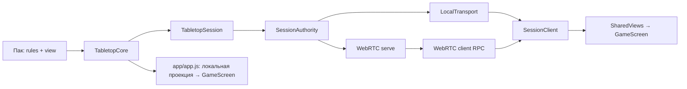
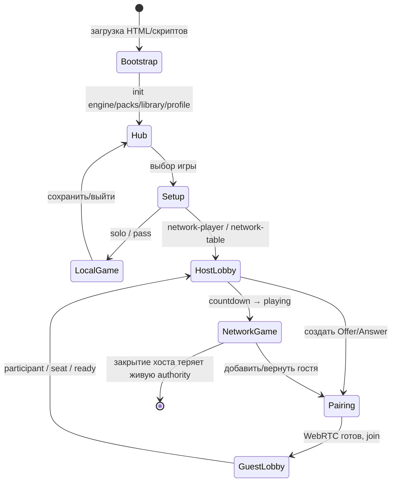

# Архитектура приложения и точка входа (RC6)

[← Индекс](DEVELOPER-INDEX.md) · [Интерфейс](DEVELOPER-UI.md) · [Игровой цикл](DEVELOPER-GAMEPLAY.md) · [Сеть](DEVELOPER-MULTIPLAYER.md) · [Данные и паки](DEVELOPER-DATA.md) · [Рабочий процесс](DEVELOPER-WORKFLOW.md)

**Исходное состояние:** `v0.15.0-rc.6`. Приложение — **одна офлайн-способная браузерная оболочка** с общим движком. Отдельные Node-серверы игрового процесса не запускаются. Полная сетевая `Session` создаётся и остаётся в браузере хоста, обмен осуществляется через WebRTC.

## 1. Точки входа и порядок загрузки

`index.html` содержит контейнеры `#app`, `#modal-root`, `#toast`, CSS и последовательность обычных `<script src=...>`. Нет module-loader/framework, импортов ES-модулей, централизованного dependency injection. Большинство файлов — IIFE, публикующие API на `globalThis` (часть имеет CommonJS export для Node-тестов).

**Порядок зависимостей (важен):**

1. `core/engine.js` → `TabletopCore` (`PlayroomEngine`), `audio.js`, `session.js`, `protocol.js`, `authority.js`, `core/ui.js`, `core/player-target.js`.
2. `app/views.js` → `PlayroomViews`; `core/packs.js` → `TabletopPacks`.
3. `installed-packs.js` (генерируемый, не коммитится) → `PlayroomInstalledPacks`; `app/pack-manager.js` создаёт `PlayroomPacks`, bootstraps игры.
4. `app/library.js` → `PlayroomLibrary`; `app/multiplayer.js` → `PlayroomMultiplayer`; `app/pairing.js` → `PlayroomPairing`; `app/pwa.js` → `PlayroomPWA`.
5. `app/vendor/qrcode.js` + `app/qr.js`; `app/vendor/jsqr.js` + `app/qr-scanner.js` → локальный QR без CDN; `app/vendor/ggwave.js` + `app/acoustic-pairing.js` → локальный звук.
6. `app/transports/webrtc.js`, `app/transports/local.js` → RPC на разных транспортных путях; `app/session-client.js` → клиентская модель снимков.
7. `core/motion.js` / `game-flow.js` / `hand-overflow.js`, `app/game-screen.js` / `game-feedback.js` / `shared-views.js` → общая отрисовка и эффекты.
8. `app/network-ui.js` подписывается на DOM/PWA и подготавливает сеть, используя ленивый `bridge()`. **Последний `app/app.js`** создаёт `PlayroomAppBridge`, запускает `render()` и начальный ввод профиля.

**Нельзя:** менять порядок скриптов, рассчитывая на автоматическое разрешение импортов; использовать `PlayroomAppBridge` в момент исполнения `network-ui.js` до инициализации `app/app.js`. Поэтому сетевой модуль обращается к нему через `bridge()`.

## 2. Структура репозитория

| Путь | Назначение | Граница изменений |
| --- | --- | --- |
| `core/engine.js` | Реестр версий паков, создание/валидация состояния, разрешённые действия, переходы, проекции | Не помещать сюда конкретные правила UNO |
| `core/session.js` | Авторитетное состояние/временная линия `states[]`, компактная сериализация и restore | Не смешивать с DOM/localStorage |
| `core/protocol.js` / `core/authority.js` | Envelope, receipts, борьба с повторами, привязанный `viewer` | Не доверять actor/viewer из сообщения |
| `core/input.js` / `ui.js` / `motion.js` / `game-flow.js` / `audio.js` | Жесты, компоненты, анимации, темп, звук | Общее для всех режимов и игр |
| `app/app.js` | Хаб/навигация/настройки/локальная игра/хостовая комната | Состояния локального UI |
| `app/network-ui.js` | Сетевые диалоги, pairing, лобби клиента/хоста, запуск сетевой игры, возврат | Не реализовывать внутри правила пака |
| `app/multiplayer.js` | `ProfileStore`, `ResumeStore`, `RoomService`, `SwitchableConnection` | Власть хоста над участниками и местами |
| `app/transports/*` | WebRTC RPC, локальный адаптер и вспомогательный MessagePort | `snapshot/dispatch/history/subscribe/close` |
| `app/shared-views.js` / `game-screen.js` | Авторизованная сетевыми снимками сцена / общий GameScreen | Отображать только разрешённое |
| `app/pairing.js` / `acoustic-pairing.js` / `qr-scanner.js` | PR2/PR3 и транспорт сигналов Offer/Answer | QR сам по себе не удостоверяет игрока |
| `app/library.js` / `core/packs.js` / `app/pack-manager.js` | Хранение локальных партий, установка паков, версии | Не стирать старые версии с зависимыми сохранениями |
| `build.py`, `sw.js`, `manifest.webmanifest` | Сборка HTML/PWA, offline cache/install, share-target | Проверять **итоговый** архив |

Полные контракты автора пака остаются в [PACKS](PACKS.md), [PACK-FORMAT](PACK-FORMAT.md); подробная версия этого архитектурного раздела для представлений — в [MULTIVIEW](MULTIVIEW.md).

## 3. Три исполнения игровых команд

- **Локальная партия `solo`/`pass`:** `app/app.js` владеет `session`, `localAuthority()` и `localClient(viewer)`. `act()` вызывает `PlayroomProtocol.command(...)`, `connection.dispatch(...)` и отрисовывает тот же `GameScreen`.
- **Хост сети:** `RoomService` управляет составом и готовностью; `network-ui.js:startHostGame` создаёт `new Session(...)` и `new SessionAuthority(session)`. Хост тоже использует `SessionClient(LocalTransport(authority.connect(hostViewer)))` через `SharedViews.mount`.
- **Удалённый игрок:** `RTCDataChannel` обслуживается `PlayroomWebRTCTransport.serve`. Клиентский `PlayroomWebRTCTransport.client` предоставляет тот же методный фасад, `SessionClient` хранит последний публично разрешённый snapshot.

**Сетевой transport не владеет правилами.** `SessionAuthority` вызывает `session.act(actor,action)`, а engine через реестр выбирает конкретную версию rules-пака.

## 4. Глобальные объекты и владение жизненным циклом

| Объект | Кто создаёт | Время жизни |
| --- | --- | --- |
| `TabletopCore`/`TabletopSession`/`SessionAuthority` | соответствующие `core/*.js` | API до закрытия страницы |
| `PlayroomPacks` | `app/pack-manager.js` | один менеджер в странице |
| `PlayroomAppBridge` | в конце `app/app.js` | ссылка на локальный room/профиль, методы UI |
| `PlayroomNetworkDebug` | `app/network-ui.js` | diagnostic getter, без секретов resumeToken |
| `RoomService` | один экземпляр в `app/app.js` | **только до закрытия браузера хоста** |
| `hostPeer` / `hostSwitch` / `connectedHostPeers[]` | замыкание `network-ui.js` | активное приглашение и сохранённые соединения |
| `clientPeer` / `clientTransport` / `clientGameClient` | замыкание `network-ui.js` | текущий клиентский RTC / сцена |
| `TabletopSession` локальной партии | `app/app.js` / `PlayroomLibrary` | возможно восстановить из локального сохранения |
| `TabletopSession` сетевой партии | `startHostGame` | в RC6 **не** пишется в durable host SessionStore |

Никаких центральных Redux/React-store или DOM-виртуализации нет: `app/app.js` и `network-ui.js` содержат собственное состояние в замыканиях, перерисовывая `#app`/`#modal-root`. Игровая правда хранится в `Session` и `RoomService`, DOM не служит источником истины.

## 5. Жизненный цикл

Гость и хост могут находиться на **разных экранах одновременно**. Детальная последовательность сетевого перехода и возвращения: [DEVELOPER-MULTIPLAYER](DEVELOPER-MULTIPLAYER.md).

## 6. Дистрибутивы и offline

`build.py` читает `index.html` и инлайнит локальные CSS/JS в автономный `playroom.html`, а при `--all-games` — в `playroom-all-games.html`. При `--pwa` формирует каталог и `playroom-pwa.zip` с `index.html` и статическими `app/`, `core/`, `icons/`. Имена и набор пака не жёстко зашиты в движок: сборка берёт источники из явно указанного `--packs-dir`.

`sw.js` кеширует оболочку и отрабатывает переходы/`pair`-ссылки; `app/pwa.js` обрабатывает share target, `web+playroom:` и `?pair=...`. При запуске автономного `file://`/`content://` доступность камеры/микрофона, Origin/хранилища и clipboard **браузерозависима**. Для сканирования QR достаточно системной фотографии; для приёма звука обычно требуется HTTPS/PWA и разрешение микрофона.

**Не путать:** offline pairing (QR/звук передают только сигнализацию) и отсутствие сети между устройствами — разные вещи. После QR нужен рабочий LAN UDP путь для WebRTC.

## 7. Где продолжать работу

- Для нового меню и реакции на DOM: [DEVELOPER-UI](DEVELOPER-UI.md).
- Для новых правил, бота и локальных сохранений: [DEVELOPER-GAMEPLAY](DEVELOPER-GAMEPLAY.md).
- Для безопасности возвращения/истории и LAN-01/03: [DEVELOPER-MULTIPLAYER](DEVELOPER-MULTIPLAYER.md) и [roadmap](PlayRoom_Roadmap_and_Agent_Handoff_2026-10-08.md).
- Для PR2/PR3, ggwave, QR и диагностики IP: [DEVELOPER-PAIRING](DEVELOPER-PAIRING.md).
- Перед изменением сборки/сервиса: [DEVELOPER-WORKFLOW](DEVELOPER-WORKFLOW.md).
