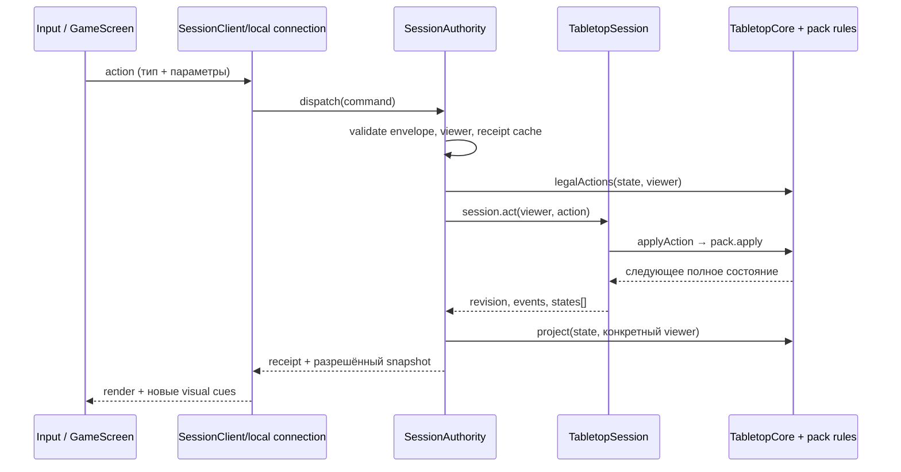

# Игровой цикл: правила, Session, боты, команды и история (RC6)

[← Индекс](DEVELOPER-INDEX.md) · [Архитектура](DEVELOPER-ARCHITECTURE.md) · [UI](DEVELOPER-UI.md) · [Сеть](DEVELOPER-MULTIPLAYER.md) · [Хранение](DEVELOPER-DATA.md) · [Контракт паков](PACKS.md)

Центральный принцип: **правила принадлежат версии игрового пака, полное состояние — `TabletopSession`, право на действие и проекции — `SessionAuthority`, визуальные эффекты — общим UI/Flow**. Сетевые модули не реализуют штрафы UNO или выбор действий бота.

## 1. Модули и публичные API

| Файл / global | Главные методы |
| --- | --- |
| `core/engine.js` → `TabletopCore` | `register/activatePack/get`, `createGame`, `validateState`, `legalActions`, `reactions`, `applyAction`, `project`, `botAction/botReaction`, `soundCues`, RNG/зоны |
| `core/session.js` → `TabletopSession` | `new Session(engine,game,options)`, `current`, `states`, `act`, `view`, `serialize`, `export`, `restore` |
| `core/protocol.js` → `PlayroomProtocol` | `command`, `validate`, `canonical`, `clone`, `freeze` |
| `core/authority.js` → `SessionAuthority` | `connect(viewer)`, `actBot`, `scheduleBot`, `dispose`, `revision` |
| `app/session-client.js` → `PlayroomSessionClient` | `accept`, `refresh`, `send`, `retry`, `history`, `subscribe`, `close` |
| `core/game-flow.js` → `PlayroomGameFlow` | `presets`, `speed`, `timing`, `eventAction`, `GameFlow` |
| `core/motion.js` → `PlayroomMotion` | `capture`, `play`, `cancel` |
| `app/game-screen.js` / `app/shared-views.js` | общая сцена / разрешённые сетевые проекции |

## 2. Реестр паков и алгоритм хода

Правила загруженного пака регистрируются через `TabletopCore.register`; для отдельно установленных версий `TabletopPacks.prepare/install/activate` связывает `id@version` с rules и view. Движок получает конкретную версию из `state.packVersion`, а **не** «самую новую» во время старой партии.

Нормальный путь одного действия:



`TabletopCore.createGame(game,options)` формирует начальный `GameState` и вызывает `pack.create(state,options)`; создаёт event о начале партии. `applyAction(state,actor,action)` сначала ищет соответствие в `legalActions` (в том числе `reactions`), увеличивает `move`, клонирует исходное состояние и вызывает `pack.apply`. Важное свойство — состояние для отдельного хода не редактируется через UI.

Некоторые ключи действия (`label`, `notify`, `confirmation`, `targetPrompt`) — UI-метаданные; при сравнении законности проверяются остальные поля. Новые типы команд **не** добавляются в network transport до появления поддержки в rules-паке и тестов.

## 3. Схема GameState версии 1

Базовая форма после `createGame` (значения для примера, содержимое `data` определяется только паком):

```json
{
  "version": 1,
  "game": "uno",
  "packVersion": "0.2.1",
  "packStateVersion": 1,
  "preset": "standard",
  "players": [
    {"name": "А", "bot": false, "score": 0},
    {"name": "Б", "bot": true, "score": 0}
  ],
  "turn": 0,
  "status": "playing",
  "winner": null,
  "move": 0,
  "rng": 123456,
  "openHands": false,
  "data": {},
  "events": []
}
```

**Это структура полей движка, не пример полной или гарантированно допустимой UNO-партии**: реальные `preset` и `data`/зоны должны соответствовать версии пака. Используйте `engine.validateState(state)` при входе из storage/доверенной сериализации. Запись `rng` и все закрытые карты **не** должны уходить клиентам.

`status` сейчас `playing` или `finished`, `winner` — индекс игрока либо `null`. `move` — авторитетная ревизия для `SessionAuthority`, и может увеличиваться при реакциях. `events[]` содержит последовательные `id`/`text`/`kind`, `player` и при необходимости `privateTo`, `publicText`, `sound`, `notice`. Правила конкретной игры добавляют свои поля в `data`; не перечисляйте их в общей оболочке без ссылки на rules-пак.

## 4. Проекция и скрытые руки

`TabletopCore.project(state,viewer)` делает независимую копию, удаляет `rng`, маскирует чужие `data.hands` (если `openHands` не позволяет просмотр), а `drawPile`/`stock` скрывает для всех. Скрытые events заменяются публичной подписью; затем **`pack.project` должен убрать другие собственные приватные поля**. Пак, вводящий закрытые данные, обязан отдельно покрыть этот путь тестами.

`SessionAuthority.connect(viewer)` создаётся **только организатором**: `viewer >= 0` — один определённый игрок; `viewer=-1` — read-only публичный стол. Возвращаемый facade содержит `snapshot,dispatch,history,subscribe,close` и закрепляет viewer в замыкании. Клиент не присылает viewer в `PlayroomProtocol.command`. Для чужого зрителя/бота `actions=[]`.

`SessionAuthority._snapshot(viewer,index)` возвращает ограниченный `ClientSnapshot`, включающий:

- `protocolVersion`, `kind='snapshot'|'history'`, `sessionId`, `authorityEpoch`, `revision`;
- `game`, `packVersion`, `viewer`, `audience`;
- `state` **после project** только с разрешёнными полями; `actions`, `events`, `historyLength`;
- `cues` и `effects` для live-снимков, не для пересмотра истории.

Нельзя переносить `Session.export()` или `Session.options/seed/rng` через RTCDataChannel вместо `_snapshot`.

## 5. Команда, receipt и дедупликация

Формат `PlayroomProtocol.command(snapshot,action,commandId)` версии 1:

```json
{
  "protocolVersion": 1,
  "sessionId": "SESSION_ID",
  "authorityEpoch": "AUTHORITY_EPOCH",
  "commandId": "UNIQUE_CLIENT_COMMAND_ID",
  "expectedRevision": 12,
  "action": {"type": "ACTION_FROM_LEGAL_ACTIONS"}
}
```

Это **структурный пример**, не реальная команда UNO. Валидация (`core/protocol.js`) запрещает посторонние поля, неверные ID/ревизии, превышение 16 KiB. `SessionAuthority._dispatch` проверяет аудиторию/эпоху/идентификаторы и cache receipts. Receipt содержит `ok`, `code`, `commandId`, `revision`, при доступе — свежий `snapshot`; повтор того же ID и содержимого возвращает уже принятый результат с `duplicate:true`, **без второго хода**. Тот же ID с другим содержимым → `ID_CONFLICT`; неверная ревизия → `STALE`.

`SessionClient.send(action)` создаёт один envelope, запоминает в `pending`, вызывает `retry()`; при потерянном ответе он повторяет **тот же commandId**, а не новый. Клиент применяет только снимок с неубывающей ревизией того же `sessionId/authorityEpoch` и viewer/версии игры.

**Граница RC6:** receipts живут в памяти `SessionAuthority` (лимит 20 000) и **не переживают перезапуск хоста**. Переподключение при живом хосте использует прежнюю authority, но ещё нет durable exactly-once журнала после host reboot. См. [network](DEVELOPER-MULTIPLAYER.md).

## 6. Боты

Бот — это **атрибут элемента `state.players[]`** (`bot:true`), а не сетевой клиент и не отдельный игрок сервера. В настройке `solo` `app/app.js:startFromForm` создаёт ботов на местах после первого игрока. В `pass` все люди локальные; в сетевой партии `startHostGame` собирает `players` с `bot:false`, поэтому автоматические боты в сетевом лобби RC6 **не создаются**.

- `TabletopCore.botAction(state,actor)` берёт легальные основные действия пакета и вызывает `pack.bot(state,actor,actions)`, если он задан; иначе выбирает первый допустимый ход.
- `TabletopCore.botReaction(state,actor)` обрабатывает реакции через `pack.botReaction` и повторно проверяет выбранное действие по списку разрешённых.
- `SessionAuthority.scheduleBot({delay,run,onError})` выбирает сначала действующую реакцию бота, затем обычного бота на `state.turn`. Вызывает `actBot` напрямую или переданный callback `run(actor,action)`.
- `app/app.js:scheduleBot` выбирает задержку из `GameFlow.pace().botDelay` и останавливает очередь при modal, replay, paused, hidden document, переходе анимации/завершении партии.
- `SessionAuthority.actBot` проверяет `bot:true` и применяет ход напрямую, публикуя обновлённые авторитетные проекции подписчикам.

Ботная «стратегия» конкретной игры находится **в другом репозитории** (rules-пак); движок отвечает за исполнение и разрешения. Новую логику бота нужно тестировать на паке, а тайминг — на общих тестах GameFlow.

## 7. Timeline и сохранения

`new TabletopSession(engine,game,options)` хранит `options` и `states[]` через private `WeakMap`. Вызов `act(actor,action)` добавляет новый immutable snapshot. В `current.events` остаётся полный live-журнал; старые snapshots сокращают локальную копию событий, чтобы сериализация не росла квадратично.

Сериализация:
- `session.export()` → внешний `{format:'playroom-session',version:1,game,packVersion,options,createdAt,updatedAt,states}` (plain).
- `session.serialize()` по умолчанию → JSON `format:'playroom-session',version:2,encoding:'interned-json-v1'` со `states`, `journal`, `nodes`; сохраняет историю в более компактном виде.
- `Session.restore(engine,saved)` принимает версию 1/2, разворачивает компактный кодек, проверяет историю, переходы и конкретную `packVersion`; **не перезапускает `pack.create()`**.
- `app/library.js` управляет `playroom.session.v1` и `playroom.paused.v1.<id>`, pinned версиями паков и предупреждениями отсутствующей версии. Подробно [Данные](DEVELOPER-DATA.md).

Для истории удалённого игрока вызывается `connection.history(index)` на **том же viewer**. `SessionClient.history` не получает общую приватную историю; `SharedViews` перестраивает read-only scene с проекцией.

## 8. UI / звуковые события и эффект хода

`core/game-flow.js:GameFlow` использует `instant/fast/normal/slow`, `quickPlay` и reduced-motion; `core/motion.js` анимирует DOM-компоненты по стабильным `data-entity`. `SessionAuthority.transfers(before,after)` формирует агрегированные эффекты transfer для добора, без раскрытия чужих карт. `app/game-feedback.js` и `core/audio.js` берут только **новые события разрешённой проекции**. Replay и первое подключение не должны повторно проигрывать старое уведомление или звук.

Для расширения логики см. [UI](DEVELOPER-UI.md), [MULTIVIEW](MULTIVIEW.md), [PACKS](PACKS.md), тесты `tests/authority.test.cjs`, `tests/session.test.cjs`, `tests/game-flow.test.cjs`, `tests/multiplayer-lobby.test.cjs`.

## 9. Шаблон диагностики хода

1. Проверьте точную `packVersion`, `state.turn`, `state.move`, `status` и `engine.legalActions` для нужного actor.
2. Если ход законен, но не виден: проверьте `project` пака, `authority._snapshot.actions` и UI `quickPlay/selected`.
3. Если виден, но не проходит: проверьте `PlayroomProtocol.validate`, `sessionId/authorityEpoch`, `expectedRevision`, `commandId`.
4. Если ход проходит только на хосте: проверьте `RTCDataChannel` RPC, `SessionClient.accept` и `SharedViews.mount`.
5. Если ошибка сохраняется после повторного подключения: не создавайте новую authority вслепую — используйте [диагностику reconnect](DEVELOPER-MULTIPLAYER.md).
