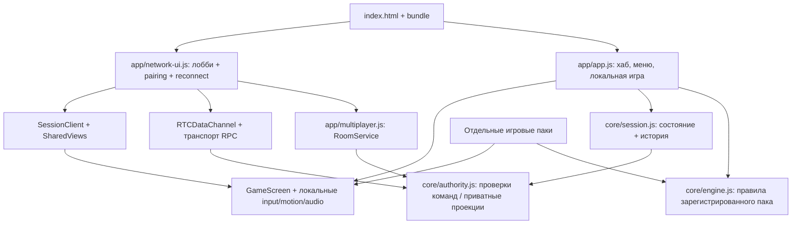

# PlayRoom «ХОД» — путеводитель по коду для разработчика (RC6)

> **LAN-01 (работа после RC6):** [хостовый IndexedDB SessionStore / стадия и границы восстановления](LAN-01-SESSION-STORE.md). В этом справочнике реализованная база RC6; незавершённый LAN-01 не считать выпущенной возможностью.

> **Срез:** опубликованный [`v0.15.0-rc.6`](https://github.com/GraphGiraffe/boardgame-playroom/releases/tag/v0.15.0-rc.6), release SHA `8fef7853e37f4f7de9163ab016a09ef36ff6373b`; функциональный код интеграционной `dev` — `afe8b9d701308824d3133177a67855419543f592`. На дату релиза код был включён в `dev` коммитом `afe8b9d...`; позднее в `dev` добавлены этот справочник и метаданные базового RC6 (версия приложения и PWA-cache). Релизный publisher workflow остаётся привязан к неизменяемому выпуску. Данный набор описывает **работающий код RC6**, а не целевую архитектуру из roadmap.
>
> **Область:** основное браузерное приложение `boardgame-playroom`; сами правила пяти игр находятся в отдельном `boardgame-playroom-paks`. Комментарии `[РЕАЛИЗОВАНО]` и `[НЕ РЕАЛИЗОВАНО]` означают проверенное наличие или отсутствие соответствующего пути в коде, а не обещание поведения на всех устройствах.

## С чего начать

| Что нужно понять или изменить | Точный документ | Основные файлы |
| --- | --- | --- |
| Загрузка HTML, зависимости, слои, жизненный цикл | [Архитектура и старт](DEVELOPER-ARCHITECTURE.md) | `index.html`, `app/app.js`, `core/*` |
| Главная, меню, создание партии, общий GameScreen, события UI | [Интерфейс и навигация](DEVELOPER-UI.md) | `app/app.js`, `app/game-screen.js`, `app/shared-views.js` |
| Правила, состояние, ходы, боты, проекции, история | [Игровой цикл](DEVELOPER-GAMEPLAY.md) | `core/engine.js`, `core/session.js`, `core/authority.js` |
| Room/Participant/Seat/Connection; WebRTC, приватные руки, возврат | [Сеть и возвращение игрока](DEVELOPER-MULTIPLAYER.md) | `app/multiplayer.js`, `app/network-ui.js`, `app/transports/webrtc.js` |
| Offer/Answer, PR2/PR3, QR, звук, IP, Android | [Сигнализация и QR](DEVELOPER-PAIRING.md) | `app/pairing.js`, `app/acoustic-pairing.js`, `app/qr-scanner.js` |
| Схемы хранения и паков; миграции/ограничения | [Данные, паки и сохранения](DEVELOPER-DATA.md) | `app/library.js`, `core/packs.js`, `app/pack-manager.js` |
| Где тестировать изменения, CI, релиз, диагностика | [Тестирование и работа с репозиторием](DEVELOPER-WORKFLOW.md) | `tests/*`, `scripts/codex/*`, `.github/workflows/*` |

Каждая глава содержит ссылки на соседние и на исходные файлы в корне проекта. **Первым делом изучайте актуальный код**, поскольку этот индекс описывает конкретный снимок RC6.

## Карта ответственности (сжатая)

`index.html` по порядку подключает браузерные UMD/IIFE-модули. `core/` не содержит правил отдельной игры. `app/` занимается оболочкой, вводом, сохранениями, UI и транспортными адаптерами. `boardgame-playroom-paks` поставляет исполняемые rules/view/assets выбранной версии игры.

**Главные границы доверия:** исходное полное состояние партии существует у хоста/локального исполнителя; удалённому игроку отправляется проекция `SessionAuthority.connect(viewer)`. `viewer` нельзя выбирать сообщением клиента. Публичный UUID профиля и QR приглашение **не** дают права получить чью-либо скрытую руку. Повторный вход проверяется отдельным секретом **после** установки WebRTC — см. [сеть](DEVELOPER-MULTIPLAYER.md).

## Четыре сценария, которые нужно различать

1. **`solo`** — один человек с ботами, локальная `Session`, пакетный `bot()/botReaction()`, авторитетные команды локально.
2. **`pass` / hot seat** — несколько людей на одном устройстве, локальная `Session`; передача телефона скрывает руку (`gate`), новый `viewer` определяется ходом.
3. **`network-player`** — браузер хоста хранит полную `Session`; клиенты после WebRTC видят только свой `viewer` через `SessionClient`, общий GameScreen.
4. **`network-table`** — хост отображает публичный стол с `viewer=-1`, удалённые игроки используют свои телефоны. Здесь `surface` (компоновка) и `viewer` (полномочие) принципиально различны.

Меню режима сетевой партии **не** означает новую `Session.options.mode`: при создании сетевой партии `app/network-ui.js:startHostGame` использует `mode:'solo'` и массив `players` с `bot:false`. Режим сети принадлежит оболочке/RoomService, а не API движка.

## Что на RC6 готово и что отложено

| Возможность | Статус в коде RC6 |
| --- | --- |
| Две страницы/два телефона, LAN P2P через WebRTC DataChannel, игровое лобби | Реализовано; ранее пройдена физическая партия |
| Компактный PR3 и старый PR2; QR, ссылка, Share, звуковая сигнализация | Реализовано |
| Встроенная камера-фото/галерея, локальный декодер QR без CDN | Реализовано; физическое тестирование именно встроенного сканера RC6 — отдельно |
| Возврат гостя на прежнее место **при живом хосте** через новый Offer/Answer | Реализовано; browser E2E |
| Защита повторного входа отдельным 256-битным токеном, ротация и отзыв старого lease | Реализовано |
| Долговечное сохранение **локальной** партии/истории в браузере | Реализовано |
| Долговечное сохранение **сетевой хостовой** партии/истории для host reboot | **Не реализовано** (LAN-01) |
| Бесшовный автоматический ICE restart/reconnect без повторного QR | **Не реализовано** (LAN-03) |
| Дедупликация принятых ходов после перезапуска хоста/смены authority epoch | **Не реализовано** |
| RoomHub/WAN-релей/облачная синхронизация | **Не реализовано**, отдельная продуктовая фаза |

## Куда обращаться при типичной проблеме

- Игрок не видит кнопку: [UI](DEVELOPER-UI.md) → `GameScreen`, `Input`, `SharedViews` → проверьте, выдаёт ли `engine.legalActions` разрешённое действие.
- Правило/штраф/бот: [игровой цикл](DEVELOPER-GAMEPLAY.md) → `TabletopCore` и **конкретный пак**, а не сетевой RPC.
- Двойной ход или неверная рука: [сеть](DEVELOPER-MULTIPLAYER.md) → `authority.connect(viewer)` и [игровой протокол](DEVELOPER-GAMEPLAY.md).
- PR2 вместо PR3, не видно IP/VPN: [pairing](DEVELOPER-PAIRING.md) → ICE-кандидаты и `Acoustic.pack`.
- Телефон не читает QR: [pairing](DEVELOPER-PAIRING.md) → `qr-scanner.js`, `BarcodeDetector` / `jsQR`; камера возвращает **фото**, не поток.
- Исчезла партия после смены файла/origin: [данные](DEVELOPER-DATA.md) → ключи браузерного хранилища и точная версия пака.
- Нужна новая версия приложения: [workflow](DEVELOPER-WORKFLOW.md) → PR в `dev`, два CI и отдельный immutable GitHub Pre-release.

## Уже существующие первичные документы

- [`ARCHITECTURE.md`](ARCHITECTURE.md) — ответственность app/core/pack.
- [`MULTIVIEW.md`](MULTIVIEW.md) — проекции, GameScreen, реакции, анимация, команды.
- [`PACKS.md`](PACKS.md) и [`PACK-FORMAT.md`](PACK-FORMAT.md) — полноценные интерфейсы для автора пака.
- [`ACOUSTIC-PAIRING.md`](ACOUSTIC-PAIRING.md) — акустический канал.
- [`QR-PAIRING-AND-RESUME.md`](QR-PAIRING-AND-RESUME.md) — требования RC6 и ручная приёмка.
- [`PlayRoom_Roadmap_and_Agent_Handoff_2026-10-08.md`](PlayRoom_Roadmap_and_Agent_Handoff_2026-10-08.md) — **план, не описание завершённой реализации**.
