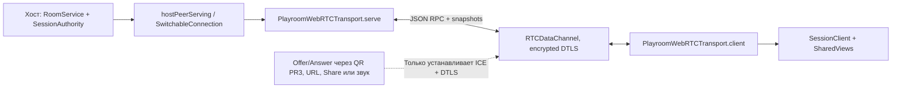
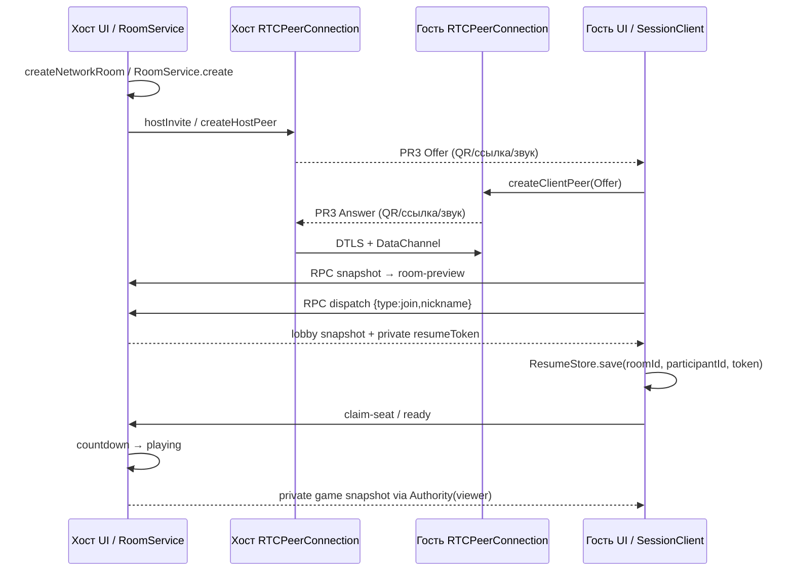
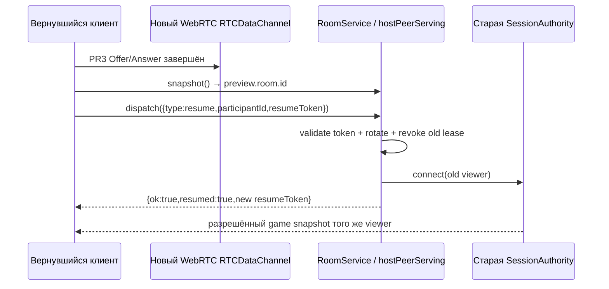

# Сетевая архитектура: Room, WebRTC, приватные руки и reconnect (RC6)

[← Индекс](DEVELOPER-INDEX.md) · [Архитектура](DEVELOPER-ARCHITECTURE.md) · [Игровой цикл](DEVELOPER-GAMEPLAY.md) · [Сигнализация PR3/QR](DEVELOPER-PAIRING.md) · [Данные](DEVELOPER-DATA.md)

**Модель RC6:** браузер хоста — единственный организатор комнаты и владелец `TabletopSession/SessionAuthority`; браузеры гостей — `SessionClient`, получающие разрешённые снимки по `RTCDataChannel`. Комнату не хранит облачный сервер. Публичный номер комнаты, QR и совпадающий никнейм **не удостоверяют возвращающегося игрока**.

После явного выхода хоста из лобби или незавершённого матча `PlayroomNetworkLibrary.leaveHostRoom(roomId)` освобождает authority/Web Lock, подписку комнаты, RTC и исходные lobby connections (включая их leases), затем удаляет комнату в памяти через `discardRecovery`. `SessionStore` и приватные права из сохранения не удаляются. Возврат завершённого матча в лобби сохраняет соединения до явного выхода; продолжение из «Моих партий» доступно после выхода без reload. Нельзя снимать защиту `continueHostArchive` от параллельной активной комнаты.

## 1. Сущности и связи

| Сущность | Код | ID / роль / время жизни |
| --- | --- | --- |
| Profile | `ProfileStore` в `app/multiplayer.js` | `profile.id` постоянный в рамках browser origin, `name` — имя по умолчанию; **не credential комнаты** |
| Room | `RoomService.rooms` (Map) | `room.id`, 4-значный `room.code`, `phase`, `game`, `rules`; живёт в памяти хоста |
| Participant | элемент `room.participants[]` | `participant.id`, `nickname`, `role`, `seatId`, `ready`, `connected`, `isHost` |
| Seat | элемент `room.seats[]` | `seat.id='seat-N'`, индекс, цвет, `participantId` |
| Connection | `RoomService.connection(roomId)` | привязанное RPC-соединение лобби, после join знает `participantId` |
| Lease | `connectionLeases` | одно актуальное соединение на `roomId:participantId`; старый lease не имеет права dispatch |
| Resume ticket | `resumeTokens` / `ResumeStore` | приватный случайный 256-битный токен; **не равен profileId** |
| WebRTC peer | `hostPeer`, `clientPeer`, `connectedHostPeers[]` | SDP Offer/Answer, `RTCPeerConnection` и `RTCDataChannel` |
| Session | `new TabletopSession` в `startHostGame` | полная игровая правда в памяти хоста |
| Authority/viewer | `SessionAuthority.connect(viewer)` | полномочия только выбранного игрока; `viewer=-1` публичный стол |

Участники лобби (`role='spectator'|'player'|'table'`) и состояния игрового пакета (`players[]` с `bot`, `turn` и `hands`) — **разные структуры**. Привязка между ними выполняется **один раз при старте**: `occupied = room.seats.filter(...).sort(index)`, индекс места в отсортированном списке становится `viewer`. Нельзя подменять этот индекс клиентской строкой `seatId` без проверки на хосте.

## 2. Контракт RoomService

`app/multiplayer.js:RoomService` — основной API управления лобби; источником истины служит `rooms` Map хоста:

- `create({name,game,host,hostMode,rules,constraints})` создаёт `Room`, участника-хоста и до 32 слотов. В режиме `hostMode='player'` хост занимает `seat-1`; в `table` хост не занимает место.
- `preview(roomId)` отдаёт ограниченную информацию для просмотра гостем **без массива participants**; `snapshot(roomId)` даёт копию состояния лобби (не путать с `SessionAuthority` game snapshot).
- `join(roomId,{id,nickname})` — новый guest только в `phase='lobby'`, стартует `spectator`, выдаёт `resumeToken` отдельно от `room`.
- `claimSeat`, `becomeSpectator`, `rename`, `setReady`, `updateRules` и `kick` управляют доступными изменениями лобби. Изменение правил снимает готовность у игроков.
- `canStart` проверяет допустимое число игроков, занятые места, `ready` и `connected`; `beginCountdown` → `phase='starting'`, `tick` через 3 секунды (из UI) → `phase='playing'`.
- `setConnected` обновляет флаг связи гостя и публикует событие; не создаёт нового участника.
- `connection(roomId)` предоставляет `snapshot,dispatch,history,subscribe,close` и связывает **конкретный** `participantId` с актуальным lease.
- `resume(roomId,{participantId,token})` доступен для старого участника при живой комнате, проверяет точное совпадение приватного токена, меняет токен, возвращает того же участника и сохраняет место.
- `SwitchableConnection.set(newFacade)` меняет подлежащий транспортированный facade с lobby на игровой `Authority.connect(viewer)`, не меняя физический RTC-канал.

### Структура Room (схематично)

```json
{
  "id": "ROOM_UUID",
  "code": "0123",
  "name": "Комната",
  "phase": "lobby",
  "revision": 5,
  "lobbyRevision": 3,
  "rulesRevision": 1,
  "ownerId": "HOST_PROFILE_ID",
  "hostMode": "player",
  "game": {"id": "uno", "name": "UNO", "version": "0.2.1"},
  "rules": {
    "preset": "example-preset",
    "presetLabel": "Набор правил",
    "openHands": false,
    "options": {},
    "display": []
  },
  "constraints": {"min": 2, "max": 4, "allowed": null},
  "participants": [
    {"id": "HOST_PROFILE_ID", "nickname": "Хост", "role": "player", "seatId": "seat-1", "ready": false, "connected": true, "isHost": true, "joinedAt": 0}
  ],
  "seats": [
    {"id": "seat-1", "index": 0, "color": {"value": "#587d5d", "label": "Зелёный"}, "participantId": "HOST_PROFILE_ID"}
  ],
  "events": [],
  "eventSequence": 1,
  "countdownEndsAt": null
}
```

Это **схема полей**, не валидный экспорт конкретного текущего лобби: временные метки, весь состав и набор допустимых правил зависят от создания комнаты и пака. В `Room` **нет `resumeToken`**, а `room.code` — метка UI, не номер WebRTC-сервера.

## 3. Слои сигнализации и RPC — не путать



Сигнализация PR3 содержит SDP/ICE/DTLS параметры, чтобы **создать** RTC-канал. Она не содержит команд игры, приватные руки или токены возвращения. Физически дальше используется WebRTC (`RTCPeerConnection`, `RTCDataChannel`); формат PR3 не является протоколом игровых действий. Подробнее [DEVELOPER-PAIRING](DEVELOPER-PAIRING.md).

`app/transports/webrtc.js`:
- `createHostPeer({configuration:{iceServers:[]},label:'playroom'})` создаёт `RTCPeerConnection`, ordered DataChannel, Offer и pairingId, ждёт окончания ICE gathering.
- `createClientPeer(offer)` устанавливает remote Offer, создаёт Answer, получает DataChannel через `datachannel` event; `waitOpen` ждёт `open`.
- `serve(channel,connection)` принимает `hello` → `transport-ready`, RPC-requests `snapshot/dispatch/history`; подписка facade пушит `{kind:'snapshot',snapshot}`.
- `client(channel)` ждёт handshake, выдаёт клиентский facade `snapshot,dispatch,history,subscribe,close`; запросы связаны через `requestId` и тайм-аут.

Формат транспортных сообщений JSON (пример **контрактных форм**, поля результата зависят от метода):

```json
{"kind":"hello","version":1}
{"kind":"transport-ready","version":1}
{"kind":"request","requestId":1,"method":"snapshot"}
{"kind":"request","requestId":2,"method":"dispatch","value":{"type":"join","nickname":"Гость"}}
{"kind":"response","requestId":2,"result":{"ok":true,"snapshot":{"kind":"lobby"}}}
{"kind":"snapshot","snapshot":{"kind":"lobby"}}
```

Здесь `snapshot` с `kind='room-preview'|'lobby'` выдаётся **RoomService**, а `kind='snapshot'|'history'` c `protocolVersion:1` — **SessionAuthority**. Не путайте обе «snapshot»-формы. `response` на JOIN содержит **дополнительный** `resumeToken`; его нельзя перенаправлять в broadcast/snapshots. При ошибке `serve` возвращает общий текст (`Запрос не выполнен.`), точная причина остаётся на стороне хоста.

## 4. Создание комнаты и вход нового игрока



Пути реализации: `app/app.js:createNetworkRoom` → `RoomService.create` → `network-ui.js:ensureHostSubscription,hostInvite,acceptAnswerSignal,createClientAnswer,joinRoom,startHostGame/startClientGame`.

При `phase='playing'` `network-ui.js:startHostGame` создаёт `Session` и `SessionAuthority` на хосте; каждому подключённому игроку делает `SwitchableConnection.set(hostAuthority.connect(viewer))`. Хост отображает собственную разрешённую проекцию через `LocalTransport`/`SessionClient`. Гость рисует через `SharedViews` и **не получает full Session/export/seed**.

## 5. Возврат на прежнее место в RC6

Это **ручное повторное QR/PR3-сопряжение** (пока нет бесшовного ICE restart), но с автоматическим восстановлением идентичности уже внутри нового RTC-канала.

1. `RoomService.join` создаёт 32 random bytes через `crypto.getRandomValues` → 64 hex символа, сохраняет в **приватном** `resumeTokens` Map на хосте и возвращает в **индивидуальном RPC response** (`result.resumeToken`).
2. Гость `app/network-ui.js:joinRoom` записывает `{version:1,roomId,participantId,token}` через `ResumeStore` под `playroom.network-resume.v1.<roomId>` в `localStorage` (в памяти есть fallback; при невозможности записи UI предупреждает).
3. После разрыва `showDisconnectBanner` предлагает «Повторно подключиться через QR». Хост может нажать «Подключить / вернуть игрока» во время игры. Новый Offer/Answer не содержит credential.
4. После `clientTransport.snapshot()` (`room-preview`) новый клиент проверяет `resumeStore.load(preview.room.id)` и посылает `dispatch({type:'resume',participantId,resumeToken})` **только через открытый RTCDataChannel**.
5. Хостовая `RoomService.resume` проверяет, что игрок не хост, комната не закрыта, секрет валиден и принадлежит данному `roomId:participantId`, а при `playing` у гостя есть игровое место. Затем помечает участника connected и **ротирует секрет**; ответ содержит новый токен.
6. `hostPeerServing` закрывает прежние соединения гостя; если партия уже запущена, вычисляет прежний viewer по занятым местам и делает `switchable.set(hostAuthority.connect(viewer))`. Новый `SessionClient` получает **актуальную разрешённую проекцию** прежней руки.
7. `RoomService.connectionLeases` отклоняет dispatch старого канала, а его запоздалый `close()` не помечает восстановившегося игрока offline. Гость сохраняет новый токен поверх прежнего.



**Безопасность:** `Profile.id`, никнейм, IP, `room.code` и QR не служат секретами. Токен — **bearer capability**; пользователь другого устройства без сохранённого токена **не может** восстановить приватную руку. Однако вредоносный код в том же browser origin может читать localStorage; браузерная локальная изоляция не эквивалентна аппаратному хранилищу.

**Границы:** если браузер/`content://` меняет origin или не сохраняет localStorage, токен может пропасть. После перезапуска хоста исчезнут и `RoomService`, и `SessionAuthority`, и приватные токены — их сейчас **не восстанавливает** никакое durable хранилище. Пауза/восстановление старой authority epoch и точно-однократные ACK между перезапусками — будущие LAN-01/03, см. [roadmap](PlayRoom_Roadmap_and_Agent_Handoff_2026-10-08.md).

## 6. Ошибки, состояние связи и отладка

- `PlayroomNetworkDebug()` показывает `host.roomId/connectedPeers/channel/rpc` и `client.channel/ice/participantId/hasResumeToken/rpc`; **не возвращает секрет**.
- `RTCPeerConnection.connectionState`/`iceConnectionState` — диагностика конкретного канала; `disconnected` может быть временным, `failed` не исправляется заменой UI.
- `SharedViews.setConnected(false)` **умеет** выключать UI-действия, анимации и звук, но в **RC6** обработчик `RTCPeerConnection.connectionstatechange` в `network-ui.js` **не вызывает его напрямую**: он устанавливает `reconnectStatus` и добавляет баннер через `showDisconnectBanner()`. При развитии автоматического reconnect нужно явно синхронизировать это состояние с `clientMount.setConnected(false/true)`, а не считать блокировку уже подключённой. Даже при показе старого снимка источник истины остаётся у хоста.
- QR не устанавливает WebRTC, если выбранный IP/UDP-порт недостижим из-за VPN, firewall или изоляции клиентов Wi-Fi.
- `sessionId`/`authorityEpoch` из [игрового протокола](DEVELOPER-GAMEPLAY.md) и `pairingId` из [PR3](DEVELOPER-PAIRING.md) — **разные** идентификаторы.
- Полная сетевая Session сейчас не сохраняется через `app/library.js`. UI «Мои партии» относится к локальным `solo/pass`, а не к восстановлению хоста после перезапуска.

## 7. Как безопасно развивать LAN

1. Никогда не принимайте `participantId/viewer/seatId` из RPC как безусловную истину; сверяйте host room и приватный credential.
2. Для spectator отдельно проектируйте `viewer=-1` и пустые `actions`.
3. Любая новая команда game проходит [`PlayroomProtocol` + `SessionAuthority`](DEVELOPER-GAMEPLAY.md), не напрямую `Session.act()` из клиента.
4. При изменениях возврата прогоняйте `tests/network-resume.test.cjs`, `tests/network-reconnect-browser.test.cjs`, `tests/network-same-origin.test.cjs` и реальные два устройства.
5. Для durable host recovery сначала спроектируйте LAN-01: сериализация **хостовой** Session и receipts, packVersion, epoch, запрет второго authority; не делайте вид, что текущий `ResumeStore` решает эту задачу.

## LAN-01 — не выпущенный блок после RC6

В отдельной feature-ветке предусмотрены `Session.prepare/commitPrepared`, `NetworkSessionStore` и async `dispatch` WebRTC: успешный ход фиксируется с receipt до изменения live Session и рассылки. Архив после reload читается, но сеть/идентичности участников не возобновляются до LAN-03/04. Приватные снимки остаются только у авторитетного браузера. [ADR и стоп-условия](LAN-01-SESSION-STORE.md).
