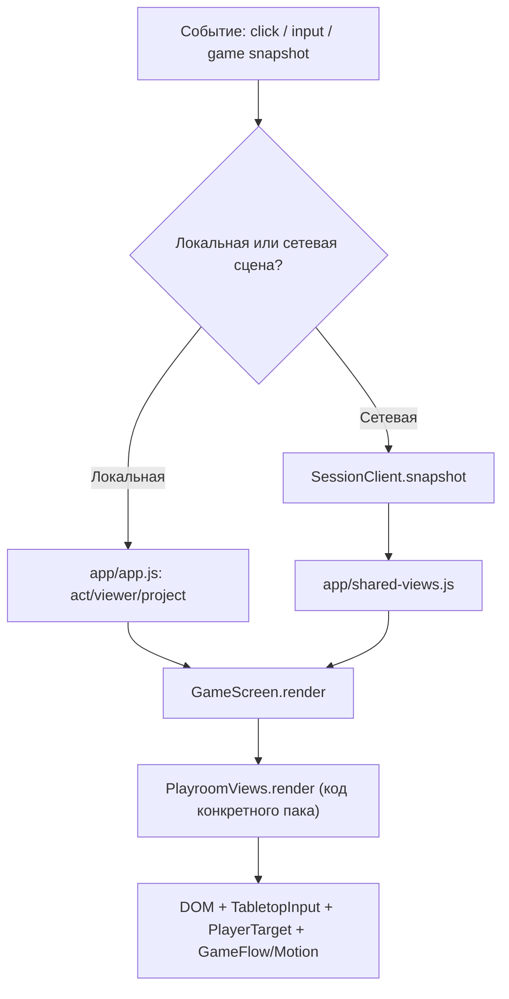

# Интерфейс, меню, события DOM и рендеринг (RC6)

[← Индекс](DEVELOPER-INDEX.md) · [Архитектура](DEVELOPER-ARCHITECTURE.md) · [Игровой цикл](DEVELOPER-GAMEPLAY.md) · [Сеть](DEVELOPER-MULTIPLAYER.md) · [Pairing](DEVELOPER-PAIRING.md)

В PlayRoom нет роутера/React-компонентов: `app/app.js` рендерит HTML-строки в `#app`, а `app/network-ui.js` добавляет/заменяет сетевые экраны. Обработчики **делегированы** на `document`, чтобы переживать перерисовку DOM.

## 1. Дерево экранов и меню

```text
index.html
├─ #app
│  ├─ Hub (`screen='hub'`)
│  │  ├─ Sidebar: «Все игры» / «Мои партии» / «Как играть»
│  │  ├─ Header: «Паки игр» / настройки / полный экран
│  │  ├─ Категории: все / cards / board
│  │  ├─ Карточки игр → setup(gameId)
│  │  ├─ Баннер последней локальной партии → resumeSession()
│  │  └─ [NetworkUI добавляет «Присоединиться к комнате»]
│  ├─ HostLobby (`screen='lobby'`)
│  │  ├─ Игровые места, участники и зрители
│  │  ├─ Выбранные правила / редактирование правил (хост)
│  │  ├─ Изменить ник / готовность / начать через 3 секунды
│  │  └─ [NetworkUI добавляет «Подключить устройство»]
│  ├─ Local Game (`screen='table'`) → GameScreen
│  └─ Network Game → SharedViews.mount() → тот же GameScreen
│     └─ [хост: «Подключить / вернуть игрока»]
├─ #modal-root
│  ├─ «Как вас называть?» / форма настройки новой партии
│  ├─ Профиль/параметры игры/правила/подсказки/пауза/результат
│  ├─ Пак-менеджер, подтверждение удаления
│  ├─ Network: приглашение хоста и PR3 QR
│  ├─ Network: «Присоединиться» / камера / поле ввода
│  ├─ Network: «Ответ для хоста» и QR Answer
│  └─ Network: preview комнаты / окно входа
└─ #toast: короткие сообщения об ошибках и событиях
```

Разные устройства **не обязаны одновременно показывать один и тот же экран**: хост может видеть `HostLobby`/игру, а гость — диалог QR/своё лобби.

## 2. Где хранится UI-состояние

`app/app.js`:

| Поля в замыкании | Назначение |
| --- | --- |
| `screen` = `hub` / `lobby` / `table`, `hubTab` = `games` / `sessions`, `filter` | Навигация хоста/локального пользователя |
| `session`, `sessionId`, `viewer`, `authority`, `localClients` | Локальная партия и её полномочия |
| `room`, `lobbyParticipantId`, `lobbyTimer`, `lobbyCountdown` | Хостовая комната/лобби |
| `settings` (`sound`, `volume`, `animationSpeed`, `quickPlay`) | Настройки устройства, ключ `playroom.settings.v1` |
| `historyOpen`, `replayIndex`, `replayTimer`, `paused`, `gate`, `awaitingPass` | Просмотр истории, пауза, скрытие руки hot seat |
| `selected`, `input`, `playerTargets`, `transition`, `feedback` | UI выбора/жестов, эффекты и события |

`app/network-ui.js` дополнительно хранит `hostPeer`, `clientPeer`, `clientRoom`, `connectedHostPeers[]`, `resumeStore`, состояния QR, звука и диагностики IP. Подробно: [Сеть](DEVELOPER-MULTIPLAYER.md).

**Истина игры** — `Session.current` на хосте, а не `selected`/DOM. Для удалённого клиента истина отображения — проверенный `SessionClient.snapshot`, не локальный полный `Session`.

## 3. Рендеринг и общие представления

- `app/app.js:render()` выбирает `renderHub()`, `renderLobby()` или `renderTable()`.
- `renderHub()` вызывает `latestPacks()`, читает метаданные `TabletopCore.GAMES` / `PlayroomCatalog`, строит карточки, фильтры и локальную библиотеку `savedGamesMarkup()`.
- `renderTable()` вызывает `E.project(state,shownViewer)`, вычисляет `activeActions` и передаёт всё в `PlayroomGameScreen.render({...})`. Конкретная игровая сцена приходит из `PlayroomViews.render(projected,viewer,actions,{selected,flipped,quickPlay})`.
- `app/network-ui.js:startHostGame` / `startClientGame` создают `SessionClient` и `SharedViews.mount(...)`. `app/shared-views.js` сам вызывает тот же `GameScreen.render` и renderer экспортированного view-пака. **Не создавать отдельную HTML-сцену специально для сети.**
- `app/game-screen.js` — общий каркас: шапка, панель игроков, стол, игровые кнопки, история, footer, результат; `core/ui.js` даёт общие элементы руки и интерфейса, `core/hand-overflow.js` следит за скрытым краем скроллируемых карт.
- `app/shared-views.js` монтирует input, target-selection, feedback, историю/анимацию. `setConnected(false)` выключает взаимодействие и прекращает эффекты. Подробнее: [MULTIVIEW](MULTIVIEW.md).



## 4. DOM-события и команды

`app/app.js` создаёт `commands` — таблицу обработчиков `data-command`. Основные группы:

| Атрибут / event | Обработчик | Эффект |
| --- | --- | --- |
| `data-start="uno"` | `setup(id)` | Диалог выбора режима и правил |
| `#setup-form` submit | `startFromForm` | `Session` для local или `createNetworkRoom` |
| `data-command="home"`/`"sessions"` | `leaveTable` | Навигация, сохранение локальной партии |
| `data-command="packs"` | `packUI.open` | Менеджер паков |
| `data-command="settings"` | `showSettings` | Поля профиля/звука/темпа |
| `data-command="history"`/`replay-*` | `openHistory`/`startReplay` | Read-only просмотр временной линии |
| `data-command="pause"`/`result` | `paused`/`showResult` | Пауза/финальный экран локальной партии |
| `data-lobby-seat`/`lobby-ready`/`lobby-start` | `RoomService` через UI | Места, готовность, countdown |
| `data-action` / drag/touch | `TabletopInput.attach` | Контекст действия, `act()` только при наличии разрешения |
| `data-accuse-player` | `PlayroomPlayerTarget` | Подсветка цели, подтверждение действия |
| `data-net-qr-camera` / `data-net-qr-gallery` | `scanControls` + `readPairingQR` | File chooser Android, потом Offer/Answer |

В `app/network-ui.js` есть **отдельные** capture-слушатели click/change/submit: они маршрутизируют сетевые действия до локального `app/app.js`. Сетевые элементы обычно имеют `data-net-*` или `net-*`. В `app/app.js` click handler пропускает элементы внутри `.network-game,.shared-modal-backdrop`, чтобы не было двойного исполнения.

**Правило модификации:** при добавлении UI-кнопки сохраняйте делегирование, поскольку DOM целиком перерисовывается; не прикрепляйте жизненно важную логику к конкретному удаляемому узлу без повторной регистрации.

## 5. Форма старта и режимы

`setup(gameId)` читает метаданные и параметры из пака:

- Radio `name=mode`: `solo`, `pass`, `network-player`, `network-table`.
- `players` и `name0...` — только local; для solo игроки с индексом 1+ имеют `bot:true` и readonly имена.
- В сети отображаются `roomName`/`networkNickname`, состав по `constraints`/слотам, без автоматических ботов.
- `preset` / `option-<key>` читаются из `PlayroomCatalog[gameId].settings`, `openHands` — только при `capabilities.hands`.
- `roomRulesFromForm` создаёт объект `{preset,presetLabel,openHands,options,display}`; `display` — подписи для лобби, **не** новые игровые правила.

`startFromForm` для local вызывает `new Session(TabletopCore,game,{players,mode,...})` и сохраняет в `PlayroomLibrary`. Для network — `createNetworkRoom()` (проверяет `V.supports(game,'table'/'player')`), затем `RoomService.create` и `renderLobby`. Переход из лобби к игре производится по `RoomService.tick()` и сетевой подписке `ensureHostSubscription()`.

## 6. Настройки, анимации и звук

- `settings` хранится под `playroom.settings.v1`. Изменения полей обновляют `TabletopAudio`, `animationSpeed` и `quickPlay`, затем рассылают DOM-событие `playroom:game-options`.
- `core/game-flow.js` задаёт пресеты `instant/fast/normal/slow`, задержки, `quickPlay` и учёт `prefers-reduced-motion`. Не поддерживайте отдельную таблицу скоростей для WebRTC.
- `core/motion.js`: `capture` текущих DOM-компонентов, `play` перехода, `cancel`; устойчивые маркеры `data-entity`, `data-motion-table`, `data-motion-stock` и т.д. описаны в [PACKS](PACKS.md).
- `app/game-feedback.js` воспроизводит новые объявления и cues только от разрешённых событий. Не запускать старые события при reconnect/повторном ACK/просмотре истории.
- `core/audio.js` = `TabletopAudio` с unlock после пользовательского жеста; игровой звук **отделён** от акустического ggwave pairing.
- Локальное `app/app.js:scheduleBot` использует задержку `pace().botDelay`, и не запускает бота во время modal/replay/paused/document.hidden.

Подробнее о проверке законности и ботов: [Игровой цикл](DEVELOPER-GAMEPLAY.md).

## 7. Модальные окна, доступность, touch

`openModal(content)` записывает в `#modal-root`, устанавливает `aria-modal` и `#app.inert=true`, сохраняет текущий фокус; `closeModal` его восстанавливает и отправляет `playroom:game-options`. Есть обработчик Escape, trap Tab/Shift+Tab, fullscreen API с fallback, горизонтальный скролл руки, drag/touch/swipe и индикаторы overflow.

**После RC9 — прокрутка:** общие правила в `app/styles.css` блокируют overflow корневой страницы, пока `#modal-root` содержит окно или `#app` содержит `.handoff` / `.lobby-countdown`. Это дополняет `inert`: сам диалог сохраняет `overflow:auto`, а overscroll окна/подложки не передаётся фону. Состояние определяется DOM через `:has()`, поэтому закрытие, замена владельца и уничтожение shared mount не требуют отдельных счётчиков или обработчиков touchmove и не оставляют блокировку. `tests/ui.test.cjs` проверяет реальные touch/wheel жесты в пак-менеджере, настройках, помощи, setup/rules, pairing, shared rules/result, передаче хода и отсчёте комнаты; короткое окно и оба края длинного списка, разблокировку после close/destroy.

**RC9 / RC8-UX-01:** shared mount хранит ссылку на собственный диалог. `close()` и `destroy()` удаляют именно этот узел и снимают `#app.inert`, если modal-root пуст. Уничтожение игрового экрана при возврате гостя или хоста в лобби больше не оставляет результат без обработчиков. Диалог другого экрана, заменивший старый узел, не удаляется. Проверка: `tests/network-main-app.test.cjs`, две последовательные смены матча через прежний RTC.

**RC9 / RC8-UX-02:** сетевой и архивный viewer обновляет разрешённый кадр на `input`, объединяя быстрые события через `requestAnimationFrame`; `change` отменяет ожидающий запрос кадра и запрашивает точную финальную позицию. `historyRequested` отличает выбранную позицию от показанной `historyIndex`. Ticket отбрасывает старые ответы/ошибки, проверяются viewer/session/epoch/revision. При рендере истории обновляются содержимое сцены, игроки, подписи и кнопки, а range и контейнер управления остаются теми же DOM-узлами. Это сохраняет native drag и фокус. Звуки и игровые команды при просмотре выключены. `closeHistory()`/`destroy()` отменяют ожидающий animation frame. Проверка: `tests/unified-game-screen-browser.test.cjs` (touch 320 px, mouse 390 px, архив 740×390), `network-host-recovery-browser` и `mobile-navigation`.

На `visibilitychange` локальная игра останавливает анимации/ботов и позже может показать уведомление о пропущенных ходах; это **не** системное reconnect-событие. В сетевой игре отслеживание `connectionstatechange` и баннер относятся к `network-ui.js`. **В RC6 баннер не вызывает `SharedViews.setConnected(false)` автоматически**; метод есть, но для последующего полноценного UI-lock/reconnect потребуется дополнительная привязка.

**Технические долги среза RC6:** в `showHelp()` сохранилась историческая фраза о «будущих сетевых комнатах» — не принимать её за техническое состояние. Другой долг — ручное копирование может потребоваться в `content://` при отказе `navigator.clipboard.writeText`. Ни один из них не означает отсутствие рабочих WebRTC/QR.

## 8. Куда добавлять новую функцию

- Новая экранная карточка/фильтр/настройка → `app/app.js` + `app/styles.css` и тест UI.
- Новый вид действия/жест → `core/input.js` / `core/player-target.js`; игровая законность → конкретный rules-пак.
- Новое событие, результат или оформление карточек → `app/game-screen.js`, `app/shared-views.js` и renderer пака.
- Новое действие сети или QR → `app/network-ui.js`; кодирование сигнала → [Pairing](DEVELOPER-PAIRING.md).
- История/дедупликация/новая проекция → `core/session.js`, `core/authority.js` и [игровой цикл](DEVELOPER-GAMEPLAY.md).

**Тестирование:** [DEVELOPER-WORKFLOW.md](DEVELOPER-WORKFLOW.md); критически важны `tests/network-main-app.test.cjs`, `tests/network-same-origin.test.cjs`, `tests/network-reconnect-browser.test.cjs` и `tests/game-screen.test.cjs`.
