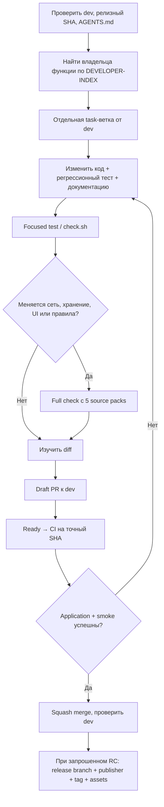

# Разработка, тестирование, диагностика и выпуск версий (RC6)

[← Индекс](DEVELOPER-INDEX.md) · [Архитектура](DEVELOPER-ARCHITECTURE.md) · [UI](DEVELOPER-UI.md) · [Игровой цикл](DEVELOPER-GAMEPLAY.md) · [Сеть](DEVELOPER-MULTIPLAYER.md) · [Pairing](DEVELOPER-PAIRING.md) · [Данные](DEVELOPER-DATA.md)

**Базовый срез:** `v0.15.0-rc.6` release SHA `8fef7853e37f4f7de9163ab016a09ef36ff6373b`. Функциональный интеграционный коммит `dev` — `afe8b9d701308824d3133177a67855419543f592`. Публикация произошла через проверенный `release/publish-v0.15.0-rc.6`, код игры/QR/reconnect уже был в `dev`. После релиза `dev` дополнен технической документацией и синхронизирован с версиями/кэшем RC6. Для дальнейшей разработки опирайтесь на актуальный `dev`, не на старую feature-ветку и не на релизную сборочную ветку.

## 1. Репозитории и ветки

- [`GraphGiraffe/boardgame-playroom`](https://github.com/GraphGiraffe/boardgame-playroom) — приложение, `core`, UI, хранилище, браузерный WebRTC, тесты и сборщик.
- [`GraphGiraffe/boardgame-playroom-paks`](https://github.com/GraphGiraffe/boardgame-playroom-paks) — исходники и независимые версии игровых паков.
- `main` — стабильный код, **не** следует считать его равным последнему pre-release.
- `dev` — интеграционная ветка для доработок.
- Обычная задача: `feature/*` / `fix/*` / `docs/*` от `dev` → PR к `dev` → проверки на точном head SHA → squash merge.
- Новый RC: только после проверки интегрированного кода, **отдельная релизная ветка и GitHub Pre-release с новым тегом**. Уже опубликованный тег/пак/активы не перезаписывать. Stable релиз выполняется отдельно по `CONTRIBUTING.md` и release skill.

Полный перечень проверок самого RC6 сохранён также в [RC6-TEST.md](RC6-TEST.md). Исходный release-tag остаётся неизменяемым; workflow публикации RC6 не переносится в обычный цикл разработки новых версий.

## 2. Подготовка локального окружения

Точный набор команд/зависимостей определяют [AGENTS](../AGENTS.md), [CONTRIBUTING](../CONTRIBUTING.md) и `scripts/codex/*.sh`.

```bash
git clone https://github.com/GraphGiraffe/boardgame-playroom.git playroom
git clone https://github.com/GraphGiraffe/boardgame-playroom-paks.git playroom-paks
cd playroom
git switch dev
bash scripts/codex/setup.sh --packs-dir ../playroom-paks/packs
bash scripts/codex/check.sh
bash scripts/codex/check.sh --full --packs-dir ../playroom-paks/packs
bash scripts/codex/serve.sh
```

Установленный Node/Chromium должен соответствовать `.nvmrc`, `scripts/codex/browser.cjs` и локальным зависимостям. Система `setup.sh` не устанавливает системные зависимости без явного `--install-system-deps`. `--packs-dir` указывает на **каталог с исходниками пака**, а не просто JSON чужого релиза, если нужен полноценный совместный прогон.

Без второго репозитория `bash scripts/codex/check.sh` выполняет автономную проверку приложения; она **не заменяет** полный тест пяти паков.

## 3. Разработческие проверки и что они покрывают

| Проверка | Команда / файл | Что искать |
| --- | --- | --- |
| Полная независимая проверка | `bash scripts/codex/check.sh` | Node syntax, Bash, Python, сборка, `npm run test:app` |
| Все 5 паков и UI | `bash scripts/codex/check.sh --full --packs-dir PATH` | Связка паков+app, браузерный UX, сериализация |
| Unit rules/session/receipts | `tests/session.test.cjs`, `tests/authority.test.cjs`, `tests/engine.test.cjs` | Иммутабельность, действие, события, проекции, receipts |
| Room/identity/seat/reconnect | `tests/multiplayer-lobby.test.cjs`, `tests/network-resume.test.cjs` | Участники, запрет takeover, ротация токена |
| WebRTC transport | `tests/webrtc-browser.test.cjs`, `tests/webrtc-transport.test.cjs` | Реальный DataChannel, handshake/RPC |
| Compact PR3 и звук | `tests/pairing.test.cjs`, `tests/acoustic-pairing.test.cjs`, `tests/acoustic-webrtc-browser.test.cjs` | Кодек, SDP, legacy PR2, real Chromium RTC |
| QR сканер из фото | `tests/qr-pairing-browser.test.cjs` | Реальная PNG-матрица QR/PR3, локальный jsQR без BarcodeDetector |
| Сквозная сеть и игра | `tests/network-main-app.test.cjs`, `tests/network-same-origin.test.cjs` | Два браузера, UI, лобби, скрытые руки, ход UNO |
| Возврат посреди UNO | `tests/network-reconnect-browser.test.cjs` | Перезагрузка гостя → **фотографии** обоих PR3 QR → прежний viewer/seat и новый секрет |
| GameScreen/Motion/Touch | `tests/game-screen.test.cjs`, `tests/game-flow.test.cjs`, `tests/hand-overflow.test.cjs`, drag/compact тесты | Анимация, быстрый ход, overflow, портрет/landscape |
| История, восстановление, пак | `tests/recovery-warning.test.cjs`, `tests/packs-reconcile.test.cjs`, `tests/pwa.test.cjs` | Не портить старые saves и pack-version |

Изменение API, истории, UI или сетевого пути требует не только одной unit-проверки, но и хотя бы релевантного браузерного теста. При новом снимке `SessionAuthority` всегда проверяйте, что клиенту не выдана чужая рука.

## 4. Штатные GitHub Actions в `dev`

- `.github/workflows/ci.yml` — **Application checks**. Событие `pull_request` типа `ready_for_review` для `dev/main` (и `workflow_dispatch`). Сборка независимого приложения через `check.sh`.
- `.github/workflows/multiplayer-smoke.yml` — **Multiplayer preview smoke**. Событие `pull_request:ready_for_review` в `dev`. Восстанавливает закреплённые источники паков, запускает legacy layout gate, **Two-device release gate** и собирает/проверяет автономный HTML + PWA, включая QR vendor.
- `.github/workflows/integration.yml` — отдельная интеграция с паками (смотреть триггеры перед ручным запуском).
- Релизная ветка `release/publish-v0.15.0-rc.6` содержит собственный `.github/workflows/rc6-publish.yml`; именно он проверил tagged immutable release и загрузил артефакты.

**Процедура:** создавайте PR сначала как Draft, затем один раз переводите в Ready **после** основной работы. Оба статуса должны быть `success` на **точном финальном SHA**, нельзя считать предыдущую успешную сборку актуальной после нового коммита. Не отключайте неуспешные проверки «для релиза», разбирайте первый упавший test/stack trace.

Особая ловушка тестовой среды: `scripts/codex/browser.cjs` умеет **подставлять `playroom.player-profile.v1` автоматически**. Если тест ожидает появление диалога «Как вас называть?», создавайте context с `playroomProfile:false`. Иначе тест может беспричинно ждать несуществующее поле.

**Вторая ловушка Chromium:** сохранность `localStorage` между перезагрузками `file://` зависит от политики браузера. Для тестов долгоживущих сохранений (например, `tests/recovery-warning.test.cjs`) используйте имеющийся `tests/browser-origin.cjs:serveBrowserFixture(root)` и проверяйте фактическую запись **после** reload. Это не ослабляет тест восстановления: он должен увидеть повреждённое сохранение, предупредить о нём и удалить только по явному действию пользователя. Итоговый самостоятельный HTML по `file://` продолжайте проверять отдельными smoke-тестами сборки.

## 5. Схема действий для нового модуля



Проверяйте заголовки существующих документов, но **не превращайте roadmap в отчёт о реализованном функционале**. При любом изменении публичного API обновляйте контракты [PACKS](PACKS.md), [MULTIVIEW](MULTIVIEW.md), [PAIRING](DEVELOPER-PAIRING.md) или [MULTIPLAYER](DEVELOPER-MULTIPLAYER.md) по затронутой области.

## 6. Воспроизводимый технический разбор ошибки

**Сбой подключения / QR:** проверить `PlayroomNetworkDebug()` на обоих устройствах, тип `PR3/PR2`, правильность `offer/answer/pairingId`, список локальных ICE-кандидатов, состояние `RTCPeerConnection/ICE` и доступность UDP Wi-Fi. Проверить `readPairingQR`, если код фотографировался; `app/qr-scanner.js` не зависит от производителя камеры. При VPN может быть неправильная маршрутизация LAN.

**Сбой клиента после reconnect:** проверить, остался ли жив `RoomService` на хосте, есть ли сохранённый `playroom.network-resume.v1.<roomId>` в том же origin клиента и совпадает ли `Participant.id`. Не выводить сам секрет в журнал. После `resume` проверить, что `hostPeerServing` сделал `SwitchableConnection.set(authority.connect(oldViewer))`, а старый lease отозван.

**Неожиданная чужая карта:** воспроизвести по `tests/authority.test.cjs` и `tests/network-reconnect-browser.test.cjs`; проверить `TabletopCore.project` и `pack.project`, запрет `Session.export()` через RTC, соответствие `viewer` и occupied seats. Исправление GUI без исправления проекции недостаточно.

**Потеря локальной партии:** проверить `playroom.session.v1` и `playroom.paused.v1.*`, `library.references`, `packVersion` и неизменяемость установленного пака. Не стирать повреждённую запись до решения пользователя.

**Тест зависает:** сначала `pageerror`/`console`, состояние DOM и активный шаг Actions, а затем тайм-аут. Не увеличивать задержки вместо исправления неправильного тестового контекста/устаревшего селектора.

## 7. Проверка готового дистрибутива

Перед публикацией:
- Сверьте `package.json` и `package-lock.json`, новый `sw.js CACHE` и changelog.
- Сборка `build.py` должна включать `jsQR`, QR-генератор, их лицензии и ggwave **внутри HTML и PWA**; никакого runtime CDN.
- Проверьте настоящий `file://...playroom-all-games.html` и локально поданный PWA через Chromium, не только исходный `index.html`.
- Прогоните двухбраузерный `network-main-app` и `network-reconnect-browser` с финальными собранными ассетами, включая жесты/эффекты UNO.
- ZIP распаковывается, файлы checksum пересчитаны **после** всех изменений артефактов; GitHub tag указывает на точный SHA, `prerelease=true`.
- После фактической публикации отдельно откройте GitHub Release и проверьте **все четыре актива** (HTML/PWA/Bundle/SHA256SUMS). Зелёный CI сам по себе ещё не подтверждает публикацию.

Исторический прецедент с RC6: [GitHub Release](https://github.com/GraphGiraffe/boardgame-playroom/releases/tag/v0.15.0-rc.6) и [release CI](https://github.com/GraphGiraffe/boardgame-playroom/actions/runs/37881795074). Новые версии должны иметь **собственный** запуск и immutable tag.

## 8. Мониторинг длительного CI без «зависшего чата»

Следуйте правилам `repository-workflow`: один initial status на точный head SHA, далее проверки с реальными интервалами (примерно 1–3 минуты, затем реже), а не десятки частых опросов. После завершения немедленно зафиксируйте terminal `success/failure`, URL, SHA. **Без отдельной scheduler-задачи никакой фоновой проверки ChatGPT после завершения ответа нет.** Если пользователь явно просит уведомление позже, нужна настоящая почасовая `condition_watch` с `run ID + exact SHA`; быстрые события лучше уведомлять GitHub-native. Задача уведомления **не** продолжает программирование/merge автоматически.

## 9. Что намеренно остаётся в плане

- LAN-01: долговечный host SessionStore, журнал, history/receipts, восстановление хоста и pinned packVersion.
- LAN-03: повторное соединение/ICE restart без QR, корректный recovery после host reboot/смены authorityEpoch, exactly-once между сессиями.
- WAN/NAT relay и независимый RoomHub — отдельная архитектурная фаза; `iceServers:[]` пока рассчитан на прямой LAN.
- Полная физическая матрица разных Android/Windows/iOS, VPN и камеры/микрофона требует испытаний на устройствах; CI Chromium не подменяет её.

Актуальные планы: [PlayRoom roadmap/handoff](PlayRoom_Roadmap_and_Agent_Handoff_2026-10-08.md). Проводите работу по этим пунктам **после сверки с реальным кодом**, т.к. часть ранних roadmap-формулировок относится к RC1 и уже устарела.
