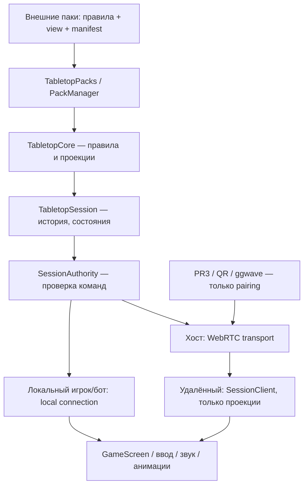

# PlayRoom «ХОД» — справочник разработчика (RC6)

> **Точка входа для продолжения разработки.** Состояние исходников: `dev` @ `afe8b9d701308824d3133177a67855419543f592` (содержательная база опубликованного [`v0.15.0-rc.6`](https://github.com/GraphGiraffe/boardgame-playroom/releases/tag/v0.15.0-rc.6)). Проверено 09.10.2026. Сборка релиза имеет отдельный SHA для номера версии, документации и публикации. Инструкции ниже описывают **реализованное поведение**, а не целевой roadmap.

## Сначала выбрать задачу

| Если нужно… | Начните здесь | Главные исходники |
| --- | --- | --- |
| Понять устройство приложения и загрузку модулей | [Архитектура и жизненный цикл](DEV-ARCHITECTURE.md) | [`index.html`](../index.html), [`app/app.js`](../app/app.js), [`core/engine.js`](../core/engine.js) |
| Изменить меню, настройки, лобби, сцены, ввод, анимации | [UI и пользовательские сценарии](DEV-UI.md) | [`app/app.js`](../app/app.js), [`app/game-screen.js`](../app/game-screen.js), [`app/shared-views.js`](../app/shared-views.js) |
| Изменить правила движка, ботов, сессию, приватность | [Игровая модель и боты](DEV-GAMEPLAY.md) | [`core/engine.js`](../core/engine.js), [`core/session.js`](../core/session.js), [`core/authority.js`](../core/authority.js) |
| Исправить LAN, Offer/Answer, QR, звук, каналы RPC | [P2P, QR и WebRTC](DEV-NETWORK.md) | [`app/network-ui.js`](../app/network-ui.js), [`app/transports/webrtc.js`](../app/transports/webrtc.js), [`app/pairing.js`](../app/pairing.js) |
| Исправить переподключение и идентификацию гостя | [Identity и reconnect](DEV-RECONNECT.md) | [`app/multiplayer.js`](../app/multiplayer.js), [`app/network-ui.js`](../app/network-ui.js) |
| Работать с JSON, токенами, снимками и сетевыми сообщениями | [Протоколы и примеры структур](DEV-PROTOCOLS.md) | [`core/protocol.js`](../core/protocol.js), [`app/pairing.js`](../app/pairing.js), [`core/session.js`](../core/session.js) |
| Поменять паки, сохранения, версии или миграции | [Паки и хранение](DEV-STORAGE-PACKS.md) | [`core/packs.js`](../core/packs.js), [`app/pack-manager.js`](../app/pack-manager.js), [`app/library.js`](../app/library.js) |
| Собрать, проверить, выпустить приложение или отладить проблему | [Сборка, тесты и диагностика](DEV-BUILD-QA.md) | [`build.py`](../build.py), [`scripts/codex/check.sh`](../scripts/codex/check.sh), [`tests/network-main-app.test.cjs`](../tests/network-main-app.test.cjs) |

## Картина системы за минуту

**Главное разграничение:** `core/` исполняет правила без сети и DOM; `app/` создаёт страницы и управляет сессиями; игровой **пак** владеет специальными правилами и отрисовкой конкретной игры. WebRTC переносит разрешённые проекции/команды, но не полное состояние партии гостю. Веб-браузер хоста — единственный авторитетный исполнитель сетевой игры в RC6.

## Что именно подтверждено и чего ещё нет

- **Реализовано:** автономный HTML, PWA, установка версионированных паков, локальная игра против ботов, hot seat, локальные сохранения и история, сетевое лобби и партия, RC6 QR из фотографии/галереи, PR2/PR3, WebRTC RTCDataChannel, авторизация возврата гостя на то же место при живом хосте.
- **Подтверждено пользователем на устройствах:** полная LAN-партия в предыдущем RC с настройками, ходами, штрафами и завершением; отдельный Android↔Android эксперимент с PR3 QR по системным фотографиям и обменом сообщениями. **Именно встроенный сканер RC6 ещё требует отдельной физической проверки**, хотя Chromium E2E прошёл.
- **Не реализовано как гарантия:** восстановление сетевой партии после перезапуска хоста, постоянный журнал/сохранение authority у хоста, автоматический ICE restart без нового QR, полноценный exactly-once через смену WebRTC-эпохи, отдельный сервер RoomHub/WAN relay. См. [roadmap](PlayRoom_Roadmap_and_Agent_Handoff_2026-10-08.md).
- Публичный `Profile.id` **не удостоверяет** право на чужую руку. `resumeToken` не находится в QR и в `room snapshot`. Подробнее: [identity](DEV-RECONNECT.md).

## Сквозные сценарии — куда идти в коде

**Новая локальная партия:** `app/app.js:setup → startFromForm → TabletopSession → renderTable → TabletopInput → act → SessionAuthority → Session.act → Library.write`. Бот назначается в `players[].bot` и планируется через `scheduleBot`.

**Сетевая партия:** `app/app.js:createNetworkRoom` создаёт `RoomService`; `app/network-ui.js:hostInvite` создаёт Offer; клиент получает PR3 QR через `PlayroomQRScanner.scan`; хост считывает Answer; `WebRTC.serve/client` передают RPC. После `RoomService.tick` хост создаёт `SessionAuthority` и связывает участников с `viewer`; клиент видит `PlayroomSharedViews.mount`.

**Возврат клиента:** первый `join` возвращает секрет внутри RTC; `ResumeStore` сохраняет его; после повторного QR `dispatch({type:'resume',...})` возвращает старый `participantId` и новый токен; сервер перепривязывает личную `SessionAuthority.connect(viewer)`. Не использовать QR как удостоверение пользователя.

## Связанные действующие документы

- [`docs/ARCHITECTURE.md`](ARCHITECTURE.md) — краткий обзор; этот справочник — детальная RC6-версия.
- [`docs/MULTIVIEW.md`](MULTIVIEW.md) — проекции/представления и скрытые данные.
- [`docs/PACK-FORMAT.md`](PACK-FORMAT.md), [`docs/PACKS.md`](PACKS.md) — контракты игровых паков.
- [`docs/ACOUSTIC-PAIRING.md`](ACOUSTIC-PAIRING.md) — звуковой сигнал и ограничения Android.
- [`docs/QR-PAIRING-AND-RESUME.md`](QR-PAIRING-AND-RESUME.md) — приёмка RC6.
- [`AGENTS.md`](../AGENTS.md), [`CONTRIBUTING.md`](../CONTRIBUTING.md) — правила работы с репозиторием.

## Правило сопровождения

Когда меняется внешний API, порядок скриптов, формат JSON, способ привязки `viewer`, режим комнаты или ключ хранилища — исправить **соответствующий раздел этого справочника в том же PR**, добавить проверку совместимости и указать, какое поведение существует в коде, а какое ещё только планируется. Избегать переноса исторических формулировок «сетевой режим в будущем» в описание RC6.
