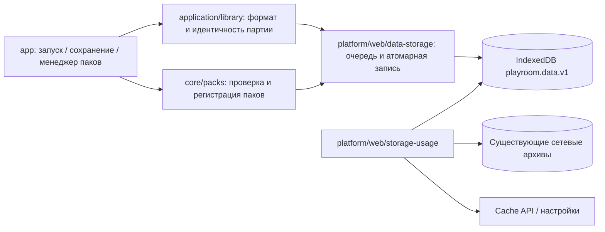

# Локальные данные · 0.19.7

Область применения: приложение **0.21.0** и коллекция **0.8.9**, engineApi 4 / viewApi 3 / protocol 3. Исторические этапы ниже поясняют совместимость; текущая приёмка хранится в [utils](https://github.com/GraphGiraffe/boardgame-playroom-utils/blob/main/docs/project/app/reports/ACCEPTANCE-0.21.0.md).

Новые локальные партии используют `playroom-session` v3 / `actions-v1`: параметры старта с seed и именами игроков, точная версия пака, принятые команды и изменения участников. Поля, руки, текст событий и промежуточные снимки не входят в запись. Форматы 1/2 продолжают читаться; старые партии без журнала команд остаются в формате 2, без попыток угадать команды по снимкам.

`records` содержит ключ `playroom.packs.v1`, активную партию `playroom.session.v1` и отдельные `playroom.paused.v1.<id>`. Значения — прежние строки. Хранилище загружает строки в кеш для синхронного чтения существующими сервисами; не декодирует истории. `legacy` сохраняет конфликтующие исходные значения при переносе, если IndexedDB уже содержит другую запись. Идентичные копии после проверки удаляются.

Миграция копирует исходные строки одной транзакцией, проверяет чтением резервной копии, затем удаляет только всё ещё совпадающие старые ключи localStorage. Прерывание до удаления допускает безопасный повтор. При конфликте данные IndexedDB имеют приоритет, старые байты остаются в `legacy`. Невалидные партии сохраняются как есть и доступны существующей диагностике; неподдерживаемые паки сохраняет карантин паков. Отказ IndexedDB блокирует запуск с возможностью повтора, не включает скрытое непостоянное хранилище.

`DataStorage.transact(callback)` принимает **синхронный** callback, собирает изменения и публикует кеш только после `transaction.oncomplete`. При abort кеш остаётся прежним. Сравнение изменяемых ключей с актуальной записью предотвращает перезапись более новых данных другой вкладки устаревшим кешем; для такой вкладки требуется перезагрузка. Очередь продолжает работать после ошибки. Не вызывать `setItem/removeItem` вне транзакции.

`Library.writeAsync/activateAsync/removeAsync` — точки записи Web-приложения. Кодирование выполняется до ожидания очереди, чтобы сохранить нужный шаг. Перенос прежней активной партии в архив и активация новой выполняются одной транзакцией. UI заменяет текущую Session/ID только после успеха. Синхронные методы остаются для независимых синхронных портов и контрактных тестов. PWA не обновляет оболочку при незавершённых записях или ошибке сохранения.

`Packs` принимает `storage.commit(text): Promise` или прежний синхронный `storage.set`. Для асинхронного порта bootstrap/install/remove/discardQuarantine сериализуются и возвращают Promise; вызывающий код обязан await. Runtime-регистрация выполняется после записи, ошибка регистрации восстанавливает предыдущее содержимое хранилища. `activate` остаётся синхронным выбором уже установленной версии. Aggregate-лимит 20 МиБ снят; per-pack проверка 4 МиБ остаётся защитой импорта.

Объём измеряется только при открытии/обновлении менеджера паков. Размер пака — UTF-8 JSON одного контейнера, вычисленный при подготовке. Общий объём включает контейнер коллекции, локальные сохранения и конфликтные резервные копии, сетевые архивы, настройки и тела ответов кешей `playroom-*`. Сетевые записи читаются курсором, тела кеша — последовательно, без удержания всех данных. Это размер полезных данных, а не физическое место на диске; служебные расходы IndexedDB, файлы Downloads и данные других сайтов не считаются. При недоступной части хранилища показано «не менее». Квоту определяет браузер и свободное место; постоянная безлимитность не обещается.

Проверки: `node --test tests/data-storage-browser.test.cjs tests/recovery-warning.test.cjs`. Первый сценарий проверяет миграцию, архивирование, abort записи партии и удаления пака, повтор записи, холодное чтение объёма >5 МиБ и компактное отображение размеров. `PLAYROOM_TEST_ARTIFACT=file:///…/playroom-all-games.html` проверяет автономную сборку; `PLAYROOM_STORAGE_SCREENSHOTS=/…` сохраняет виды 390/320 px.

## Журнал действий

`Session.prepare` связывает копию команды с подготовленным кандидатом через WeakMap. `commitPrepared` добавляет команду только после успешной фиксации нового состояния. Декоративные поля интерфейса исключаются. Смена участника хранится рядом с ближайшей принятой командой и воспроизводится до неё. `serialize({history:'snapshots'})` явно запрашивает старый v2 для совместимости/диагностики; `export()` остаётся полным v1 для существующего приватного порта хоста.

При чтении v3 Session создаёт начальную позицию из сохранённых параметров и воспроизводит команды через engine.applyAction. Боты, таймеры, сеть, звуки и анимации не запускаются. Полученная обычная History обслуживает прежний просмотр истории, включая раунды. Восстановление не клонирует всю реконструированную историю повторно. Максимум 100000 команд, 32 МиБ входного JSON, ограниченные глубина и число элементов. Сверяются число команд и 64-битный диагностический отпечаток итоговой позиции (без производного текста событий); это обнаружение повреждений, не криптографическая подпись.

Оптимизация касается дисковых локальных сохранений. Во время открытой партии снимки ещё остаются в памяти для навигации. Журналы authority/ACK и клиентские сетевые проекции не изменены: воспроизводить закрытую игру по полному журналу на госте означало бы раскрыть чужие карты. Настройки/обучение не являются игровыми командами.

Проверка `node --test tests/action-history.test.cjs tests/session.test.cjs tests/session-runtime.test.cjs`: каждый из 15 паков, восстановление каждого снимка, продолжение партии, повреждения, устаревшие prepare, старые форматы и отсутствие случайного выбора при чтении. Замеры размера — конкретные сценарии, не гарантированное отношение для любой партии.

Менеджер резервирует строки статистики с первого кадра, включая загрузку и ошибку. Последние значения сохраняются при изменении порядка/видимости/избранного. Новый подсчёт выполняется при открытии и после операций с содержимым хранилища; параллельные запросы объединены, изменение данных во время подсчёта вызывает последовательный повтор. Ответ применяется только к тому открытию, которое его запросило. Получение каталога меняет только раздел обновлений, не пересоздавая список паков и не запуская подсчёт.

## Кэш собственной публичной карточки

`playroom.account-profile.v1:<userId>` хранит только username и nickname с версией формата. Это необязательный малый кэш для немедленного отображения карточки и просмотра аккаунта при недоступной сети, не авторизация. Другой аккаунт, гостевой режим и восстановление пароля не используют чужую запись. Токены остаются в отдельном Auth-адаптере; e-mail и пароли в этот кэш не копируются. Ошибка/quota localStorage не блокирует работу; свежая синхронизация обновляет карточку и кэш.
