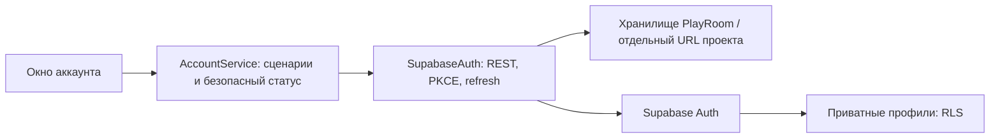
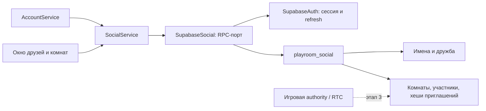
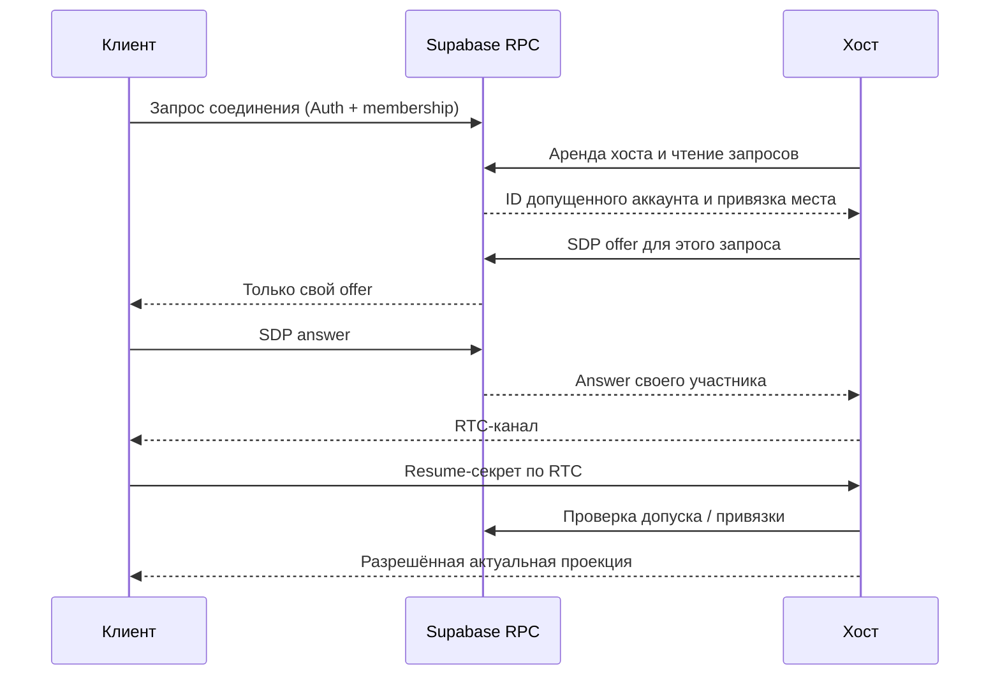

# Сетевой сервис ХОД · 0.21.0

Область применения: приложение **0.21.0** и коллекция **0.8.10**, engineApi 4 / viewApi 3 / protocol 3. Исторические этапы ниже поясняют совместимость; текущая приёмка хранится в [utils](https://github.com/GraphGiraffe/boardgame-playroom-utils/blob/main/docs/project/app/reports/ACCEPTANCE-0.21.0.md).

Сервис поддерживает email/пароль, подтверждение регистрации, восстановление и смену пароля, дружбу, приватные облачные комнаты, адресные приглашения, личные/групповые/командные чаты, прочтения и реакции. Web Push и плановая передача хоста реализованы. Игровая authority находится на устройстве хоста; Supabase хранит разрешённые метаданные и сигналинг. Ручное подключение Рядом остаётся самостоятельным путём. Внешний TURN требует отдельной настройки и проверки.

## Актуальное уточнение: общение и режим Онлайн

Кнопка друзей/общения есть **только на главном экране, в настройках и в живой партии**. Общий renderer не добавляет её в произвольные окна; в лобби, добавлении друга, аккаунте и окне приглашения её нет. Одна кнопка открывает одно окно с друзьями, присутствием и приглашениями. Добавление друга — отдельное окно. Карточки друзей оформлены как слоты лобби: аватар, никнейм, актуальный статус. Нажатие открывает личный чат; в нём также показано название текущей игры. Web Push реализован; подробности — в [руководстве Push](../server/push/README.md).

В лобби сохранены 3 области: конфигурация, прокручиваемые места и закреплённые нижние действия. Приглашение — стандартная кнопка `addPlayer` внизу, без отдельной строки. Режимы используют общую анимированную поверхность: локальный зелёный, сетевой и Онлайн синие, иконки геймпада, Wi-Fi и глобуса с доступными именами; те же обозначения используются в сохранениях и карточках продолжения. Причина недоступного старта в сетевых режимах находится в подсказке кнопки, а не отдельном абзаце.

Общение и приглашения используют большой профиль окна. Список выделен фоном и прокручивается независимо; вкладки и действия закреплены. На узком экране вкладки имеют иконки с доступными именами, на широком — подписи. Обновления списка сохраняют DOM и прокрутку. В альбомном окне приглашения настройки и список занимают 2 колонки. Действия друзей, аккаунта и приглашений — стандартные квадратные кнопки. Игровая шапка сохраняет 4 слота; общение доступно в настройках партии. Поле имени имеет единую рамку с фиксированным `@`.

В обоих полях имени аккаунта `@` — фиксированный визуальный префикс внутри общей рамки; редактируется только имя после него. Placeholder — `...`; вставка `@имени` убирает лишний префикс. В БД сохраняется голое имя. Префикс не превращается в третий пользовательский никнейм.

Режимы лобби:

| Режим | Подключение и приглашение |
|---|---|
| Локальная | Один экран, локальные игроки/боты |
| Сетевая | Прежний ручной QR/код/звук, без облачной публикации |
| Онлайн | Сервис комнат, адресные приглашения, пароль и прямая ссылка |

В Онлайн кнопка приглашения автоматически подготавливает/публикует комнату. Владелец видит 6-символьный пароль заглавными буквами и цифрами, его смену, видимость «Для всех / Для друзей / Скрытая», ссылку с отдельной кнопкой копирования и список друзей. Символы генератора не включают неоднозначные `I`, `O`, `0`, `1`. Смена пароля инвалидирует прежние ссылки, но не выгоняет уже вошедших участников и не отменяет отдельные адресные приглашения: для этого остаются удаление участника и отзыв приглашения.

Видимость управляет **обнаружением**, а не заменяет пароль. «Для всех» попадает в ограниченный список активных комнат; «Для друзей» виден подтверждённым друзьям владельца; «Скрытая» не выдаётся в обнаружении. Полученная прямая ссылка позволяет войти по паролю и в скрытую комнату. Списки обнаружения не содержат паролей. По умолчанию комната скрыта.

Пригласительная ссылка использует текущий HTTP(S)-адрес приложения (либо явно заданный `PlayroomNetworkConfig.appUrl`), а для автономного файла — канонический сайт. Существующий 4-значный номер комнаты и пароль находятся во fragment (`#playroom-room=5040&password=AB23CD`), не в query. Сервер разрешает номер по паре номер + пароль, а не по одному короткому номеру; неоднозначное совпадение отвергается. Прежние ссылки с UUID продолжают работать. В поле входа можно ввести номер и затем пароль. Приложение удаляет fragment до сетевой операции; при первом запуске сначала запрашивает основной никнейм и только затем продолжает вход. Это пароль входа в комнату, **не** приватный resume-секрет. Если данные устройства сохранены, прежний участник возвращается через существующий механизм resume. Ссылка на опубликованный старый сайт не добавляет ему новый функционал: живой переход через защищённую оболочку проверяется после соответствующего деплоя.

### Миграция и права

Применить `server/online.sql` после предыдущих `supabase.sql`, `social.sql`, `signaling.sql`; все четыре файла входят в объединённый `setup-supabase.sql` локального кандидата. Повторное выполнение сохраняет пользователей, дружбу, комнаты и привязки. Новых административных credentials в клиенте нет.

`playroom_online` предоставляет:

- `settings` — владелец или участник с разрешением приглашать; владелец передаёт исходный `roomCode` и название игры `gameName`;
- `rotate`, `visibility`, `permission` — только владелец; `invite`/`revoke` — владелец либо разрешённый участник, который отзывает только свои приглашения;
- `chat`, `send-message` — только переписка текущего постоянного аккаунта с указанным зарегистрированным пользователем, включая незнакомого отправителя; сообщение до 2000 символов, 30 новых сообщений в минуту на отправителя, идемпотентность по `(sender, nonce)`, страницы по 80 сообщений;
- `decline-invite` — только адресат приглашения; идемпотентный отказ блокирует вход по нему;
- `inbox` — только входящие сообщения текущего аккаунта после числового курсора, до 30 за запрос; без курсора устанавливает начальную границу и не пересылает старую историю;
- `discover` — максимум 20 активных видимых комнат, без паролей;
- `join-password` — Auth-аккаунт или явный облачный гость, проверка пароля и доступности хоста, максимум 32 участника, идемпотентное членство;
- `presence`, `hub` — постоянный аккаунт, только собственное присутствие и разрешённые друзья/приглашения.

Для отображения владельцу пароль комнаты хранится на сервере как отзываемый код приглашения; таблица закрыта для прямого доступа, код выдаётся владельцу и допущенным к приглашению участникам через RPC. Это не Auth-пароль. Слабее бесконечного длинного приглашения компенсируется ограничением попыток: не более 10 попыток за минуту на Auth ID. Неудача возвращается типизированным результатом и фиксирует счётчик, а не исключением с откатом транзакции. Ограничения анонимной регистрации/CAPTCHA сервиса остаются самостоятельной настройкой; лимит одного Auth ID не заявляется полной защитой от создания новых идентичностей.

Присутствие — успешная активность постоянного аккаунта за последние 75 секунд. В видимом приложении выполняется необязательный heartbeat раз в 30 секунд; скрытая страница его не посылает. Запуск локального профиля не создаёт запросов Auth/присутствия, а статус никогда не блокирует локальную игру или запуск. Это не признак существования игрового RTC-канала. Чужие статусы выдаются только по связям дружбы.

### Владельцы модулей

`application/community-service.js` держит границу Auth ID/поколения для RPC; `platform/web/supabase-social.js` переносит HTTP трёх фиксированных endpoint. `app/community-ui.js` отвечает за общее окно/присутствие и жизненный цикл Web-таймера; `app/social-ui.js` — только добавление друга и стандартное поле имени с префиксом. `app/lobby-network.js` — настройки Онлайн, приглашения, ввод ссылки/пароля и Web deeplink. Pure RoomService хранит режим и флаг `allowPlayerInvites`; не знает Supabase, DOM или сообщения. `app/network-invitations.js` владеет сроком жизни временных ручных SDP-приглашений, `app/network-ui.js` связывает их с RTC-каналом и полномочиями комнаты. В обоих сетевых режимах настройка по умолчанию выключена. Для ручной сети участник запрашивает offer у хоста и возвращает ему answer нового игрока: прямой игровой канал устанавливается с хостом, посредник не получает authority. Отзыв закрывает ожидающие соединения, но не исключает вошедших игроков. В Онлайн также отзываются неиспользованные приглашения участников и меняется пароль общей ссылки. Authority, разрешённые проекции, durable ACK и resume остаются прежними.

Переписка реализована в отдельном `app/chat-ui.js`: карточки друзей открывают диалог, история прокручивается отдельно от поля ввода; старые сообщения загружаются кнопкой, новые — каждые 5 секунд только в открытом видимом диалоге. Черновик и ключ повторной отправки сохраняются при сетевой ошибке до закрытия диалога. `server/online.sql` хранит сообщения в закрытой RLS-таблице, выдаёт только участникам соответствующей пары; удаление дружбы не удаляет переписку. Чужие пары недоступны, гости не могут читать и отправлять сообщения. Список `hub.conversations` формируется из истории, поэтому сообщение или направленное приглашение незнакомца создаёт диалог без автоматической дружбы. Аватар — идентификатор общего каталога; имя игры — добровольно передаваемое локальное присутствие, не игровое состояние. Статус «В игре» требует свежего heartbeat, иначе показывается «Не в сети». Web Push добавлен в ROADMAPler отдельной плановой карточкой `web-push` вместе с этапом чатов: явное разрешение, серверные подписки/отправка, SW push/notificationclick, переход к адресату и реальные фоновые проверки. До этого разрешение на уведомления не запрашивается.

Следующие разделы сохраняют историю предыдущих этапов. При расхождении UI-сценариев актуален этот раздел.

## Чат комнаты, команды и отметки сообщений

Чат доступен из нижнего ряда лобби и быстрых действий настроек во время сетевой/онлайн-партии. В шапке — штатный арт игры, название игры и комнаты. В личном диалоге шапку занимает карточка собеседника; предложение добавить незнакомого пользователя расположено поверх переписки, без отдельной занимаемой строки.

Переключатель «Общий / Команда» расположен над полем ввода. Вкладка команды появляется только у участника с командой. Общий экран стола и зрители командной вкладки не имеют. Цвет команды приходит из публичной метаинформации пака: фон области чата, сообщения и пузырьки имеют разные оттенки, выделение слайдера плавно меняет цвет. При reduced motion переход отключается.

`application/room-chat.js` хранит и фильтрует переписку независимо от правил игры. Хост использует IndexedDB (`playroom.room-chat.v1.<roomId>` в `PlayroomData`), подтверждает запись после durable transaction и выдаёт по 80 сообщений с пагинацией. История переживает переоткрытие чата и переподключение к тому же хосту. Это локальное хранилище хоста, не облачная копия: удаление данных хоста удаляет и переписку. Клиенты не получают полную историю других команд или поля audience/readBy.

Отправитель определяется по привязанному RTC-участнику. Командное сообщение адресуется составу команды на момент отправки; чтение дополнительно требует текущую принадлежность этой команде. Смена команды не открывает прошлую историю новой команды. Хост доверенный: он хранит историю всех команд. Для общего чата достаточно членства в комнате. Длина сообщения — до 2000 символов, не более 30 сообщений/реакций от одного участника в минуту. ID повторной отправки не создаёт дубль. Комнаты разделены по ID, игровой журнал не затрагивается.

Сообщения и реакции входят в историю. В живой партии полученное сообщение показывается пузырьком рядом с автором на 2 секунды. Максимальная ширина — 230 px в пределах экрана, до 2 строк; длинное содержимое сокращается, полный текст остаётся в чате. Командный пузырёк передаётся только союзникам. Переоткрытие истории не воспроизводит старые пузырьки.

У исходящих сообщений рядом со временем: одна небольшая галочка — запись подтверждена сервером личного чата или хостом комнаты («Доставлено»); две галочки другого цвета — «Прочитано». Первое не обещает, что адресат уже онлайн. Прочтение отправляется только для сообщений, видимых в активном окне переписки; фоновые загрузки и история вне видимой области его не выставляют. В общем чате достаточно одного другого читателя; в командном учитываются только адресаты-союзники. Личный чат использует защищённую таблицу `playroom_chat_reads` и RPC `read-messages`; старые отметки только продвигаются вперёд.

Обновление требует актуальный `server/online.sql` для личных отметок; порядок полного setup: supabase → social → signaling → online. Общий/командный чат использует текущие RTC-подключения и IndexedDB, отдельного сервера не требует.

## Быстрые реакции и проверка пограничных случаев

В чате кнопка слева в поле ввода открывает 9 реакций в сетке 3×3. Выбор отправляет обычное отдельное сообщение с существующими правами, nonce и ограничением частоты. Набранный текст сохраняется. Поле отправки не блокирует навигацию после завершения запроса; запоздалый ответ приглашения не меняет уже другой открытый диалог.

В живой партии выбор открывается по своему аватару. Голубой пузырёк виден 2 секунды всем подключённым участникам, включая общий стол. Только игрок может отправлять от своего имени: хост определяет индекс через привязку RTC-канала к участнику и `SessionAccess.resolve`, игнорирует переданный клиентом индекс, проверяет текущую партию и подключение. Зритель и общий стол отправлять реакции не могут. Локальная партия использует тот же каталог и ограничитель.

`application/quick-reactions.js` задаёт каталог и временный ограничитель: не чаще 1 реакции от игрока за 2 секунды, повтор того же ID не транслируется. `app/quick-reactions.js` отвечает за выбор, фокус и привязку пузырька к аватару; `app/network-ui.js` — за проверку участника и рассылку. Транспорт передаёт реакцию отдельно от игровых snapshot/ACK. Реакции не меняют ход, игровой журнал или контрольную ревизию. Реакции сетевой партии сохраняются отдельно в истории общего чата комнаты; сами пузырьки остаются временными. Подписка после reconnect не воспроизводит старые реакции; чужая партия, история, скрытый экран и неподходящий словарь отбрасываются. В чате смайлики, напротив, сохраняются в переписке.

Повтор запроса направленного приглашения в ту же комнату от того же отправителя возвращает существующий активный invite ID. Серверная блокировка сериализует запросы; триггер не создаёт вторую карточку чата. После отказа, отзыва, использования или истечения срока можно отправить новое приглашение.

Проверены локально: реальный loopback WebRTC с 3 Chromium-клиентами (хост, игрок, общий стол), отправка в обе стороны, исчезновение пузырька, обычные ходы после реакции; диалог с сохранением черновика и выбором 9 реакций; отдельная PostgreSQL с production SQL и проверками доступа/повторного приглашения. Мобильная геометрия проверена в браузере, физические Android и интернет-маршруты в эту проверку не входят.

Внешние TURN-сервисы настраиваются отдельно. Локальные уведомления и Web Push используют разные способы доставки. Блокировка нежелательных собеседников пока не реализована; разрешение переписки с незнакомыми аккаунтами не означает наличие блокировки.

## Текущий интерфейс: аккаунт, друзья и лобби

- **Имя аккаунта** — уникальный изменяемый идентификатор для поиска, например `player_name`. Настраивается в окне аккаунта. 3–24 символа `a–z`, `0–9`, `_`, начинается с буквы; регистр приводится к нижнему. Сохранение атомарно проверяет свободное имя. Email остаётся только для входа и восстановления, в поиске не выдаётся.
- **Никнейм** — основное отображаемое имя локального профиля. Отдельной настройки «имя для друзей» нет. При облачном взаимодействии он синхронизируется с профилем сервиса; `playroom_profiles.nickname` — его копия, а не независимое пользовательское поле. Переименование себя в игровом лобби также обновляет основной локальный профиль после принятого действия.
- **Друзья** — отдельное окно. На главном экране кнопка заменяет справку; в шапке настроек также стоят друзья, а справка/правила — в строке быстрых действий. В остальных окнах друзья находятся в такой строке, вне верхних трёх кнопок. Поиск по точному `@имени_аккаунта`, добавление и подтверждение дружбы. UUID и email пользователю для этого не нужны.
- **Пригласить в игру** — в строке действий игрового лобби. Постоянный аккаунт создаёт/находит и публикует облачную комнату для этого локального лобби автоматически. Повторное открытие не создаёт вторую комнату и не перезапускает активную публикацию. В окне выбирается друг либо создаётся одноразовое приглашение для гостя; доступны отзыв и копирование. Отдельно создавать и именовать облачную комнату не требуется.
- **Присоединиться** на главном экране сразу открывает входящие приглашения, ранее принятые комнаты и ввод гостевого кода. Принятие приглашения само запускает соединение. «Другие способы подключения» открывают прежний ручной QR/код/звук; его механизм сохранён.

Для обновления уже настроенного сервера повторно выполнить **обновлённый `server/social.sql`**. Он добавляет nullable username и уникальный индекс, заменяет RPC, не удаляет пользователей, дружбу, комнаты или игровые привязки. На чистом сервере порядок остаётся `supabase.sql` → `social.sql` → `signaling.sql`. Старые аккаунты получают имя только когда пользователь его задаст; автоматического публичного имени из email не создаётся.

### Поиск друзей по части имени аккаунта

Поиск выполняется явно кнопкой от 3 символов. Допустимы части имени из букв `a–z`, цифр и `_`, включая начало с цифры или `_`; `@` в начале убирается, регистр не учитывается. Никнейм используется для отображения, не заменяет уникальное имя аккаунта. Буквальная подстрока ищется через `strpos`, поэтому `_` не является wildcard. Совпавшее целиком имя показывается первым, затем остальные имена в устойчивом порядке; по 30 результатов с кнопкой «Показать ещё» и keyset-курсором. Ответ содержит только `id`, `nickname`, `username`; свой и гостевые профили исключены. Новый клиент явно передаёт `format: "page-v2"`, получая `{items,next}`; без этого флага RPC сохраняет совместимый массив первой страницы для уже открытых старых клиентов. Смена формата по умолчанию запрещена: старые интерфейсы вызывают `.map` непосредственно у ответа. Редактирование запроса не запускает фоновую сеть и не принимает устаревший ответ. Старая серверная выдача-массив остаётся читаемой, но интерфейс явно предупреждает о доступном только точном поиске.

Для **существующего** PlayRoom backend `geurlwivdiqboylciqhl`, указанного в `app/network-config.js`, сначала выполнить только [friend-search-preflight.sql](../server/friend-search-preflight.sql) через уже настроенное подключение Supabase: сохранить hash/флаги схемы и прав, без строк профилей или определения функции в отчёте. После отдельного разрешения применить [friend-search-v2.sql](../server/friend-search-v2.sql) тем же административным SQL/migration-инструментом проекта. Не создавать новое подключение, не запускать полный setup и не получать серверные ключи в клиенте. Миграция точечно заменяет ожидаемую старую ветку `search`, оставляет прочие ветви RPC и права без изменений; повтор безопасен, неожиданное определение вызывает отказ до изменения. Затем повторить read-only preflight и выполнить авторизованную проверку поиска с тем же постоянным тестовым пулом аккаунтов. Аккаунты между прогонами не удалять. До применения эта документация описывает подготовленную реализацию, не подтверждает обновление рабочего backend.

## Подключение Supabase

1. Создать **отдельный** Supabase-проект PlayRoom. Не применять эту схему в ROADMAPler.
2. Выполнить [server/supabase.sql](../server/supabase.sql) в SQL Editor. Миграция повторяема и не удаляет данные. Она создаёт приватные профили аккаунтов для следующих этапов. Вход использует Supabase Auth. Никнейм отправляется только при явном открытии друзей/облачного приглашения или сохранении имени аккаунта; запуск и локальная игра не требуют запросов.
3. В Authentication → URL Configuration указать Site URL `https://graphgiraffe.github.io/playroom-hod-test/` и такой же Redirect URL. Для разработки добавить точный адрес локального сервера, например `http://127.0.0.1:4173/`. Не разрешать произвольные чужие redirect-домены.
4. В Sign In / Providers включить Email, подтверждение email и Anonymous Sign-Ins. В Password Security установить минимум 8 символов. Восстановление использует стандартные шаблоны Supabase и PKCE; ссылки нужно открывать в том же браузере, где был отправлен запрос. При очистке данных, другом браузере или просроченной ссылке запросить новое письмо.
5. Для писем пользователям настроить собственный SMTP в Authentication → Email/SMTP. Встроенный SMTP ограничивает получателей и частоту отправки: не считать отсутствие письма доказательством ошибки клиента. Установить подходящие Auth rate limits; публичную регистрацию гостей защищать CAPTCHA перед широким открытием (подключение CAPTCHA — отдельная настройка и интеграция, пока не реализовано).
6. В [app/network-config.js](../app/network-config.js) находятся **только публичные** URL и publishable/legacy anon key. Secret, service_role, пароль БД и токены пользователей туда не помещать. Изменение конфигурации требует пересборки; само по себе не публикует сайт.

После настройки владельцем 28.10.2026 на проекте PlayRoom проверены включённые email/подтверждение/анонимный вход, реальный гостевой вход, обновление токена и восстановление сессии. Запрос без авторизации к профилям отклоняется; авторизованный гость видит пустой список и не может создать профиль. Тестовая сессия завершена, токены локально не оставлены. В Auth остаётся одна запись тестового анонимного пользователя без профиля и игровых данных; при необходимости владелец может удалить её в Authentication → Users. Владелец подтвердил работу восстановления пароля на локальной сборке. Регистрация/подтверждение email и callback защищённого сайта учитываются отдельно; через защищённый Pages эти сценарии ещё не проверены. Не создавать тестовые аккаунты на чужие email.

На GitHub Pages остаётся прежний пароль входа в приложение. Он независим от сетевого аккаунта. Старый опубликованный сайт до выпуска новой сборки не умеет обрабатывать Auth callback; письма для рабочего сайта проверять после публикации соответствующего кандидата. Во время локальной проверки добавить локальный Redirect URL и открывать приложение через HTTP на localhost, не как HTML-файл. Вход email/пароль работает и в автономном HTML при наличии сети; подтверждение и восстановление требуют корректного HTTP(S) redirect.

## Ответственность модулей



- Application не импортирует DOM, localStorage или Supabase. `snapshot()` возвращает тип идентичности, ID, email, состояние операции и восстановления; токены туда не входят. `subscribe()` возвращает функцию отписки. Параллельные UI-команды отвергаются.
- Web-адаптер владеет HTTP, секретами сессии и её обновлением. Ключи имеют префикс `playroom.cloud-auth.v1:` и URL конкретного проекта. Межвкладочное обновление токена использует Web Locks, где они доступны; без них остаётся обычный запрос без межвкладочной блокировки. Сессии других приложений и локальный профиль не меняются.
- UI использует стандартное модальное окно, локализованные тексты и безопасное экранирование. Кнопка-облако находится справа от локального имени в настройках. Варианты: вход не выполнен/гость, вход сохранён, запрос выполняется, ошибка последнего запроса, браузер офлайн, сервис не настроен. Сохранённый вход восстанавливается из scoped cache без стартового запроса и не подтверждает доступность облака или права на сервере; операции по-прежнему используют Auth и RLS. Сырые ответы Auth, токены, пароли и callback-коды не выводятся в сообщения или логи. Одноразовый код удаляется из URL до обмена на сессию.
- При изменении busy/error сохраняются DOM формы, введённые значения и фокус; поля блокируются только на время запроса. Неудачный ответ не очищает форму и позволяет повторить попытку одной кнопкой. При смене режима или выходе пароль удаляется вместе с формой. Письма и регистрация автоматически не повторяются.
- Вошедший постоянный пользователь может выбрать «Сменить пароль», указать текущий и новый. Адаптер читает текущего пользователя из Auth, повторно авторизует именно его по текущему паролю, проверяет совпадение ID и отправляет новый пароль из свежей сессии; операция сериализована через тот же Web Lock. Это проверяет пароль и недавнюю авторизацию независимо от дополнительных настроек проекта. Поле `current_password` также отправляется серверу для совместимости с включённой проверкой Supabase. Пароли не записываются в хранилище или статус приложения. Облачному гостю эта операция недоступна. Восстановление использует свою PKCE-сессию и не требует старого пароля.
- Auth возвращает числовой `code` и строковый `error_code`: причина берётся из `error_code`, с поддержкой строкового `code` для других версий ответа. Совпадение паролей, слабый новый пароль, неверный текущий пароль и необходимость повторного входа имеют отдельные локализованные сообщения; сырые `msg` не показываются. При отказе восстановления пользователь может исправить пароль без повторного письма. [Коды Auth](https://supabase.com/docs/guides/auth/debugging/error-codes), [настройки смены пароля](https://supabase.com/docs/guides/auth/password-security).
- Запуск локальной игры не выполняет запросов Auth. Сохранённый вход восстанавливается при открытии окна аккаунта; истёкший токен обновляется перед использованием. Временная недоступность сервиса не стирает сессию и сохранения. Невалидный refresh удаляется с предложением войти заново.
- `ensureGuest()` — явная операция для будущего входа по приглашению. Облачный гость не создаётся при каждом открытии приложения. ID облачного аккаунта/гостя не подменяет ID локального профиля, участника комнаты или resume-secret.
- Выход удаляет локальную облачную сессию и пытается отозвать её на сервере с `scope=local`. При отсутствии сети локальная сессия удалена, серверный отзыв не подтверждён; ошибка отображается. Локальные партии и настройки сохраняются.
- Таблица `playroom_profiles` разрешает постоянному аккаунту читать/создавать только свою запись и менять только свой `nickname`; облачные гости, `anon` и чужие аккаунты не получают доступа. Профили не содержат email, игровые позиции, руки или resume-токены. Доступ друзей будет введён отдельной миграцией.

## Проверки

Выполняются локально, без GitHub Actions:

```sh
node --test tests/account-service.test.cjs tests/cloud-account-rls.test.cjs tests/cloud-account-browser.test.cjs
```

Для SQL-проверки нужен PostgreSQL 18 (`PLAYROOM_PG_BIN` задаёт другой путь к bin). Тест создаёт временный кластер с отдельным Unix-сокетом, без TCP, дважды применяет production SQL, проверяет RLS аккаунтов/гостей и удаляет кластер. Браузерная проверка использует два независимых контекста и подменённый Auth HTTP: она не доказывает работу писем, реального Supabase или защищённого Pages-wrapper.

Приёмка на живом проекте: регистрация на собственный тестовый email → подтверждение → повторный вход после перезапуска → восстановление пароля → выход; отдельная проверка гостевой сессии после включения Anonymous Sign-Ins. Проверить callback через защищённую оболочку Pages, а не только обычный index.html. До этой проверки этап нельзя считать полностью принятым.

Контракты провайдера: [Password Auth](https://supabase.com/docs/guides/auth/passwords), [PKCE](https://supabase.com/docs/guides/auth/sessions/pkce-flow), [Anonymous Sign-Ins](https://supabase.com/docs/guides/auth/auth-anonymous), [Auth REST](https://supabase.github.io/auth/).


## Этап 2: друзья и доступ в приватные комнаты

Состояние: локальная реализация для проверки, **без релиза и деплоя**. Для живой проверки владельцу нужно выполнить дополнительную миграцию:

1. Открыть [SQL Editor проекта PlayRoom](https://supabase.com/dashboard/project/geurlwivdiqboylciqhl/sql/new).
2. Скопировать целиком [server/social.sql](../server/social.sql) в новый запрос и нажать **Run**. Базовая `supabase.sql` уже должна быть применена. Повторный запуск безопасен для данных; изменяются таблицы, права и функция RPC, а не аккаунты.
3. Открыть свежую сборку и войти в аккаунт через облако рядом с основным никнеймом. В аккаунте выбрать уникальное имя; на главном экране открыть друзей отдельной кнопкой.
4. На двух устройствах войти в разные постоянные аккаунты, найти друг друга по точному имени аккаунта, отправить и подтвердить запрос дружбы. Никнейм берётся из основного профиля.
5. Хост создаёт сетевое игровое лобби и нажимает «Пригласить в игру». Выбрать друга или создать гостевой код. Получатель открывает «Присоединиться» на главном экране и принимает приглашение/вводит код; соединение начинается сразу.
6. Проверить отзыв неиспользованного приглашения, удаление участника, выход и закрытие комнаты. Чужой аккаунт не должен входить по адресному коду.

Граница исходного этапа 2 была **доступом в облачную комнату**; в текущем интерфейсе соединение с партией уже подключено этапом 3. Привязка cloud member к локальному участнику, передача сигналов WebRTC и проверка допуска перед игровыми проекциями относятся к этапу 3. Пока эти проверки не подключены, существующее ручное лобби не объявляется защищённым облачными приглашениями. В Supabase не передаются SDP, игровые состояния, руки и resume-секреты.

### Модули и контракт



- `application/social-service.js`: сценарии, подписки и снимок для UI. Смена аккаунта очищает данные и отбрасывает поздний ответ старого аккаунта; адаптер сверяет ID ожидаемого пользователя с текущей Auth-сессией перед запросом, включая смену входа в другой вкладке. Коды приглашений возвращаются только результатом создания и не входят в снимок сервиса.
- `platform/web/supabase-social.js`: один явный POST RPC, scoped Auth/refresh, 15-секундный таймаут и безопасные коды ошибок. Нет фоновых запросов при старте приложения, сохранения социальных данных в localStorage или автоматического повторения действий.
- `app/social-ui.js` / `social.css`: отдельное стандартное окно друзей и точного поиска; `app/lobby-network.js`: приглашения и входящие подключения рядом с лобби. Приглашение само находит облачную комнату и запускает публикацию; принятие само запускает RTC. DOM формы сохраняется при busy/error. Автоматического обновления присутствия пока нет.
- `server/social.sql`: единственная серверная точка записи и чтения социальных проекций. Прямой доступ к четырём таблицам закрыт для anon/authenticated; включён RLS. SECURITY DEFINER RPC с фиксированным search_path проверяет Auth ID, гостевой статус, участника/владельца и возвращает только явные поля без email и хешей. Профили по прежнему недоступны для глобального просмотра; имя раскрывается связанным запросом дружбы или участникам комнаты.

RPC: `playroom_social(p_action text, p_data jsonb) → jsonb`.

| Действия | Кто может |
|---|---|
| `profile`, `request`, `accept`, `remove` | Постоянный аккаунт; подтверждает только получатель запроса |
| `list` | Свои друзья, комнаты, адресные приглашения; у гостя только свои комнаты |
| `create`, `invite`, `revoke`, `close`, `kick` | Создание — постоянный аккаунт с профилем; управление — владелец комнаты |
| `join` | Постоянный аккаунт или явный облачный гость; действующий код либо ID своего адресного приглашения |
| `room`, `leave` | Текущий участник незакрытой комнаты; владелец закрывает комнату вместо выхода |

Открытого каталога и поиска по email нет. Имя аккаунта — публичный точный идентификатор для поиска, без авторизационных прав; внутренние UUID не меняются при переименовании. Запросы требуют подтверждения, встречные запросы объединяются в одну пару. Удаление дружбы отзывает адресные приглашения этой пары; уже вошедший участник удаляется из комнаты отдельно.

Приглашение: 64 hex-символа (две случайные UUID), в БД только SHA-256, срок 24 часа, одно использование. Адресное приглашение привязано к подтверждённому другу; дружба повторно проверяется при входе. Отзыв/закрытие/удаление участника проверяются сервером. Повтор входа тем же участником после потерянного ответа идемпотентен; после выхода использованный код не возвращает доступ. Room→invite locks сериализуют вход, закрытие и отзыв. Максимум 32 участника, 10 открытых комнат на владельца, 100 активных приглашений на комнату и 100 исходящих неподтверждённых запросов. Это ограничения данных; защита публичной регистрации CAPTCHA/rate limit остаётся отдельной настройкой перед широким запуском.

Локально проверены production SQL дважды, доступ разных аккаунтов/гостя, прямые запреты таблиц, адресные/одноразовые/отозванные/истёкшие приглашения, удаление друга и участника, закрытие комнаты. Браузерный сценарий двух клиентов подменяет RPC и доказывает UI, а не живой Supabase. Живая миграция и приёмка владельцем ещё не выполнены. Новые production credentials не требуются.


## Этап 3: внешняя сигнализация и возврат

Локальная реализация; **релиз и деплой не выполняются**. После базовых миграций выполнить целиком [server/signaling.sql](../server/signaling.sql) в том же SQL Editor проекта PlayRoom. Все три миграции проверяются повторным применением в изолированном PostgreSQL. Старые описания этапа 2 выше фиксируют его границу: в текущей сборке игровой путь добавлен этапом 3.

Проверка владельцем:

1. Применить `supabase.sql` → `social.sql` → `signaling.sql` (первые две, если ещё не выполнены). Запустить свежий локальный `pwa/` через HTTP.
2. Хост создаёт сетевое лобби выбранной игры и освобождает место для второго игрока. Нажать **Пригласить в игру** в строке быстрых действий. Комната и её публикация подготавливаются автоматически для выбранного лобби; приложение не выбирает игру за пользователя.
3. Второй аккаунт открывает **Присоединиться** и принимает адресное приглашение; гость вводит код там же. Соединение запускается автоматически, код/QR ответа передавать не нужно. В открывшемся игровом лобби подтвердить имя и занять место.
4. Начать партию. Перезагрузить страницу клиента, нажать «Присоединиться» и выбрать прежнюю принятую комнату: при сохранённом resume-секрете игрок возвращается на прежнее место с актуальной разрешённой проекцией. Новое приглашение не требуется. После очистки данных/на другом устройстве прежнего приватного секрета нет — право на место не восстанавливается только по аккаунту.
5. При полном разрыве активного RTC существующий RecoveryCoordinator вызывает внешний reconnect; при временной недоступности хоста/сервиса повторяется попытка через 3 секунды. Явный выход, смена аккаунта и закрытие страницы останавливают попытки. Запуск приложения сам по себе не обращается к облаку и не возвращает в игру автоматически.
6. Проверить удаление участника, закрытие комнаты, другой аккаунт и второе окно хоста. Открыть заново сохранённую хостом партию штатным восстановлением и явно опубликовать её лобби для той же комнаты. Это не выбор нового хоста: authority/приватный архив остаются на прежнем устройстве.

### Ответственность



- `application/cloud-signaling.js`: отменяемый цикл обнаружения, поколения соединений, обмен offer/answer через remote-порт, жизненный цикл RTC-портов. Никаких DOM, Auth-токенов или игровых состояний. Устаревший ответ не создаёт новый peer после stop. Смена поколения закрывает старые handles.
- `app/cloud-network.js`: Web wiring аккаунта, RPC-адаптера и существующего сетевого UI; явная публикация/подключение, остановка и повтор после полного разрыва. Не содержит правил игры.
- `platform/web/supabase-social.js`: общий проверяемый HTTP/refresh для двух фиксированных RPC (`playroom_social` и `playroom_signal`). Ожидаемый Auth ID проверяется перед каждым запросом.
- `app/network-ui.js`: cloud peer использует те же RoomService, SessionAccess, projected transport и durable resume, что ручной путь. Snapshot/history/dispatch/presentation/subscription проходят проверку допуска до передачи. Ошибка подписки закрывает peer; запоздалые результаты проверок не переставляют кадры. Нельзя смешать уже подключённые ручные каналы и новую приватную cloud-публикацию одного лобби; кнопка ручного приглашения облачного хоста открывает управление облачной комнатой.
- `application/rooms.js`: доверенный параметр `boundParticipantId` у host-side connection ограничивает join/resume ровно своей серверной привязкой. Даже действующий чужой resume-секрет не позволяет cloud-каналу занять чужое место. Аккаунт без resume-секрета не создаёт дубликат уже существующего участника.

### Сервер и ограничения

`playroom_signal(p_action,p_data)` проверяет membership, владельца, поколение хоста и адресата каждого запроса. Прямой доступ к `playroom_signals` и `playroom_peer_bindings` закрыт; включён RLS. Канал сигнализации не передаёт Auth-токены, resume-секреты, игровые руки, history или Session.export. Серверная привязка `(cloud room, Auth user) → participant ID` доступна только владельцу через проверенный RPC. Сам participant ID не является секретом или правом управления.

Аренда хоста — 20 секунд, опрос — 2 секунды после завершения предыдущего запроса. Второе окно не захватывает активную аренду. После временного засыпания тот же хост может продлить истёкшую аренду; сменившееся поколение блокирует старый процесс. Полное закрытие хоста не переносит authority на другой аккаунт или устройство. Передача — этап 4.

SDP доступен только двум сторонам запроса до 2 минут, один текущий запрос на участника, не более 64 КиБ на offer/answer. Просроченные строки удаляются при следующей операции с комнатой; автоматическая физическая очистка полностью неактивных комнат пока не настроена. Допуск существующего RTC проверяется по membership/epoch/binding отдельно от истёкшего SDP. Отзыв приглашения запрещает новый вход по нему; удаление уже вошедшего участника — отдельное действие, запрещающее дальнейший RPC/выдачу проекций.

STUN/TURN здесь не добавляются. Текущий RTC использует прежние настройки; локальный loopback-сценарий не доказывает прохождение NAT между разными провайдерами и доступность без VPN. Настройка новых relay-сервисов остаётся последним функциональным этапом 0.20. Проверки этого этапа используют настоящий WebRTC между двумя Chrome-контекстами, но подменяют облачный HTTP; серверная SQL-проверка выполняется отдельно на PostgreSQL. Живой Supabase и физические устройства требуют приёмки владельцем после миграции.


### Схема имён и повторного открытия лобби

`profile({nickname, username?})` синхронизирует основной никнейм и при явной передаче сохраняет новое уникальное имя. Без `username` прежнее имя сохраняется. Коллизия уникального индекса даёт `username-taken`; некорректное имя — `username-invalid`. `search({username})` доступен постоянному аккаунту, возвращает максимум одну точную запись `{id, nickname, username}`, без email или возможности получить каталог всех пользователей. `request({username})` разрешает запрос по текущему имени; ID существующих связей остаются прежними после переименования. Гость не может искать аккаунты или менять имя аккаунта.

`lobby({localRoomId, name})` доступен владельцу постоянного аккаунта с профилем. Блокировка профиля сериализует поиск/создание и проверку лимитов: повтор для того же незакрытого лобби возвращает существующую комнату. Публикация уже активной пары cloud/local room не перезапускается. Созданные прежним интерфейсом данные сохраняются; повторно принятые комнаты доступны в окне подключения.

`openModal` принимает необязательный `onBack` для явного возврата в предыдущее окно. Общий renderer не добавляет кнопку друзей: точки входа задаются явно на главном экране, в настройках и в живой партии. Игровые правила и transport от этой навигации не зависят.


### Приглашения в переписке и уведомления

В окне «Друзья» остаются вкладки друзей и чатов. Направленное приглашение записывается триггером в `playroom_messages` как событие `kind=invitation`, с уникальным `invitation_id`, снимком комнаты и игры. Пароль/токен в сообщении не сохраняются и не выдаются. Повторная миграция не дублирует события; для старых приглашений без даты используется время миграции. RPC вычисляет текущее состояние карточки по приглашению и комнате: active, joined, declined, revoked, expired, closed или offline. Вход/отказ не создают нового сообщения: обновляется карточка с прежним ID. Приглашение зарегистрированному незнакомцу разрешено владельцу/допущенному участнику; присоединиться может только указанный адресат. Старый RPC выдачи произвольной ссылки остаётся отдельным сценарием.

Время сообщения — часы и минуты, бейджи дней используют локальную дату пользователя. Кнопка «Добавить» справа от контакта требует подтверждения и отправляет запрос/принимает входящий. Приглашение и удаление друга тоже подтверждаются. `friend-profile-ui.js` показывает полное имя аккаунта, а шапка чата — только никнейм и статус.

`app/chat-notifications.js` опрашивает `inbox` раз в 5 секунд только при видимом приложении и постоянном аккаунте. `platform/web/chat-notification-store.js` хранит локально отдельный курсор аккаунта, без тел сообщений и credentials. При первом включении курсор устанавливается на текущую историю, далее после перезапуска поступают новые записи. До 3 баннеров группируются по отправителю; сообщения открытого диалога не показываются баннерами. Закрытие не открывает чат, нажатие открывает его. `captureModalReturn` сохраняет узлы исходного окна, прокрутку, ввод и обратный переход; для другого чата используется `PlayroomChatUI.captureReturn` с черновиком и историей. Web Push для закрытого приложения реализован отдельно; настройка сервера и границы проверки описаны в [Web Push](../server/push/README.md).

Для обновления существующего проекта применить актуальные `social.sql`, затем `online.sql` (либо полный `setup-supabase.sql` кандидата). Локальные PostgreSQL/RLS и браузерные тесты не означают, что рабочий Supabase уже мигрирован.


## Группы, приглашения и быстрый запуск (локальный кандидат)

Группы — карточки в списке «Друзья», отдельной вкладки нет. Вкладка «Чаты» содержит личную переписку, включая незнакомых пользователей. Кнопка редактирования включает общий порядок друзей и групп: стрелки и перетаскивание за ручку, в том числе на сенсорном экране. Порядок сохраняется на устройстве отдельно для каждого аккаунта; это не облачная настройка.

Группа хранится в облаке независимо от игровой комнаты. Любой участник может приглашать друзей и выходить, включая создателя. Выход не удаляет группу или историю остальных; ушедший теряет доступ. Повторный вход требует нового приглашения. Текущее членство даёт доступ к существующей истории группы. Ограничения: 32 участника, приглашение действительно 7 дней, 30 сообщений/приглашений за минуту (по соответствующим RPC), 5 созданий групп за минуту. Это не перенос истории комнат: общий и командный игровые чаты по-прежнему хранятся у хоста.

Приглашение в группу приходит карточкой личного чата. Приглашение в игровую комнату можно отправить карточкой в группу: каждому текущему участнику сервер создаёт отдельное право входа. Отказ или вход одного не меняет статус для остальных. Карточка не дублируется в личную переписку. Новые участники группы не получают старые права входа; ушедшие не могут воспользоваться ими. Для отправителя действует разрешение хоста приглашать игроков.

Закрытие облачной комнаты делает все связанные приглашения истёкшими, включая уже принятые/отклонённые карточки. RPC закрытия допускает повтор после потери ответа. Явный выход хоста из лобби сначала закрывает облачную комнату, затем локальную. Ошибка сервиса оставляет комнату открытой для повторной попытки. Потеря связи/фон и закрытие комнаты — разные состояния: недоступный хост даёт «offline», не фиктивное закрытие. Карточки обновляются при чтении/периодическом опросе; вход проверяется сервером непосредственно перед присоединением.

«Сыграть» в информации о друге или группе создаёт онлайн-лобби и открывает существующий выбор паков. До выбора облачная комната и приглашения не создаются. Выбор публикует комнату и отправляет приглашение; отмена закрывает новую локальную комнату и возвращает исходное окно. Существующую комнату заменяют только после подтверждения в интерфейсе. Повтор отправки использует тот же ключ операции. В сетевой/онлайн-партии чат находится вместо истории в верхней панели; история доступна в настройках. В локальной партии панель не меняется. В лобби чат также в верхних быстрых действиях.

Для обновления схемы выполнить полный актуальный `setup-supabase.sql` локальной сборки (supabase → social → signaling → online). Новые таблицы закрыты RLS и правами, чтение/запись идут через проверяемые RPC. Production и деплой этим изменением не обновляются.


Групповые действия `playroom_online`:

| Действие | Параметры | Результат / доступ |
| --- | --- | --- |
| `group-list` | — | Текущие группы аккаунта |
| `group-create` | `id` (UUID повтора), `name` | Новая группа с создателем-участником |
| `group-info` | `groupId` | Информация и участники; только член группы |
| `group-invite` | `groupId`, `userId` | Адресное приглашение в группу |
| `group-accept` / `group-decline` | `inviteId` | Решение адресата; принятие добавляет членство |
| `group-leave` | `groupId` | Выход; последний участник закрывает группу, история сохраняется |
| `group-read` | `groupId`, `before?` | До 80 сообщений, состояния приглашений и отметки |
| `group-send` | `groupId`, `id` (UUID повтора), `body` | Durable-сообщение; повтор не создаёт копию |
| `group-seen` | `groupId`, `through` | Прочтение входящего сообщения |
| `group-inbox` | `after?` | Курсор и до 30 новых событий для баннеров |
| `group-invite-room` | `groupId`, `roomId`, `id` (UUID повтора) | Одна карточка в группе, отдельное адресное право входа текущим участникам |

Вход/отказ от комнаты используют прежние `playroom_social.join` и `playroom_online.decline-invite`. Не следует передавать пароль комнаты в тело сообщения или хранить его в локальном порядке карточек.


### Устойчивое обновление окон общения

Открытие вкладки и фоновое обновление используют один активный запрос обновления. Неизменившийся никнейм повторно не записывается, параллельная синхронизация имени объединяется. Полученный `hub` показывается независимо от загрузки групп; личная переписка не запрашивает `group-list`. Ошибка групп не удаляет уже показанных друзей/чатов, сообщение о ней относится только к списку друзей и очищается после успешного запроса. Это клиентские изменения, повторная SQL-миграция для них не нужна.

Редактирование порядка находится в верхних быстрых кнопках окна друзей. В информации о друге/группе одна строка иконок: удаление/выход слева, зелёная игра посередине, приглашение справа. Удаление и выход требуют прежнего подтверждения.

## Номер онлайн-комнаты и повторное открытие окон

Локальные и Wi-Fi-комнаты создаются с `code: null`. Только первое создание онлайн-приглашения вызывает `playroom_online(settings)`: сервер резервирует свободный 4-значный номер под общей блокировкой, уникальный индекс запрещает совпадения среди незакрытых комнат. Переданный клиентом `roomCode` больше не назначает номер. Миграция сохраняет прежние уникальные номера и сбрасывает лишние исторические дубликаты. `RoomService.setOnlineCode` фиксирует подтверждённый номер; признак `onlineCodeAssigned` отличает его от старого локального значения. Лобби показывает номер только в режиме Онлайн.

Окно приглашений хранит настройки по аккаунту и локальной комнате. При повторном открытии свежий кэш (30 секунд) не вызывает RPC; при обновлении полученные данные остаются на экране. Номер, пароль и видимость сохраняются сервером, после перезапуска клиента проверяются повторно. Смена аккаунта и закрытие комнаты сбрасывают кэш. Друзья/группы отображают сохранённый список сразу и обновляются в фоне при открытии/возврате; успешные изменения инвалидируют актуальность кэша.

Диагностика различает ошибку групп и основного списка. Отсутствующие колонки/функции и несовместимый schema cache распознаются как `setup`; неизвестная ошибка сохраняет только безопасные HTTP/SQL-коды и имя операции, без сырого SQL или токенов. Само наличие понятного сообщения не является доказательством исправления серверной причины.

Группы различаются по UUID: одинаковые названия разрешены, в том числе у одного создателя. Выход последнего участника закрывает группу (`closed_at`) и гасит незавершённые приглашения; повтор создания с прежним UUID и старое приглашение не открывают её заново. Новая группа с тем же названием получает новый UUID. Закрытие приложения или офлайн-статус не означают выход из группы. Миграция также закрывает ранее оставленные пустые группы, сохраняя историю.


### Кэш чатов и непрочитанные

`chat`, `group-read`, `room-chat-read` принимают `after` для новых сообщений, `before` для старой страницы и `known` для обновления отметок/приглашений уже загруженных сообщений. При `after` сервер не повторяет `body` для `known`; клиент объединяет записи по ID. Порядок новых страниц — от старых к новым. Сервер возвращает `through` — исходную границу прочитанного. Чтение/отправка и повторная отправка сохраняют прежнюю проверку членства и аудитории.

Кэш `app/chat-state.js` хранит сообщения и положение прокрутки в IndexedDB через `PlayroomData`, отдельно по аккаунту, UUID разговора и участнику комнаты/каналу. При смене аккаунта память очищается. Командный кэш сбрасывается при смене команды. Переключение окна не очищает загруженную переписку; офлайн доступен уже загруженный текст. Удаление игры не является удалением переписки.

RPC `unread` считает личные/групповые сообщения и активные входящие приглашения по серверным отметкам прочтения. `room-chat-summary` возвращает только доступные участнику счётчики общего/командного каналов. Бейджи сообщений показывают 1–99, далее `...`; приглашения — 1–9, далее `...`. Ноль скрыт. Сумма на кнопке «Друзья» включает личные/групповые чаты и текущую комнату. Счётчик команды выделен цветом.

Автопрокрутка действует только у нижнего края. При чтении старых сообщений сохраняется видимый якорь; перед первыми непрочитанными отображается горизонтальный разделитель. Прочтение в чате требует видимости сообщения и активного окна. В партии/лобби автоматически отмечается только конкретное новое видимое сообщение (`room-chat-seen.only`), поэтому ранее пропущенные записи остаются непрочитанными. Настройки, друзья, приглашения и остальные окна перекрывают игровую поверхность и не отмечают сообщения комнаты прочитанными.

Баблы в лобби, партии и списке друзей живут 2 секунды, текст ограничен 2 строками. Прокрутка привязывает их к аватару или ближнему краю списка. Бабл в списке друзей не меняет отметку прочтения и заменяет дублирующее верхнее уведомление, если карточка доступна в этом списке. В лобби собственный аватар открывает выбор быстрых реакций; доставка идёт через авторитетный чат комнаты.

Для этой версии требуется обновлённый `setup-supabase.sql`; старый сервер не поддерживает `unread` и инкрементальную выдачу. Живое применение миграции выполняется отдельно от локальной проверки.

### Необязательный пароль комнаты (preview.1)

Хост переключает пароль кнопкой замка рядом с неизменным по размеру полем пароля. `password-enabled` принимает явное `enabled` (повтор запроса идемпотентен). `password_enabled=false` сохраняется на сервере и после повторного setup; чтение `settings` не включает защиту заново. При включении создаётся новый случайный пароль. Копирование и обновление пароля отключены, пока пароль выключен.

В открытой комнате пригласительная ссылка содержит только номер. `discover` возвращает `hasPassword`, но не секрет. Вход по номеру без пароля пробуется без ввода; если защита включена, клиент открывает поле пароля. Проверки срока жизни хоста, закрытия, ёмкости и лимита попыток сохраняются. Видимость комнаты по-прежнему управляет каталогом, а скрытая открытая комната доступна знающему её номер/ссылку. Только хост может менять защиту; права участников на приглашение не дают им это право.

Нужно обновить `online.sql` или полный `setup-supabase.sql` из этой сборки. Локальная проверка не применяет миграцию в удалённом проекте.

## Web Push · 0.20 preview

Локально добавлены явная подписка устройства в аккаунте, отзыв при выходе, отдельная закрытая очередь и Edge Function. События: личные/групповые сообщения, приглашения в группы и в игру, уведомления общего/командного чата от хоста. Service Worker проверяет аккаунт, подавляет повторы и открывает цель через повторную проверку прав. Основная миграция — `server/push.sql` после `online.sql`; managed доставка подключается отдельно через `server/push/enable.sql`. Ключи и публикация требуются для живой приёмки. [Инструкция подключения и проверки](../server/push/README.md).

## Этап 4 · плановая передача хоста

Локально реализован preview.3: согласие преемника, private durable-передача по RTC, fence источника и сохранение session/seat identity. В онлайн-комнате RPC `playroom_host_transfer` подтверждает готовность, затем атомарно меняет `owner_id` и сбрасывает старый signaling epoch. Готовность блокирует второго хозяина и не истекает во время финального commit. Старый владелец не может снова приобрести аренду. При восстановлении незавершённой подготовки до fence она явно отменяется. Требуются обновлённые `signaling.sql` и `host-transfer.sql` после `online.sql`. [Полный контракт](HOST-TRANSFER.md). Живой Supabase и физические устройства требуют отдельной приёмки.

## Этапы 5 и 7 · боты и перенос сохранений

Реализованы в preview.4/5, собраны вместе с исправлениями в локальном preview.6. Временная подмена хранится отдельно от постоянного типа игрока, включается хостом вручную и снимается владельцем после принятого commit. Пользовательский перенос сохраняет точный пак, создаёт независимую локальную копию или readonly историю и не передаёт сетевые права. Оба этапа не требуют новой SQL-миграции.

[Общий статус четырёх этапов, SQL и порядок живой приёмки](https://github.com/GraphGiraffe/boardgame-playroom-utils/blob/main/docs/project/app/reports/ACCEPTANCE-0.21.0.md). Подробные контракты: [боты](TEMPORARY-BOT.md), [сохранения](SAVE-TRANSFER.md).


### Управление участниками и уведомления · preview.47

Нажатие на занятую человеком позицию в лобби открывает общий профиль участника: личный чат, добавление или удаление друга, добровольная передача хоста и отдельное исключение с подтверждением. Передача в лобби доступна подключённому игроку, зрителю или Столу; во время партии — игроку. В режиме «Сеть» профиль и передача не обращаются к Supabase; в Online профиль доступен только участникам той же комнаты. Бот настраивается и удаляется через своё окно. Отдельных кнопок исключения рядом со слотами и выбора преемника в настройках нет. Отправка приглашений в игровую комнату доступна только из лобби.

Карточка приглашения содержит текущего владельца и идентификатор комнаты. Для уже открытой комнаты она возвращает в лобби без повторного подключения; владелец на другом устройстве получает переход к «Моим партиям». Недоступность хоста показывается даже после принятия приглашения, а закрытие комнаты завершает приглашение. Уже использованное личное приглашение не отправляет повторный Push при недоступности хоста.

Открытый экран той же сетевой партии подавляет системные Push о начале, продолжении и завершении, включая окно результата или настроек поверх партии. Проверка локальная, без запросов присутствия; скрытая или неактивная вкладка уведомления не подавляет.


### Закрытие комнаты · preview.49

Последняя миграция `server/room-cleanup.sql` устанавливает закрытый для прямого вызова триггер очистки. В транзакции изменения `closed=true` сбрасываются host lease/epoch, отзываются приглашения, удаляются room members, signaling, peer bindings, handoff, game-Push metadata, room event dedup и ожидающие Push этой комнаты, включая DM/групповые карточки приглашений. Остальные сообщения и уведомления, подписки устройства и история партий сохраняются. Закрытая запись комнаты и карточки приглашений остаются для отображения «Приглашение истекло». Повторное закрытие через owner RPC безопасно; не-владелец не может вызвать очистку.

Обычный запрос `unread` принимает известный устройству `roomId` и возвращает `roomUnavailable`, если пользователь больше не состоит в открытой комнате. Через этот же существующий цикл устройство останавливает переподключение, освобождает RTC и локальный resume текущей комнаты и возвращается в библиотеку; сообщение не помечается прочитанным. Нового polling/Realtime-канала или проверки журналов нет. Это не определение аварии хоста и не автоматическая передача хоста.

С preview.49 тот же локальный фильтр видимости подавляет Push «Ваш ход» на открытом экране той же партии, включая окна поверх неё. Фон, другая комната и история сохраняют уведомления.


### Окна участников и добровольная передача · preview.51

Online-профиль участника загружает социальные данные до показа окна. До вызова `openModal` строится готовая разметка со всеми доступными действиями. При смене аккаунта, комнаты или исходного окна ожидающий ответ не открывает устаревший профиль. Повторная проверка полномочий производится перед действием. Ряд кнопок не разделяется автоматическими отступами. Режим «Сеть» не загружает данные из Supabase.

Профиль доступен из собственной позиции, места другого игрока, зрителя и Стола. Действия «Отойти», «Вернуть управление», временно заменить недоступного игрока ботом находятся здесь; отдельная кнопка управления в настройках удалена. Права и долговечность команд player-control не менялись.

Хост может добровольно передать authority подключённому человеку в любой из трёх ролей и в лобби, и во время партии. Зритель/Стол не занимают место игрока после передачи; карточки, очередь и места сохраняются. Пока ожидается согласие, authority продолжает принимать ходы и работать с ботами. После согласия передаётся актуальное, уже изменившееся состояние; на короткой стадии freeze/commit игра блокируется. Решения и ошибки показываются сверху. При ошибке прямого подключения прежнего хоста к новому в Online используется существующее восстановление с его backoff; новых фоновых запросов при исправном канале нет. Аварийная смена хоста по-прежнему не реализуется.

Закрытие после передачи использует текущую идентичность владельца и cloudRoomId, а не только кеш окна приглашений. Открывать это окно перед закрытием не требуется.


### Возврат зрителя после передачи · preview.52

Старая проверка `RoomService._resumeCandidate` требовала `seatId` у любого возвращающегося участника начатой партии. Она отклоняла бывшего хоста-зрителя/Стол, оставляя его зарезервированную карточку в лобби без активного RTC. Теперь отсутствие игрового места допустимо только для ролей spectator/table; проверка токена, запреты host/bot/local и требование места у player сохранены. SessionAccess продолжает выдавать этим ролям соответствующие публичные проекции. Регрессионные проверки выполняют оба направления передачи в настоящем локальном RTC, а не только первоначальную смену владельца. Исправление загружается на устройстве хоста; активная партия на старой версии продолжает использовать старый обработчик до безопасного обновления.


## Несколько устройств одного аккаунта · preview.87

Одна активная Online-комната на аккаунт допускает несколько независимых участников. `deviceId` — стабильный локальный ID установки, а не разрешение: Auth проверяет аккаунт, сервер сопоставляет `(room_id, user_id, device_id)` с отдельным `participant_id`, а authority ограничивает данные и команды этим участником. Два окна одной установки возвращаются к тому же участнику; разные устройства занимают разные места по обычным правилам лобби. В уже начатую игру новое устройство входит зрителем: добавить игровое место без восстановления состава нельзя. Выход зрителя или Стола не останавливает матч. Хост остаётся один, передача хоста отдельная.

Сигнализация `request/poll/answer` разделена по устройствам. Нулевой `device_id` сохраняет старый контракт. Обновлённое устройство с локальной записью может указать `resumeParticipantId` для переноса собственной прежней привязки. `leave` удаляет только привязку устройства; `kick` принимает ID участника и не исключает остальные устройства его аккаунта. Явный выход игрока сохраняет существующее восстановление состава: комната и связи других клиентов остаются, текущая партия может вернуться в recovery-лобби. Отмена неуспешного входа очищает и остановленный target.

В «Моих партиях» и на главном экране используются общие `sessionCard`/`resumeCard`, с небольшой пометкой «Другое устройство». Имена/аватары, версия пака, номер раунда/хода и число действий приходят из отдельной публичной сводки. Хост добавляет её к обычному poll только при изменении. Сервер заново собирает список разрешённых полей; руки, сцены, команды, экспорт authority и resume-секреты не сохраняются. Компактный `social/rooms` запрашивается раз в 15 секунд только на видимой главной или странице партий; фон и игра не опрашиваются этим механизмом. Закрытие комнаты удаляет сводку вместе с временными данными.

Для включения нужны обновлённые `social.sql`, `signaling.sql`, `signaling-sync.sql`, `host-transfer.sql`, `room-cleanup.sql` в этом порядке и новый клиент. Таблицы сохраняют существующие строки, новая схема допускает несколько device-привязок. История, аккаунты, переписка и архивные версии паков сохраняются. 13 ноября обновление применено к рабочей Supabase (миграция `online_device_participants_and_public_cards_20261113`); Funnel обновлён до .87, production-приложение не менялось. Локальная приёмка: PostgreSQL с двумя привязками одного аккаунта, настоящие RTC-три участника, разные приватные проекции, reconnect и выход; скриншоты карточек 320/390/844. Живой .87 подтверждён на рабочем backend: четыре независимых браузерных контекста одного постоянного аккаунта, три игрока с разными закрытыми руками, реальное игровое действие, поздний зритель, индивидуальный выход и возврат на прежнее место после обрыва RTC. Обе карточки показывают публичную сводку с актуальным счётчиком действий. После закрытия собственной тестовой комнаты свежий read-only запрос подтвердил очищенные поля хоста/сводку и 0 строк в семи временных таблицах. Ни один из восьми постоянных тестовых аккаунтов не создавался/удалялся/сбрасывался. Физические телефоны, WAN и Push ОС этим прогоном не принимаются; короткая партия не доводилась до конца.
