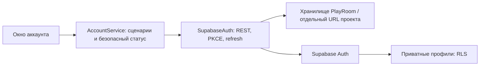

# Сетевой сервис PlayRoom · этап 1 релиза 0.20

Текущий этап добавляет необязательный сетевой аккаунт: email/пароль, регистрацию с подтверждением email, восстановление пароля и облачную гостевую идентичность. Друзья, комнаты через сервис, чат и передача хоста реализуются следующими этапами. Игровая authority остаётся на устройстве хоста. TURN подключается после остальных функций 0.20.

## Подключение Supabase

1. Создать **отдельный** Supabase-проект PlayRoom. Не применять эту схему в ROADMAPler.
2. Выполнить [server/supabase.sql](../server/supabase.sql) в SQL Editor. Миграция повторяема и не удаляет данные. Она создаёт приватные профили аккаунтов для следующих этапов. Текущий вход использует Supabase Auth; локальный никнейм автоматически в облако не отправляется.
3. В Authentication → URL Configuration указать Site URL `https://graphgiraffe.github.io/playroom-hod-test/` и такой же Redirect URL. Для разработки добавить точный адрес локального сервера, например `http://127.0.0.1:4173/`. Не разрешать произвольные чужие redirect-домены.
4. В Sign In / Providers включить Email, подтверждение email и Anonymous Sign-Ins. В Password Security установить минимум 8 символов. Восстановление использует стандартные шаблоны Supabase и PKCE; ссылки нужно открывать в том же браузере, где был отправлен запрос. При очистке данных, другом браузере или просроченной ссылке запросить новое письмо.
5. Для писем пользователям настроить собственный SMTP в Authentication → Email/SMTP. Встроенный SMTP ограничивает получателей и частоту отправки: не считать отсутствие письма доказательством ошибки клиента. Установить подходящие Auth rate limits; публичную регистрацию гостей защищать CAPTCHA перед широким открытием (подключение CAPTCHA — отдельная настройка и интеграция, пока не реализовано).
6. В [app/network-config.js](../app/network-config.js) находятся **только публичные** URL и publishable/legacy anon key. Secret, service_role, пароль БД и токены пользователей туда не помещать. Изменение конфигурации требует пересборки; само по себе не публикует сайт.

После настройки владельцем 28.10.2026 на проекте PlayRoom проверены включённые email/подтверждение/анонимный вход, реальный гостевой вход, обновление токена и восстановление сессии. Запрос без авторизации к профилям отклоняется; авторизованный гость видит пустой список и не может создать профиль. Тестовая сессия завершена, токены локально не оставлены. В Auth остаётся одна запись тестового анонимного пользователя без профиля и игровых данных; при необходимости владелец может удалить её в Authentication → Users. Владелец подтвердил работу восстановления пароля на локальной сборке. Регистрация/подтверждение email и callback защищённого сайта учитываются отдельно; через защищённый Pages эти сценарии ещё не проверены. Не создавать тестовые аккаунты на чужие email.

На GitHub Pages остаётся прежний пароль входа в приложение. Он независим от сетевого аккаунта. Старый опубликованный сайт до выпуска новой сборки не умеет обрабатывать Auth callback; письма для рабочего сайта проверять после публикации соответствующего кандидата. Во время локальной проверки добавить локальный Redirect URL и открывать приложение через HTTP на localhost, не как HTML-файл. Вход email/пароль работает и в автономном HTML при наличии сети; подтверждение и восстановление требуют корректного HTTP(S) redirect.

## Ответственность модулей



- Application не импортирует DOM, localStorage или Supabase. `snapshot()` возвращает тип идентичности, ID, email, состояние операции и восстановления; токены туда не входят. `subscribe()` возвращает функцию отписки. Параллельные UI-команды отвергаются.
- Web-адаптер владеет HTTP, секретами сессии и её обновлением. Ключи имеют префикс `playroom.cloud-auth.v1:` и URL конкретного проекта. Межвкладочное обновление токена использует Web Locks, где они доступны; без них остаётся обычный запрос без межвкладочной блокировки. Сессии других приложений и локальный профиль не меняются.
- UI использует стандартное модальное окно, локализованные тексты и безопасное экранирование. Кнопка-облако находится справа от локального имени в настройках. Варианты: вход не выполнен/гость, вход сохранён, запрос выполняется, ошибка последнего запроса, браузер офлайн, сервис не настроен. Сохранённый вход восстанавливается из scoped cache без стартового запроса и не подтверждает доступность облака или права на сервере; операции по-прежнему используют Auth и RLS. Сырые ответы Auth, токены, пароли и callback-коды не выводятся в сообщения или логи. Одноразовый код удаляется из URL до обмена на сессию.
- При изменении busy/error сохраняются DOM формы, введённые значения и фокус; поля блокируются только на время запроса. Неудачный ответ не очищает форму и позволяет повторить попытку одной кнопкой. При смене режима или выходе пароль удаляется вместе с формой. Письма и регистрация автоматически не повторяются.
- Запуск локальной игры не выполняет запросов Auth. Сохранённый вход восстанавливается при открытии окна аккаунта; истёкший токен обновляется перед использованием. Временная недоступность сервиса не стирает сессию и сохранения. Невалидный refresh удаляется с предложением войти заново.
- `ensureGuest()` — явная операция для будущего входа по приглашению. Облачный гость не создаётся при каждом открытии приложения. ID облачного аккаунта/гостя не подменяет ID локального профиля, участника комнаты или resume-secret.
- Выход удаляет локальную облачную сессию и пытается отозвать её на сервере с `scope=local`. При отсутствии сети локальная сессия удалена, серверный отзыв не подтверждён; ошибка отображается. Локальные партии и настройки сохраняются.
- Таблица `playroom_profiles` разрешает постоянному аккаунту читать/создавать только свою запись и менять только свой `nickname`; облачные гости, `anon` и чужие аккаунты не получают доступа. Профили не содержат email, игровые позиции, руки или resume-токены. Доступ друзей будет введён отдельной миграцией.

## Проверки

Выполняются локально, без GitHub Actions:

```sh
node --test tests/account-service.test.cjs tests/cloud-account-rls.test.cjs tests/cloud-account-browser.test.cjs
```

Для SQL-проверки нужен PostgreSQL 18 (`PLAYROOM_PG_BIN` задаёт другой путь к bin). Тест создаёт временный кластер с отдельным Unix-сокетом, без TCP, дважды применяет production SQL, проверяет RLS аккаунтов/гостей и удаляет кластер. Браузерная проверка использует два независимых контекста и подменённый Auth HTTP: она не доказывает работу писем, реального Supabase или защищённого Pages-wrapper.

Приёмка на живом проекте: регистрация на собственный тестовый email → подтверждение → повторный вход после перезапуска → восстановление пароля → выход; отдельная проверка гостевой сессии после включения Anonymous Sign-Ins. Проверить callback через защищённую оболочку Pages, а не только обычный index.html. До этой проверки этап нельзя считать полностью принятым.

Контракты провайдера: [Password Auth](https://supabase.com/docs/guides/auth/passwords), [PKCE](https://supabase.com/docs/guides/auth/sessions/pkce-flow), [Anonymous Sign-Ins](https://supabase.com/docs/guides/auth/auth-anonymous), [Auth REST](https://supabase.github.io/auth/).
