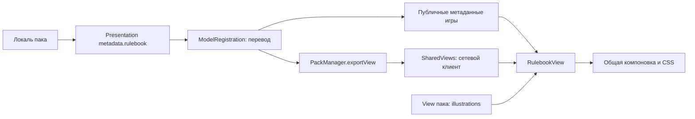

# Иллюстрированные правила

Область применения: приложение **0.21.0** и коллекция **0.8.10**, engineApi 4 / viewApi 3 / protocol 3. Исторические этапы ниже поясняют совместимость; текущая приёмка хранится в [utils](https://github.com/GraphGiraffe/boardgame-playroom-utils/blob/main/docs/project/app/reports/ACCEPTANCE-0.21.0.md).

Необязательное расширение существующего контракта API 4 / viewApi 3. Старые паки продолжают использовать экранированный `rules: string[]`. Новый пак также сохраняет полный текстовый вариант, чтобы его можно было прочитать старым приложением. Игровой движок не получает HTML и не исполняет правила из текста.

## Поток данных



`presentation.metadata.rulebook.sections` описывает разделы. Поле `text: MessageRef` использует первую строку как заголовок, остальные как абзацы; альтернативно допустимы `title` и массив `paragraphs` из MessageRef. `figures` содержит `{id, caption: MessageRef, role}`. `layout` выбирается из `grid`, `row`, `stack`, `list`; роли - `card`, `tile`, `diagram`, `control`. Неизвестные варианты получают стандартное оформление, неизвестная иллюстрация не показывается. `note: MessageRef` задаёт выделенную сноску.

Пример в presentation пака:

```js
rulebook: {sections: [{
  text: message('rules.1'), layout: 'grid',
  figures: [{id:'water-movement', caption:message('book.water'), role:'diagram'}]
}]}
```

Renderer регистрирует `illustrations` вместе с обычным видом:

```js
V.register(id, render, cover, {illustrations: figureId => illustration(figureId)});
```

Функция возвращает готовый доверенный markup из артов пака. Это та же граница доверия, что и остальные исполняемые views. Текст локали не является HTML: заголовки, абзацы, подписи и aria-label экранируются в `app/rulebook-view.js`. В локали не должно быть SVG, URL, CSS или скриптов. Layout не принимает произвольные стили.

## Ответственность модулей

- Пак: редакционный текст, схемы, подписи, соответствие правилам и цифровым компонентам.
- `core/model-registration.js`: перевод MessageRef, без DOM и без вычисления игровой механики.
- `core/engine.js`: публичные метаданные `GAMES`, включая необязательный документ.
- `core/packs.js`: сохранение providers при подготовке, активации и откате; публичный документ в `exportView`.
- `core/ui.js`: реестр providers и область активного пака во время рендера. Provider удаляется вместе с паком.
- `app/rulebook-view.js`: общий renderer разделов и сеток, экранирование текстов.
- `app/lobby-view.js`: подключение документа либо прежнего текстового варианта; настройки партии после разделителя.
- `app/shared-views.js`: передача документа view-only клиенту без правил движка и закрытых состояний.

Иллюстрации справки статичны и публичны. Не запрашивать authority, Session.export или скрытые карты. Не копировать состояние партии ради рисунка. Не дублировать локали в приложении. Не использовать game ID в общем renderer.

Общие стили используют семантические цвета темы; печатные карты и тайлы внутри иллюстраций сохраняют собственную палитру. В цифровой справке показываются цифровые лица карт и слайдеры; разделённые по диагонали физические карты относятся только к брошюре.

## Проверки

Локально: `case/rulebook-view`; `case/rule-settings-browser --name 'rulebooks: all games'`; `case/rule-settings-browser --name 'illustrated rules: offline'`; затронутые `case/view-contract,case/model-contract`. Браузерный сценарий последнего имени требует свежего `dist/playroom-all-games.html`, собранного с точным companion. Он проверяет обе темы, автономный HTML, view-only клиент, восемь игроков, четыре направления и возврат ориентации. В GitHub Actions новые тесты не добавляются.

`list` размещает иллюстрацию слева и подпись справа; переносы строк в подписи сохраняются. Подходит для списка тайлов с коротким описанием эффекта. `stack` для схем порядка фаз использует увеличенную высоту.

Раздел может задавать `blocks` вместо сплошных абзацев. Поддерживаются `{type:'paragraph',text:MessageRef}`, `{type:'list',ordered:boolean,items:MessageRef[]}` и `{type:'table',headers:MessageRef[],rows:MessageRef[][]}`. Перевод выполняет ModelRegistration; renderer экранирует каждую ячейку и пункт. Неизвестный тип пропускается. При наличии `blocks` поле `paragraphs` не выводится; текстовый `rules` сохраняется для старых приложений. Шаги оформляйте нумерованным списком, независимые условия — маркированным, сравнения — таблицей. Каждый абзац должен описывать одну мысль; исключения механики при сокращении не удаляются.

Иллюстрации могут содержать SVG или статичную HTML-композицию реальных компонентов. `PlayroomShared.rulebookArt()` создаёт общую компоновку с `inert`; provider игры выбирает только публичные примеры. Не передавать в примеры действия, DOM-привязки команд, идентификаторы текущих карт и обучающие события. Вёрстка примера должна помещаться в правилах на узком экране; таблицы и кнопки используют семантические цвета темы.

## Краткий обзор 0.21

`metadata.rulebook.brief` — отдельный документ того же формата `sections`, с локализованными `title`, `paragraphs` и `figures`. Общий ModelRegistration переводит оба документа. Три раздела: «Цель», «Ваш ход», «Финиш»; 60–100 слов вместе с подписями (до140 для Стихийной потасовки), один или два существующих публичных рисунка. Сокращение не меняет полные `sections` и `metadata.rules`.

Вкладка «Кратко» показывает только этот обзор одним прокручиваемым экраном. Настройки партии, оглавление, исключения и подробные таблицы остаются во вкладке «Полные правила». У старого пака без `brief` отображается явный переход к полному документу; полный текст не выдаётся за краткий и не обрезается стилями. Иллюстрации используют тот же view-provider, без команд и состояния партии.
