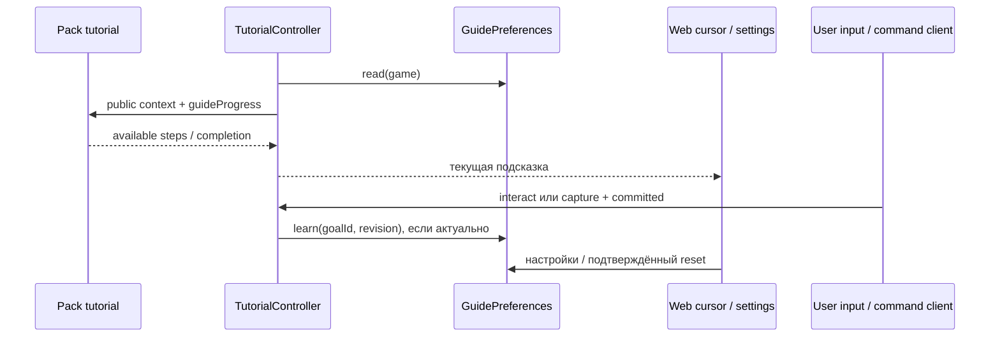

# Обучение: каталог пака и прогресс пользователя

Область применения: приложение **0.21.0** и коллекция **0.9.0**, engineApi 4 / viewApi 3 / protocol 3. Исторические этапы ниже поясняют совместимость; актуальное приложение доступно на [сайте](https://graphgiraffe.github.io/playroom-hod-test/).

Контракт реализации 0.19.5 / 0.8.5. Обучение — вспомогательное представление доступного действия. Оно не исполняет команду за человека, не меняет legal actions и не открывает скрытые данные. Общая карта слоёв — [архитектура](DEVELOPER-ARCHITECTURE.md).

## Владельцы и поток

| Часть | Источник | Владеет |
|---|---|---|
| Каталог и условия шагов | `packs/<id>/presentation/tutorial.js` коллекции | ID, revision, текст, selector, available, соответствие командам |
| Подключение | `sdk/project.json` пака, [core/packs.js](../core/packs.js) | Включение сценария в сборку пака и вызов из установленного представления |
| Семантический контроллер | [application/tutorial-controller.js](../application/tutorial-controller.js) | Текущий контекст, capture/committed/interact, проверка актуальности |
| Хранилище | [platform/web/guide-preferences.js](../platform/web/guide-preferences.js) | user/pack, enabled, prompted, epoch, mastered |
| Web-курсор | [app/first-turn-guide.js](../app/first-turn-guide.js) | Поиск доступной цели, движение/тап, ввод, idle, teardown |
| Настройки | [app/tutorial-settings.js](../app/tutorial-settings.js) | Вопрос в начале своего хода, checkbox, подтверждение сброса, список |

Указатель привязан к доступной цели, а подпись помещается в видимую область
экрана при увеличении страницы или повороте. Изменение видимой области
пересчитывает положение без перехода к другому шагу обучения.

## Описание сценария

В «Рыбе» выбор номинала предшествует выбору соперника. В UNO объявление доступно вне обычной очереди и без задержки. Список модулей для каждого пака задаёт `sdk/project.json`.

Фабрика получает translator и возвращает функцию `tutorial(context)`. Её свойства `goals` и `revisions` описывают постоянный каталог, а результат вызова — ситуацию сейчас. Все тексты берутся из locales. Не переносите в tutorial правила расчёта попадания или условия победы.

| Поле | Значение и применение |
|---|---|
| `tutorial.goals` | Полный список `{id, revision, text}` для окна освоенных действий, включая редкие/сейчас недоступные |
| `tutorial.revisions` | Ревизии по ID; отсутствующая ревизия равна 1 |
| `steps` | Упорядоченные кандидаты на подсказку в текущей ситуации |
| `id`, `selector`, `text` | Стабильный смысловой ID, селектор элемента в UI, локализованный текст |
| `available` | Можно ли сейчас предлагать этот шаг; не заменяет реальную проверку элемента/команды |
| `actions` | Типы команд, успешное применение которых осваивает цель |
| `match(action)` | Более точный предикат команды, например вторая карта или выбор цвета |
| `interaction` | Шаг может быть освоен реальным UI-взаимодействием до доменной команды |
| `completion` | Отдельные правила распознавания завершения, когда они шире текущих отображаемых `steps` |
| `observed` | Уже совершённые действия, доказанные контекстом; нельзя заполнять по одному факту автоматической смены состояния |
| `checkpoint`, `guideProgress.checkpoint` | Компактный снимок для сравнения последовательных контекстов; не копия всей партии |
| `required` | Явный набор целей завершения текущего сценария; без него используются IDs его steps |
| `phase`, `turn`, `complete` | Метаданные этапа/завершения текущего сценария |
| `concurrent` | Разрешает сценарий вне обычного `state.turn`, когда у игрока действительно есть действие |
| `immediate` у шага | Пропускает обычные 500 мс бездействия; используется для своевременного объявления UNO |

`context` содержит проекцию, разрешённую текущему игроку, его доступные действия, выбор в интерфейсе и прогресс. Выдавайте подходящую подсказку для фактического пути игрока. Уже выбранный режим не должен предлагаться для повторного нажатия; выбранное значение само по себе не доказывает, что пользователь когда-либо переключал его вручную.

Локальный и сетевой экраны передают этот контекст общему контроллеру. Он вычисляет шаги и хранит прогресс. После отрисовки поля SDK-рендерер получает готовые шаги и связывает их с целями на поле, в панели или в диалоге. Курсор использует те же привязки. Пошаговый просмотр в SDK Studio работает в своём авторском контексте.

При предварительном выборе на поле контроллер читает идентификатор
выбранного элемента у владельца ввода. Он вычисляет следующий шаг на той
же разрешённой проекции до отправки игровой команды. Например, в «Рыбалке»
выбор карты сразу делает доступной подсказку о выборе соперника.

Экран хранит выбор карты, тип действия и поворот для нативной руки арены. Рендерер и контроллер обучения получают этот выбор от одного владельца. Временный предпросмотр команды может менять изображение на поле до подтверждения хода. Сценарий обучения продолжает читать пользовательский выбор из экрана.

## Как засчитать действие

1. **Команда:** перед отправкой controller делает `capture(owner, viewer)`. После успешного применения вызывается `committed(owner, viewer, action, token)`. Условия берутся с этапа до отправки: иначе после перехода уже нельзя отличить первую карту от второй. Не подтверждайте обучение на отказ/timeout или предварительный drag.
2. **Локальный UI:** реальное открытие справки, выбор карты/панели или изменение предпочтения передаётся как interaction. В `interact` проверяются текущий контекст и доступность шага. Самостоятельная перерисовка или автопереключение не являются взаимодействием.
3. **Наблюдение:** `observed` допустим только при доказанном событии пользователя. Если состояние одинаково после автоматического и ручного изменения, одного сравнения state недостаточно — нужен сигнал реального ввода.

Одна успешная команда может закрыть несколько связанных целей. Способ ввода не имеет значения: tap и drag одного смыслового действия осваивают одну цель. Но первая/вторая карта Пексесо, первый/второй план Стихий, обычная/союзная фишка Лудо — отдельные цели. Автодобор Рыбы не должен попадать в каталог пользовательских действий.

Редкие цели не теряются при окончании хода. Они остаются в постоянном каталоге до подходящей ситуации: шестёрка, повторный бросок, вынужденный выход, командная игра, цвет UNO, дамка, возрождение. Полный список освоения показывается по `goals`, а не только текущим видимым `steps`.

## Хранение и обновление

`GuidePreferences` использует `playroom.learning.v1.<encoded user id>`. Внутри — записи по pack ID с `enabled`, `prompted`, `epoch`, `mastered:{goalId:revision}`. PackVersion в ключ не входит: обычное обновление игры не запускает всё обучение заново.

- Новое действие получает новый ID. При существенном изменении смысла/способа освоения повышается revision; старая отметка больше не закрывает новую цель.
- Переформулировка текста без изменения действия не требует новой revision. ID нельзя повторно использовать для другого действия.
- Удалённая цель не показывается в актуальном каталоге; старую запись можно оставить в пользовательских данных.
- Выключение останавливает показ **и отслеживание**, но сохраняет mastered. Повторное включение продолжает с того же места.
- Текущий `reset(game)` очищает mastered, повышает epoch, включает обучение и отмечает вопрос answered (`prompted:true`). UI запрашивает подтверждение.
- Epoch и user scope защищают от позднего подтверждения команды после сброса/переключения пользователя. Уже сохранённая goal/revision повторно не записывается.

Контроллер держит состояния экранов через WeakMap и отдельный текущий контекст. Курсор освобождает UI-обработчики при остановке. Нельзя завести setInterval в каждом паке или хранить DOM-узел/полную history в checkpoint.

Показ цели и отслеживание ввода используют одну активную поверхность. В нативном окне выбора карты курсор рисуется внутри самого окна. При смене шага в той же поверхности рука перемещается к новой цели, а подпись сразу появляется рядом с ней. Поворот экрана, смена игрока и переход в другое окно сбрасывают исходную позицию. Системное и игровое ограничение движения отключают перемещение и пульсацию.

## Добавить или изменить обучение

1. Найдите пользовательское действие и способ подтверждения: доменная команда либо реальный локальный ввод. Автоматическое действие исключите.
2. Изучите два работающих сценария сходного типа. Внесите ID/revision в goals, текст в locales, условие доступности и selector в steps.
3. Проверьте список входов `presentation` в `sdk/project.json` и регистрацию сценария в готовом паке. Для исполнения правил используется отдельный список модулей.
4. Проверьте альтернативный выбор и способ ввода, ожидание редкой ситуации на следующих ходах, недоступный/уже выбранный контрол, rejected-команду, history, сеть и хотсит в применимом объёме.
5. Проверьте выключение, включение, подтверждённый сброс, нового пользователя и обновление одной goal revision. Галочки списка — только индикаторы, пользователь не отмечает их вручную.

Существующие проверки: `tests/domain-foundation.test.cjs` (controller/store), `tests/rc2-presentation-browser.test.cjs` (этапы, список, первый ход, reset, срочность UNO). Новая подсказка не требует собственных часов, хранилища или игрового движка.

Срочные доступные шаги с `immediate:true` в `concurrent`-сценарии могут запускаться и показываться во время feedback-анимации. Обычные шаги продолжают ждать. Это не отменяет проверки active/replay и доступности DOM-цели.

## Локальное обучение и сетевые партии

Шаг выбирается и показывается на устройстве игрока, там же сохраняется прогресс. В локальной партии тот же контроллер работает офлайн с установленным паком. В сетевой партии WebRTC передаёт игровые команды, подтверждения и разрешённую проекцию партии. Каждый клиент вычисляет шаг для своего игрока и хранит его прогресс.

Открытие справки, переключение поля, автопоказ, выбор карты/типа действия и поворот локального плана отмечаются по реальному вводу без RPC и без ожидания хоста. Наблюдатель `first-turn-guide` слушает click/change на window в capture-фазе, раньше document-обработчиков сетевого экрана: иначе те успевают заменить DOM или открыть модальное окно, и исходный элемент уже не соответствует шагу. Уже выбранные, отключённые и недоступные элементы не засчитываются.

Команды, меняющие игровое состояние, используют снимок условий до отправки и `committed` после успешного ACK. Ожидающие или отклонённые команды не закрывают цель. Нельзя переносить прогресс обучения в authority, сетевой snapshot или общий журнал партии.

`tests/sdk-player-browser.test.cjs` проверяет обучение «Косынки» в автономной сборке с отключённой сетью. `tests/network-learning-browser.test.cjs` соединяет два изолированных браузерных контекста настоящим WebRTC для партии. Тесты проверяют локальный прогресс ведущего и гостя во всех 13 многопользовательских паках, изоляцию прогресса, два этапа плана Стихий, задержанный и отклонённый ACK, выключение и перезагрузку. Проверки сети на одной машине охватывают сценарий двух клиентов в лабораторных условиях.
